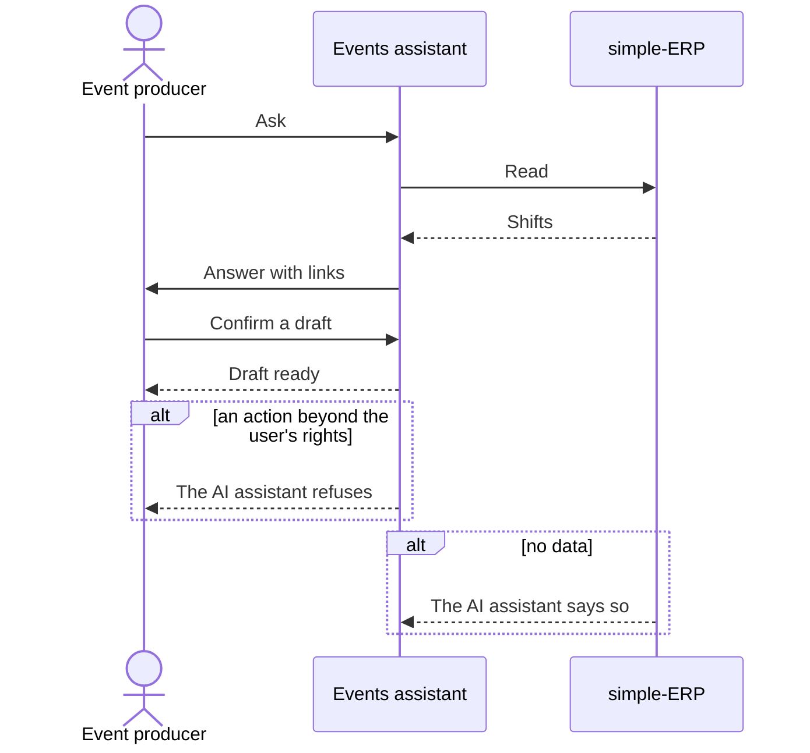

🏠 [Specs](../../../../README.md) › 🏷️ [Sectors](../../../README.md) › 🎭 [SC16 Events and culture](../../README.md) ›
📝 [Use cases](../README.md) › 📝 [Use cases: FL-SC16-05 Declarations and reports](README.md) ›
📝 UC-SC16-20 Ask the AI assistant

# 📝 UC-SC16-20 Ask the AI assistant

**Status:** ✅ specified

## Summary

The producer or box-office agent asks the AI assistant about sales, shift gaps or declarations due, within their role's
rights.

## Personas

- [U43 Event producer](../../../../01-users/personas/u43-event-producer.md)
- [U44 Box-office agent](../../../../01-users/personas/u44-box-office-agent.md)

## Goal

Answers without hunting.

## Trigger

A question.

## Frequency

Daily.

## Preconditions

- The SC16 sector pack is installed for the company,
  [UC-F14-02](../../../../02-functional/f14-plugin-store/use-cases/01-find-and-install/uc-f14-02-install-a-plugin-or-sector-pack.md),
  and its users have their roles,
  [UC-F1-06](../../../../02-functional/f01-administration/use-cases/04-edit-a-role/uc-f01-06-edit-a-role-and-its-record-rules.md).

## Postconditions

- **Success:** the answer cites the records, or the draft is confirmed.
- **Failed:** the AI assistant says it cannot answer or act, and why.

## Main flow

1. The producer asks on
   [S-SC16-20 Events assistant](../../screens/05-declarations-and-reports/s-sc16-20-events-assistant.md): "Which posts
   are uncovered on Saturday?".
2. The AI assistant reads within the user's rights.
3. The AI assistant lists them.
4. The producer asks for the day sheet; the AI assistant drafts it,
   [UC-F3-04](../../../../02-functional/f03-assistant/use-cases/04-summarise-or-draft/uc-f03-04-summarise-and-draft.md).

## Alternative flows

- 1a. The agent asks for sales: the AI assistant answers with the count.

## Error flows

- 4e. An action beyond the user's rights: the AI assistant refuses.
- 2e. No data: the AI assistant says so.
- Any step: a call to a service or an outside system fails: it is retried first
  ([BR-F3-32](../../../../02-functional/f03-assistant/business-rules/br-f03-32-retry-before-an-error.md)), then the
  error message pattern ([D122](../../../../06-decisions/ux/d122-error-message-standard.md)) says what failed; what was
  typed is kept.

## Business rules

- [BR-SC16-01 Events follow the country pack](../../business-rules/br-sc16-01-events-follow-the-country-pack.md)
- [BR-F3-34 All capabilities via the AI assistant](../../../../02-functional/f03-assistant/business-rules/br-f03-34-every-capability-is-reachable-from-the-assistant.md)
- [BR-F3-07 No deletes, no irreversible acts](../../../../02-functional/f03-assistant/business-rules/br-f03-07-no-deletes-no-irreversible-acts.md)

## Entities

- [E-SC16-01 Show](../../data/e-sc16-01-show.md)
- [E-SC16-10 Staffing post](../../data/e-sc16-10-staffing-post.md)

## Permissions

The event producer and box-office agent roles; the record rules of their role and site apply,
[UC-F1-06](../../../../02-functional/f01-administration/use-cases/04-edit-a-role/uc-f01-06-edit-a-role-and-its-record-rules.md).

## Notifications

None beyond the in-app updates of the records concerned.

## Audit events

Every creation, change and state change of event, shift records, with who, when and the values before and after (T3).

## AI involvement

The AI assistant answers questions on the event, shift records of this use case, with links, and prepares them as drafts
the user confirms. It works within the user's rights,
[BR-F3-34](../../../../02-functional/f03-assistant/business-rules/br-f03-34-every-capability-is-reachable-from-the-assistant.md),
and never deletes or does anything irreversible without the user's confirmation,
[BR-F3-07](../../../../02-functional/f03-assistant/business-rules/br-f03-07-no-deletes-no-irreversible-acts.md).

## API, MCP and A2A exposure

Through the API and webhooks (T5) and the MCP and A2A gateway (T6), with the caller's rights,
[BR-F3-34](../../../../02-functional/f03-assistant/business-rules/br-f03-34-every-capability-is-reachable-from-the-assistant.md),
reading, creating and changing the records of this use case; nothing irreversible without a person's confirmation.

## Screens

- [S-SC16-20 Events assistant](../../screens/05-declarations-and-reports/s-sc16-20-events-assistant.md)

## Flowchart

See [FL-SC16-05 Declarations and reports](../../flows/fl-sc16-05-declarations-and-reports.md#flowchart).

## Sequence diagram

## Acceptance criteria

1. **Given** the example venue's bar at 22:00 uncovered **when** the producer asks **then** the AI assistant lists it.
2. **Given** an agent asking to change a price **when** she asks **then** the AI assistant refuses.

## Non-functional notes

[D408](../../../../06-decisions/technical/d408-performance-and-profiles.md)'s targets
([performance](../../../../05-non-functional/performance.md)): 95 % of screens within 1 second; lists paged on the
server, the first page within 1 second; reports within 5 seconds or in the background. WCAG 2.2 AA and RGAA
([D46](../../../../06-decisions/ux/d46-accessibility-standard.md)).

## Regulatory references

None specific to this use case; the sector's legal rules are listed in [SC16 regulatory](../../regulatory.md).

## Related use cases

- [UC-SC16-09 Plan staff and volunteer shifts](../03-people-and-partners/uc-sc16-09-plan-staff-and-volunteer-shifts.md)

## Open questions

None.

---

⬅️ [UC-SC16-19 Communicate with attendees](../04-on-site/uc-sc16-19-communicate-with-attendees.md) ·
⬆️ [Up](README.md) ·
➡️ [UC-SC16-21](../06-cashless-cinemas-tours-and-photos/uc-sc16-21-run-cashless-payments-at-a-festival.md)
