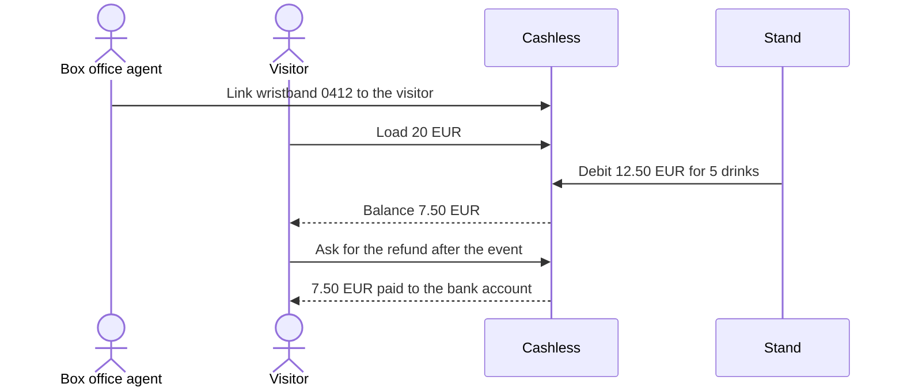

🏠 [Specs](../../../../README.md) › 🏷️ [Sectors](../../../README.md) › 🎭 [SC16 Events and culture](../../README.md) ›
📝 [Use cases](../README.md) › 📝 [Use cases: FL-SC16-06 Cashless, cinemas, tours and photographers](README.md) ›
📝 UC-SC16-21 Run cashless payments at a festival

# 📝 UC-SC16-21 Run cashless payments at a festival

**Status:** ✅ specified

## Summary

A festival replaces cash at its bars and food stands with a cashless account loaded on a wristband or a card. The box
office agent loads the account at the gate or the visitor loads it on the phone, the stands debit it at each purchase,
and after the event the visitor asks for the unused balance back. The event producer follows the money loaded, spent and
refunded.

## Personas

- [U44 Box-office agent](../../../../01-users/personas/u44-box-office-agent.md)
- [U43 Event producer](../../../../01-users/personas/u43-event-producer.md)

## Goal

Every euro loaded is either spent at a stand of the event or refunded to the visitor after the event, and the producer
can show at any time how much is held on behalf of visitors.

## Trigger

A visitor gets a wristband, loads or spends money, the event ends, or a visitor asks for a refund.

## Frequency

Thousands of accounts and tens of thousands of purchases over a festival weekend.

## Preconditions

- The event and its stands are entered ([E-SC16-01 Show](../../data/e-sc16-01-show.md),
  [E-SC16-13 Event till](../../data/e-sc16-13-event-till.md)).
- The wristbands or cards are linked to a ticket or to an anonymous account
  ([E-SC16-08 Admission ticket](../../data/e-sc16-08-admission-ticket.md)).
- A payment provider is connected for loading by card
  ([E-F11-06](../../../../02-functional/f11-online-shop/data/e-f11-06-payment-provider.md)).

## Postconditions

- **Succeeded:** each account is saved ([E-SC16-19 Cashless account](../../data/e-sc16-19-cashless-account.md)) with its
  loaded amounts, its purchases and its balance, and the balance of every account is Closed, Refunded or Expired.
- **Failed:** a purchase is refused when the balance is too low, a refund is never paid twice, and the money held never
  falls below the sum of the balances.

## Main flow

1. The box office agent opens the cashless screen
   ([S-SC16-21](../../screens/06-cashless-cinemas-tours-and-photos/s-sc16-21-cashless.md)) on the phone and links a
   wristband to the visitor.
2. The visitor loads the account with a card payment or in cash at the gate, and the balance is updated at once.
3. At a stand the seller scans the wristband and debits the price of the purchase from the balance.
4. The visitor sees the balance and the purchases on their phone.
5. When the event ends, the producer closes the accounts: balances stay held and refundable
   ([BR-SC16-16](../../business-rules/br-sc16-16-unused-balances-are-refundable-after-the-event.md)).
6. The visitor asks for a refund on the web page and the producer pays the balance to the visitor's bank account.

## Alternative flows

- 3a. The balance is too low: the purchase is refused and the visitor can load more.
- 2a. The visitor loads more than the maximum balance of the event: the load is refused.
- 6a. The visitor does not ask for a refund before the deadline: the account becomes Expired and the balance follows the
  rules of the country pack.

## Error flows

- 3e. The wristband is not linked to an account: the purchase is refused.
- 6e. The refund request has no bank account: it waits and the visitor is asked for it.
- 6e2. A refund is requested twice for the same account: the second is refused.
- Any step: a service does not answer; the call is retried first
  ([BR-F3-32](../../../../02-functional/f03-assistant/business-rules/br-f03-32-retry-before-an-error.md)), then the
  message follows the error pattern ([D122](../../../../06-decisions/ux/d122-error-message-standard.md)) and what the
  user typed stays on the screen.

## Business rules

- [BR-SC16-16](../../business-rules/br-sc16-16-unused-balances-are-refundable-after-the-event.md)
- [BR-SC16-13 Bars within the licence](../../business-rules/br-sc16-13-bars-within-the-licence.md)

## Entities

- [E-SC16-19 Cashless account](../../data/e-sc16-19-cashless-account.md): created, changed, refunded
- [E-SC16-13 Event till](../../data/e-sc16-13-event-till.md): read, the stand where the purchase is made
- [E-SC16-08 Admission ticket](../../data/e-sc16-08-admission-ticket.md): read, the ticket the wristband is linked to
- [E-F10-10](../../../../02-functional/f10-point-of-sale/data/e-f10-10-loyalty-card-and-gift-card.md): read, the stored
  value as a related instrument

## Permissions

Box office agent links and loads accounts; stand sellers debit; the event producer closes accounts and pays refunds.
A seller sees the balance of a scanned wristband, never the history.

## Notifications

The visitor, on the phone and by email: a load, a low balance and the refund once paid. The producer, in the app: the
sum of balances held and the refunds waiting.

## Audit events

Each wristband link, load, purchase, refund request and refund, with the amount, the stand, who and when.

## AI involvement

No AI step of its own. The AI assistant may open the screen and prefill it from the user's words; the user checks and
confirms
[BR-F3-07](../../../../02-functional/f03-assistant/business-rules/br-f03-07-no-deletes-no-irreversible-acts.md).

## API, MCP and A2A exposure

T5 operations of the capability for the personas above: create, read, update and list. The MCP tool of the
capability may read and propose, never confirm alone. No A2A skill.

## Screens

- [S-SC16-21](../../screens/06-cashless-cinemas-tours-and-photos/s-sc16-21-cashless.md)

## Flowchart

See
[FL-SC16-06 Cashless, cinemas, tours and photographers](../../flows/fl-sc16-06-cashless-cinemas-tours-and-photos.md#flowchart).

## Sequence diagram

## Acceptance criteria

1. **Given** an account loaded with 20.00 EUR **when** the visitor spends 12.50 EUR at a stand **then** the balance is
   7.50 EUR.
2. **Given** an account with a balance of 3.00 EUR **when** a stand debits 4.50 EUR **then** the purchase is refused.
3. **Given** an event that has ended and an account with 7.50 EUR **when** the visitor asks for a refund with their bank
   account **then** 7.50 EUR is paid and the account is Refunded.
4. **Given** an account already Refunded **when** a second refund is requested **then** it is refused.

## Non-functional notes

The screen answers within 2 seconds for 10,000 records; every change is audited.

## Regulatory references

Money loaded on a wristband that can be spent only at the stands of one event is a closed payment instrument,
but if it can be spent at other merchants it may be electronic money, which needs an authorisation and safeguarding of
the funds. The visitor can ask for the unused balance back at face value, and a fee on the refund is limited by the
country pack. Cash loaded at the gate follows the cash payment limit. VAT is due when the drink or the meal is sold, not
when the money is loaded. The France-pack rule is written later. Related:
[CR-FR-022](../../../../10-country-packs/france/payments/cr-fr-022-cash-payment-limit.md),
[CR-FR-097](../../../../10-country-packs/france/consumer/cr-fr-097-gift-card-validity.md),
[CR-FR-128](../../../../10-country-packs/france/hospitality/cr-fr-128-temporary-bars.md),
[CR-FR-181](../../../../10-country-packs/france/tax-and-vat/cr-fr-181-ticket-vat-rates.md).

## Related use cases

- [UC-SC16-22 Run a cinema](uc-sc16-22-run-a-cinema.md)
- [UC-SC16-12 Run bars and merchandise](../04-on-site/uc-sc16-12-run-bars-and-merchandise.md)
- [UC-SC16-17](../02-ticketing/uc-sc16-17-handle-cancellations-and-refunds.md)
- [UC-F10-07](../../../../02-functional/f10-point-of-sale/use-cases/03-after-sales/uc-f10-07-use-loyalty-gift-cards-and-e-wallet.md)

## Open questions

None.

---

⬅️ [UC-SC16-20 Ask the AI assistant](../05-declarations-and-reports/uc-sc16-20-ask-the-assistant.md) ·
⬆️ [Up](README.md) · ➡️ [UC-SC16-22 Run a cinema](uc-sc16-22-run-a-cinema.md)
