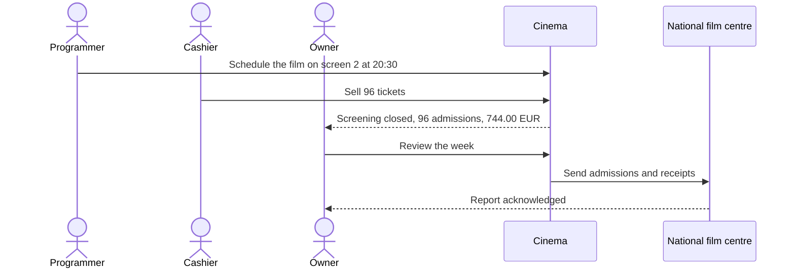

🏠 [Specs](../../../../README.md) › 🏷️ [Sectors](../../../README.md) › 🎭 [SC16 Events and culture](../../README.md) ›
📝 [Use cases](../README.md) › 📝 [Use cases: FL-SC16-06 Cashless, cinemas, tours and photographers](README.md) ›
📝 UC-SC16-22 Run a cinema

# 📝 UC-SC16-22 Run a cinema

**Status:** 🔄 waiting for the owner

## Summary

A cinema programmes films on its screens, sells tickets at the box office and online, pays each distributor its share of
the receipts, and reports its admissions and receipts to the national film centre. The programmer schedules the
screenings, the cashier sells the tickets and the owner reads the figures and the taxes.

## Personas

- [U44 Box-office agent](../../../../01-users/personas/u44-box-office-agent.md)
- [U43 Event producer](../../../../01-users/personas/u43-event-producer.md)

## Goal

Every screening has its admissions and receipts recorded, the figures are reported to the national film centre in time,
the special tax on ticket prices is declared, and each distributor is paid its share.

## Trigger

A screening is scheduled, tickets are sold, a screening ends, or a reporting date arrives.

## Frequency

Several screenings a day on each screen, a report each week or day as the rules ask.

## Preconditions

- The screens and their seats are entered as rooms ([E-SC16-03 Venue room](../../data/e-sc16-03-venue-room.md)).
- The films and their distributors' terms (the share of the receipts) are entered in the settings.
- The ticket price categories and their VAT rate are set
  ([E-SC16-07 Ticket order](../../data/e-sc16-07-ticket-order.md)).

## Postconditions

- **Succeeded:** each screening is saved ([E-SC16-20 Screening](../../data/e-sc16-20-screening.md)) with its film, room,
  admissions, receipts and the state of its report, and the tax and the distributor's share are computed from the
  receipts.
- **Failed:** a screening that has been shown is never left unreported, and a report with a screening missing its
  figures is not sent.

## Main flow

1. The programmer opens the cinema screen
   ([S-SC16-22 Cinema](../../screens/06-cashless-cinemas-tours-and-photos/s-sc16-22-cinema.md)) and schedules the film
   on a screen with its times.
2. The cashier sells tickets at the box office and the web shop sells the others; each ticket is counted for its
   screening.
3. At the end of each screening the figures are closed: admissions, receipts and the price category of each ticket.
4. simple-ERP computes the special tax on the ticket prices and the distributor's share from the receipts and the film's
   terms.
5. The owner reviews the report of the period and sends it to the national film centre
   ([BR-SC16-17](../../business-rules/br-sc16-17-box-office-figures-are-reported-to-the-cnc.md)).
6. Accounting pays the distributors and declares the tax
   ([UC-SC16-15](../05-declarations-and-reports/uc-sc16-15-declare-the-ticket-tax.md)).

## Alternative flows

- 2a. A screening is cancelled: the tickets are refunded and the screening shows no admissions.
- 4a. A free or discounted ticket scheme applies: the receipts use the price actually paid.
- 5a. A screening is shown in a private session: it is reported under its own category.

## Error flows

- 3e. A screening is closed with a ticket sold twice for the same seat: the closing is refused.
- 5e. A shown screening has no figures at the reporting date: the report is held and the screening is listed.
- 4e. A film has no distributor terms: the share cannot be computed.
- Any step: a service does not answer; the call is retried first
  ([BR-F3-32](../../../../02-functional/f03-assistant/business-rules/br-f03-32-retry-before-an-error.md)), then the
  message follows the error pattern ([D122](../../../../06-decisions/ux/d122-error-message-standard.md)) and what the
  user typed stays on the screen.

## Business rules

- [BR-SC16-17](../../business-rules/br-sc16-17-box-office-figures-are-reported-to-the-cnc.md)
- [BR-SC16-14 Ticket VAT by category](../../business-rules/br-sc16-14-ticket-vat-by-category.md)

## Entities

- [E-SC16-20 Screening](../../data/e-sc16-20-screening.md): created, changed, reported
- [E-SC16-03 Venue room](../../data/e-sc16-03-venue-room.md): read, the screen and its seats
- [E-SC16-07 Ticket order](../../data/e-sc16-07-ticket-order.md): read, the ticket orders of the screening
- [E-F8-06 Tax return](../../../../02-functional/f08-accounting/data/e-f08-06-tax-return.md): created, the tax return of
  the period

## Permissions

Programmer schedules; cashier sells; owner reviews and sends the report; accounting pays the distributors.
The cashier sees the receipts of their own session only.

## Notifications

The owner, in the app: a report is due in two days or a screening is missing its figures. Accounting: a distributor's
statement is ready.

## Audit events

Each screening scheduled, each ticket counted, each closing, each report sent and each payment to a distributor, who and
when.

## AI involvement

No AI step of its own. The AI assistant may open the screen and prefill it from the user's words; the user checks and
confirms
[BR-F3-07](../../../../02-functional/f03-assistant/business-rules/br-f03-07-no-deletes-no-irreversible-acts.md).

## API, MCP and A2A exposure

T5 operations of the capability for the personas above: create, read, update and list. The MCP tool of the
capability may read and propose, never confirm alone. No A2A skill.

## Screens

- [S-SC16-22 Cinema](../../screens/06-cashless-cinemas-tours-and-photos/s-sc16-22-cinema.md)

## Flowchart

See
[FL-SC16-06 Cashless, cinemas, tours and photographers](../../flows/fl-sc16-06-cashless-cinemas-tours-and-photos.md#flowchart).

## Sequence diagram

## Acceptance criteria

1. **Given** a screening with 96 tickets sold at 7.75 EUR on average **when** the screening is closed **then** the
   screening shows 96 admissions and receipts of 744.00 EUR.
2. **Given** a week with a shown screening that has no figures **when** the owner opens the report **then** the report
   is held and that screening is listed.
3. **Given** a film whose distributor takes 45 percent of the receipts **when** the week closes **then** the
   distributor's share of a screening of 744.00 EUR is 334.80 EUR.
4. **Given** a screening cancelled the day before **when** the programmer cancels it **then** the tickets are refunded
   and no admissions are reported.

## Non-functional notes

The screen answers within 2 seconds for 10,000 records; every change is audited.

## Regulatory references

A cinema reports its admissions and receipts per screening to the national film centre by the transmission of
its ticketing data, and a special additional tax is added to the ticket price, declared by the cinema and used to
support film production. The cinema pays the distributor a share of the net receipts under the rental terms of each
film. Cinema tickets carry the reduced rate of VAT of cultural shows. The rate of the tax, the frequency of the report
and the VAT rate are data of the France pack, written later. This tax is not the show ticket tax of live performances.
Related: [CR-FR-181](../../../../10-country-packs/france/tax-and-vat/cr-fr-181-ticket-vat-rates.md),
[CR-FR-177](../../../../10-country-packs/france/events/cr-fr-177-show-ticket-tax.md),
[CR-FR-014](../../../../10-country-packs/france/invoicing/cr-fr-014-invoice-numbering.md),
[CR-FR-015](../../../../10-country-packs/france/invoicing/cr-fr-015-invoice-mandatory-mentions.md).

- France-pack rule, (Proposed) until its law is read:
  [CR-FR-248 Cinema box-office reporting and tax](../../../../10-country-packs/france/events/cr-fr-248-cinema-box-office.md)

## Related use cases

- [UC-SC16-21](uc-sc16-21-run-cashless-payments-at-a-festival.md)
- [UC-SC16-23 Run a tour](uc-sc16-23-run-a-tour.md)
- [UC-SC16-05](../02-ticketing/uc-sc16-05-sell-tickets-with-seat-maps-and-price-categories.md)
- [UC-SC16-15](../05-declarations-and-reports/uc-sc16-15-declare-the-ticket-tax.md)
- [UC-SC16-18](../05-declarations-and-reports/uc-sc16-18-report-after-the-event.md)

## Open questions

None.

---

⬅️ [UC-SC16-21 Run cashless payments at a festival](uc-sc16-21-run-cashless-payments-at-a-festival.md) ·
⬆️ [Up](README.md) · ➡️ [UC-SC16-23 Run a tour](uc-sc16-23-run-a-tour.md)
