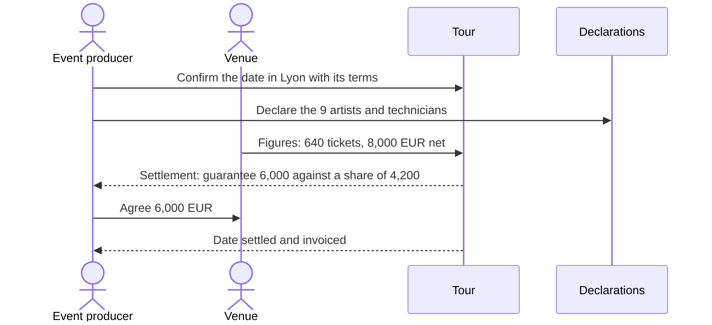

🏠 [Specs](../../../../README.md) › 🏷️ [Sectors](../../../README.md) › 🎭 [SC16 Events and culture](../../README.md) ›
📝 [Use cases](../README.md) › 📝 [Use cases: FL-SC16-06 Cashless, cinemas, tours and photographers](README.md) ›
📝 UC-SC16-23 Run a tour

# 📝 UC-SC16-23 Run a tour

**Status:** ✅ specified

## Summary

A touring production plays in many venues. The event producer plans the dates of the tour with their contracts, books
the travel and the hotels, declares the artists and technicians, and after each show settles the date with the venue: a
guarantee, a share of the ticket receipts, or both, after the costs that the contract allows. On the road the producer
follows the day on the phone.

## Personas

- [U43 Event producer](../../../../01-users/personas/u43-event-producer.md)

## Goal

Every date is settled according to its contract on the figures of the show, every artist is paid and declared for the
dates played, and the tour's balance is known after each show.

## Trigger

A date is optioned, confirmed, played or settled, or a tour ends.

## Frequency

Several dates a week on a tour, a settlement after each show.

## Preconditions

- The production's show and its artists' contracts are entered ([E-SC16-01 Show](../../data/e-sc16-01-show.md),
  [E-SC16-04 Artist contract](../../data/e-sc16-04-artist-contract.md)).
- The venue and its contract terms (guarantee, share, costs) are entered for the date.
- The employees and artists are records
  ([E-F9-01](../../../../02-functional/f09-hr-and-projects/data/e-f09-01-employee-record.md)).

## Postconditions

- **Succeeded:** each date is saved ([E-SC16-21 Tour date](../../data/e-sc16-21-tour-date.md)) with its contract terms,
  its figures and its settlement, and the tour's balance is updated.
- **Failed:** a date is not Settled with a figure missing, and an artist who played is never left undeclared.

## Main flow

1. The event producer opens the tour screen
   ([S-SC16-23 Tour](../../screens/06-cashless-cinemas-tours-and-photos/s-sc16-23-touring.md)) and sees the dates with
   their venue, contract and state.
2. A date is optioned, then confirmed with the contract signed and the terms entered (guarantee, percentage, costs,
   break-even).
3. The producer plans the travel and the hotel and declares the artists and technicians for the date
   ([UC-SC16-04](../01-plan-and-book/uc-sc16-04-prepare-intermittent-performers-pay-inputs.md)).
4. After the show, the producer enters the tickets sold and the receipts, or imports them from the venue.
5. SimpleERP computes the settlement from the terms
   ([BR-SC16-18](../../business-rules/br-sc16-18-each-show-is-settled-per-its-contract.md)): guarantee, share of the net
   receipts and costs.
6. The venue and the producer agree the figure and the date becomes Settled with its invoice or its payment.

## Alternative flows

- 4a. The venue's figures differ from the producer's: both are kept and the difference is explained before the
  settlement.
- 2a. A date is cancelled: the cancellation terms of the contract apply and the date is Cancelled.
- 3a. A foreign artist plays the date: the withholding on their fee is computed and paid.

## Error flows

- 5e. The contract has no terms: the settlement cannot be computed.
- 4e. The receipts are missing a week after the show: the date stays Played and is flagged.
- 3e. An artist who played is not declared: the date cannot be Settled.
- Any step: a service does not answer; the call is retried first
  ([BR-F3-32](../../../../02-functional/f03-assistant/business-rules/br-f03-32-retry-before-an-error.md)), then the
  message follows the error pattern ([D122](../../../../06-decisions/ux/d122-error-message-standard.md)) and what the
  user typed stays on the screen.

## Business rules

- [BR-SC16-18](../../business-rules/br-sc16-18-each-show-is-settled-per-its-contract.md)
- [BR-SC16-06](../../business-rules/br-sc16-06-performers-declared-before-the-show.md)

## Entities

- [E-SC16-21 Tour date](../../data/e-sc16-21-tour-date.md): created, changed, settled
- [E-SC16-04 Artist contract](../../data/e-sc16-04-artist-contract.md): read, the contract of the artist
- [E-SC16-06 Performer declaration](../../data/e-sc16-06-performer-declaration.md): created, the declaration of the
  performers of the date
- [E-F8-06 Tax return](../../../../02-functional/f08-accounting/data/e-f08-06-tax-return.md): created, the withholding
  and ticket tax of the date

## Permissions

Event producer plans and settles; tour manager enters the figures on the phone; accounting reads settlements.
The artists see their own fees, never the contract of another.

## Notifications

The producer, in the app and on the phone: a date to settle, figures missing or a contract not signed. The venue, by
email: the settlement.

## Audit events

Each date optioned, confirmed, played and settled, each term, figure and difference, each declaration, who and when.

## AI involvement

No AI step of its own. The AI assistant may open the screen and prefill it from the user's words; the user checks and
confirms
[BR-F3-07](../../../../02-functional/f03-assistant/business-rules/br-f03-07-no-deletes-no-irreversible-acts.md).

## API, MCP and A2A exposure

T5 operations of the capability for the personas above: create, read, update and list. The MCP tool of the
capability may read and propose, never confirm alone. No A2A skill.

## Screens

- [S-SC16-23 Tour](../../screens/06-cashless-cinemas-tours-and-photos/s-sc16-23-touring.md)

## Flowchart

See
[FL-SC16-06 Cashless, cinemas, tours and photographers](../../flows/fl-sc16-06-cashless-cinemas-tours-and-photos.md#flowchart).

## Sequence diagram

## Acceptance criteria

1. **Given** a contract with a guarantee of 6,000.00 EUR and 70 percent of the net receipts after 2,000.00 EUR of costs
   **when** the receipts are 8,000.00 EUR **then** the settlement is 4,200.00 EUR for the share, so the guarantee of
   6,000.00 EUR applies.
2. **Given** the same contract and receipts of 12,000.00 EUR **when** the date is settled **then** the share is 7,000.00
   EUR, which is above the guarantee, so 7,000.00 EUR is paid.
3. **Given** a date with a performer not declared **when** the producer settles it **then** the settlement is refused
   until the declaration is made.
4. **Given** a contract without terms **when** the producer settles **then** the settlement cannot be computed.

## Non-functional notes

The screen answers within 2 seconds for 10,000 records; every change is audited.

## Regulatory references

Performing artists and technicians engaged for a show are employed under fixed-term contracts of use or paid
through the single window for occasional organisers, and each person is declared before the show. The fee paid to a
performer who is not resident is subject to a withholding tax. The producer must hold the licence to produce shows and
declares the show, the ticket tax and the music rights as for any performance. The France-pack rule is written later.
Related: [CR-FR-176](../../../../10-country-packs/france/events/cr-fr-176-performing-arts-declaration.md),
[CR-FR-177](../../../../10-country-packs/france/events/cr-fr-177-show-ticket-tax.md),
[CR-FR-178](../../../../10-country-packs/france/events/cr-fr-178-occasional-organiser-guso.md),
[CR-FR-179](../../../../10-country-packs/france/events/cr-fr-179-music-copyright-authorisation.md),
[CR-FR-184](../../../../10-country-packs/france/payroll/cr-fr-184-withholding-tax.md).

## Related use cases

- [UC-SC16-22 Run a cinema](uc-sc16-22-run-a-cinema.md)
- [UC-SC16-24 Book shoots and sell photos](uc-sc16-24-book-shoots-and-sell-photos.md)
- [UC-SC16-03](../01-plan-and-book/uc-sc16-03-contract-artists-and-manage-riders.md)
- [UC-SC16-04](../01-plan-and-book/uc-sc16-04-prepare-intermittent-performers-pay-inputs.md)
- [UC-SC16-18](../05-declarations-and-reports/uc-sc16-18-report-after-the-event.md)

## Open questions

None.

---

⬅️ [UC-SC16-22 Run a cinema](uc-sc16-22-run-a-cinema.md) · ⬆️ [Up](README.md) ·
➡️ [UC-SC16-24 Book shoots and sell photos](uc-sc16-24-book-shoots-and-sell-photos.md)
