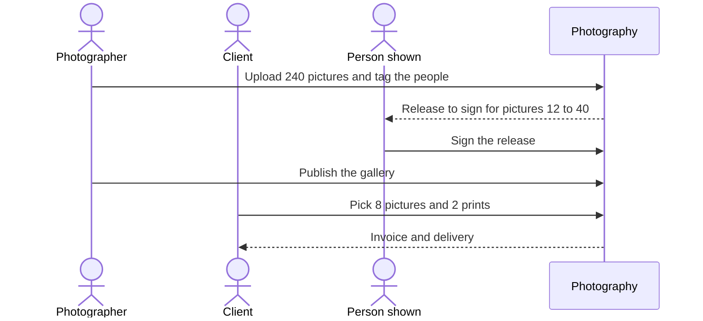

🏠 [Specs](../../../../README.md) › 🏷️ [Sectors](../../../README.md) › 🎭 [SC16 Events and culture](../../README.md) ›
📝 [Use cases](../README.md) › 📝 [Use cases: FL-SC16-06 Cashless, cinemas, tours and photographers](README.md) ›
📝 UC-SC16-24 Book shoots and sell photos

# 📝 UC-SC16-24 Book shoots and sell photos

**Status:** ✅ specified

## Summary

A photographer books shoots with clients, delivers the pictures in private galleries, and sells prints and licences.
When people appear in the pictures, the photographer needs their written release before the pictures are published or
sold. The client picks pictures and pays on the phone.

## Personas

- [U43 Event producer](../../../../01-users/personas/u43-event-producer.md)
- [U09 Customer](../../../../01-users/personas/u09-customer.md)

## Goal

Every picture that shows an identifiable person is sold or published only with that person's release, and every sale of
prints or licences is invoiced and delivered.

## Trigger

A shoot is booked, a gallery is prepared, a client picks pictures, or a picture is published.

## Frequency

A few shoots a week, a gallery after each shoot, sales over the following weeks.

## Preconditions

- The client is a record with a quote
  ([E-F6-01](../../../../02-functional/f06-customers-and-sales/data/e-f06-01-customer-record.md),
  [E-F6-03 Quote](../../../../02-functional/f06-customers-and-sales/data/e-f06-03-quote.md)).
- The release templates are in the settings with their use, duration and territory.
- The pictures are uploaded with their tags of people shown.

## Postconditions

- **Succeeded:** each gallery is saved ([E-SC16-22 Gallery](../../data/e-sc16-22-gallery.md)) with its pictures, the
  people shown, the releases and the sales, and each sale has its invoice.
- **Failed:** a gallery is not published and no picture is sold while a person shown has no release, and the missing
  releases are listed.

## Main flow

1. The photographer opens the photography screen
   ([S-SC16-24](../../screens/06-cashless-cinemas-tours-and-photos/s-sc16-24-photography.md)) and books the shoot with
   the client, the date and the price.
2. After the shoot the photographer uploads the pictures and tags the people shown on each.
3. For each person shown, the photographer sends a release for signature on the phone with the intended use, the
   duration and the territory.
4. The gallery is shared privately with the client, who picks pictures on the phone.
5. The photographer publishes the gallery or sells prints and licences only for pictures whose people have signed
   ([BR-SC16-19](../../business-rules/br-sc16-19-images-are-sold-only-with-the-models-release.md)).
6. The sale is invoiced and the prints are ordered or the files delivered
   [UC-F11-08](../../../../02-functional/f11-online-shop/use-cases/02-shop-and-check-out/uc-f11-08-confirm-the-order-and-invoice.md).

## Alternative flows

- 3a. The person is a minor: the release is signed by their legal guardian.
- 3b. A person refuses: their pictures are marked not to be published or sold and stay with the client only.
- 5a. A person withdraws their release later: the pictures are taken down from the public pages.

## Error flows

- 5e. A picture tags a person without a release: its publication and sale are refused.
- 3e. The release has no use or duration: it cannot be sent.
- 6e. A print is ordered for a picture not in the sold gallery: the order is refused.
- Any step: a service does not answer; the call is retried first
  ([BR-F3-32](../../../../02-functional/f03-assistant/business-rules/br-f03-32-retry-before-an-error.md)), then the
  message follows the error pattern ([D122](../../../../06-decisions/ux/d122-error-message-standard.md)) and what the
  user typed stays on the screen.

## Business rules

- [BR-SC16-19](../../business-rules/br-sc16-19-images-are-sold-only-with-the-models-release.md)
- [BR-SC16-15](../../business-rules/br-sc16-15-attendees-contacted-with-consent.md)

## Entities

- [E-SC16-22 Gallery](../../data/e-sc16-22-gallery.md): created, changed, published
- [E-F6-03 Quote](../../../../02-functional/f06-customers-and-sales/data/e-f06-03-quote.md): read, the quote of the
  shoot
- [E-F6-05 Invoice](../../../../02-functional/f06-customers-and-sales/data/e-f06-05-invoice.md): created, the invoice of
  the sale
- [E-F6-01](../../../../02-functional/f06-customers-and-sales/data/e-f06-01-customer-record.md): read, the client and
  the people shown

## Permissions

Photographer books, uploads, tags and publishes; the client picks pictures and pays; the person shown signs or withdraws
a release. The client sees only their own gallery.

## Notifications

The client, by email and on the phone: the gallery is ready and the sale is confirmed. The photographer, in the app: a
release is signed or withdrawn.

## Audit events

Each upload, tag, release sent, signed or withdrawn, each publication and sale, who and when.

## AI involvement

No AI step of its own. The AI assistant may open the screen and prefill it from the user's words; the user checks and
confirms
[BR-F3-07](../../../../02-functional/f03-assistant/business-rules/br-f03-07-no-deletes-no-irreversible-acts.md).

## API, MCP and A2A exposure

T5 operations of the capability for the personas above: create, read, update and list. The MCP tool of the
capability may read and propose, never confirm alone. No A2A skill.

## Screens

- [S-SC16-24](../../screens/06-cashless-cinemas-tours-and-photos/s-sc16-24-photography.md)

## Flowchart

See
[FL-SC16-06 Cashless, cinemas, tours and photographers](../../flows/fl-sc16-06-cashless-cinemas-tours-and-photos.md#flowchart).

## Sequence diagram

## Acceptance criteria

1. **Given** a gallery of 240 pictures with one person tagged on 28 of them **when** the photographer publishes it
   without that person's release **then** the publication is refused and the 28 pictures are listed.
2. **Given** the same person who signs a release for web and print use for 5 years **when** the photographer publishes
   **then** the 28 pictures can be published.
3. **Given** a person who withdraws their release **when** the photographer saves the withdrawal **then** their pictures
   are taken down and marked not to be sold.
4. **Given** a picture of a minor **when** the release is signed by the guardian **then** the picture can be published
   within the release's use.

## Non-functional notes

The screen answers within 2 seconds for 10,000 records; every change is audited.

## Regulatory references

A person has the right to control the use of their image: a picture of an identifiable person may be
published or sold only with their written agreement, which states the use, the duration and the territory, and for a
minor with the agreement of the legal guardians. The photographer keeps the copyright of the picture, and the client
buys a licence of use or prints. Prints made to the customer's order are personalised goods, for which the right of
withdrawal does not apply. Faces are personal data and the person may ask to see or erase them. The France-pack rule is
written later. Related: [CR-FR-036](../../../../10-country-packs/france/consumer/cr-fr-036-withdrawal-right.md),
[CR-FR-051](../../../../10-country-packs/france/data-protection/cr-fr-051-access-and-erasure.md),
[CR-FR-063](../../../../10-country-packs/france/consumer/cr-fr-063-electronic-marketing-consent.md),
[CR-FR-203](../../../../10-country-packs/france/digital/cr-fr-203-software-copyright-assignment.md).

## Related use cases

- [UC-SC16-23 Run a tour](uc-sc16-23-run-a-tour.md)
- [UC-SC16-18](../05-declarations-and-reports/uc-sc16-18-report-after-the-event.md)
- [UC-F11-13](../../../../02-functional/f11-online-shop/use-cases/04-special-sales/uc-f11-13-sell-digital-products.md)

## Open questions

None.

---

⬅️ [UC-SC16-23 Run a tour](uc-sc16-23-run-a-tour.md) · ⬆️ [Up](README.md)
