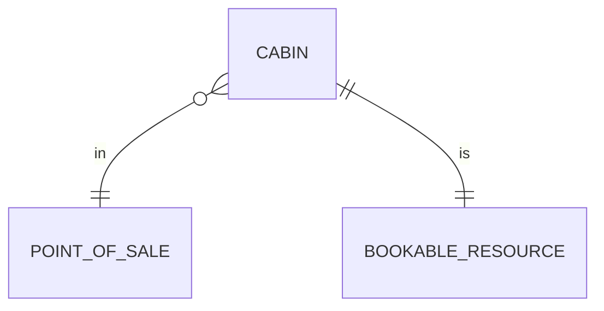
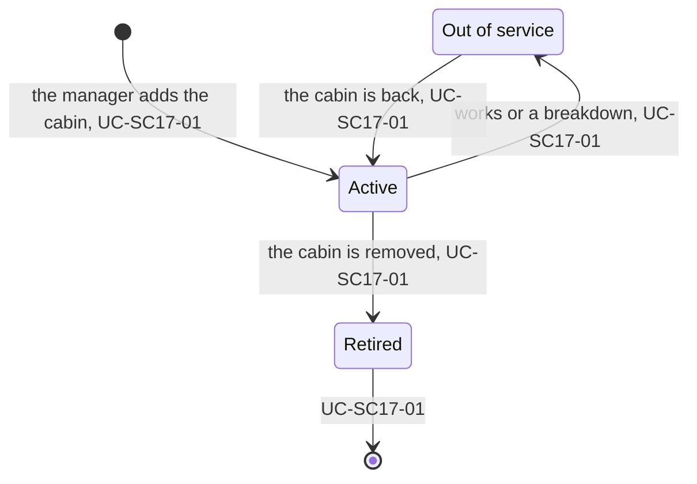

🏠 [Specs](../../../README.md) › 🏷️ [Sectors](../../README.md) › 💇 [SC17 Beauty and wellness](../README.md) ›
🗃️ [Data](README.md) › 🗃️ E-SC17-01 Cabin

# 🗃️ E-SC17-01 Cabin

**Status:** 🔄 waiting for the owner

## Purpose

A place where a service is given: a hair chair, a treatment room, a nail table or a tattoo room. It is a bookable
resource of the shared booking engine
([E-F2-17](../../../02-functional/f02-no-code-configuration/data/e-f02-17-bookable-resource-setting.md)) with the
salon's own fields (kind, cleaning time, equipment); this record adds those fields and does not replace the resource
setting ([D561](../../../06-decisions/sectors/d561-benchmark-gaps-sc17-beauty-and-wellness.md)).

## Fields

| Name | Type | Required | Validation | Default | Example | Personal data | Custom fields |
|---|---|---|---|---|---|---|---|
| name | text | yes | unique in the salon | - | Rose | no | no |
| kind | choice | yes | hair chair, treatment room, nail table or tattoo room | - | treatment room | no | no |
| salon | point of sale (E-F10-01) | yes | a salon of the company | the user's salon | Rue Verte | no | no |
| cleaning minutes | number | no | 0 or more | 10 | 15 | no | no |
| equipment | text | no | free text | - | massage table, steamer | no | no |
| booking setting | bookable resource setting (E-F2-17) | yes | created with the cabin | - | Rose calendar | no | no |
| state | Active, Out of service, Retired | yes | the lifecycle below | Active | Out of service | no | no |
| owner | user | yes | a user of the company | the creator | Claire P. | yes | no |

## Relations

- [E-F2-17](../../../02-functional/f02-no-code-configuration/data/e-f02-17-bookable-resource-setting.md)
- [E-F10-01](../../../02-functional/f10-point-of-sale/data/e-f10-01-point-of-sale.md)
- [E-SC17-02 Salon booking](e-sc17-02-salon-booking.md)

## Lifecycle

## Indexes and search

By salon, kind, state and name.

## Retention

Kept while the salon exists; a retired cabin stays for the history of its bookings
([CR-FR-002](../../../10-country-packs/france/accounting/cr-fr-002-accounting-records-kept-ten-years.md)).

## Audit

Every creation, change of kind or cleaning time, closure and retirement, with who and when.

## Import and export

Import of the cabins from a file at set-up; export of the list.

## Used by

- [UC-SC17-01](../use-cases/01-book-staff-and-cabins/uc-sc17-01-set-up-services-staff-and-cabins.md)
- [UC-SC17-02](../use-cases/01-book-staff-and-cabins/uc-sc17-02-let-customers-book-online.md)
- [UC-SC17-03](../use-cases/01-book-staff-and-cabins/uc-sc17-03-book-at-the-desk.md)

## Open questions

None.

---

⬆️ [Up](README.md) · ➡️ [E-SC17-02 Salon booking](e-sc17-02-salon-booking.md)
