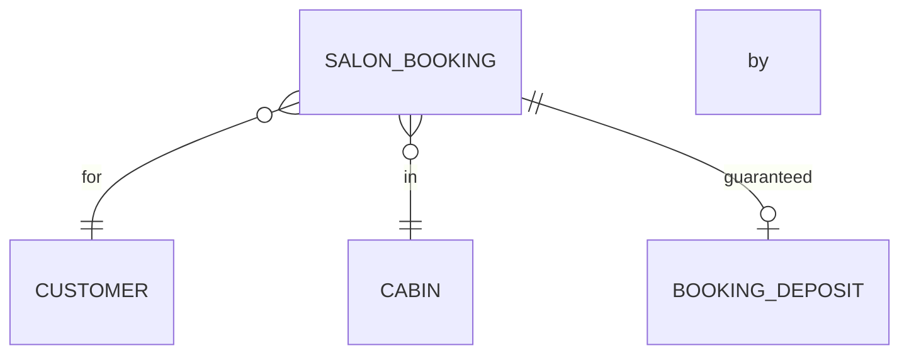
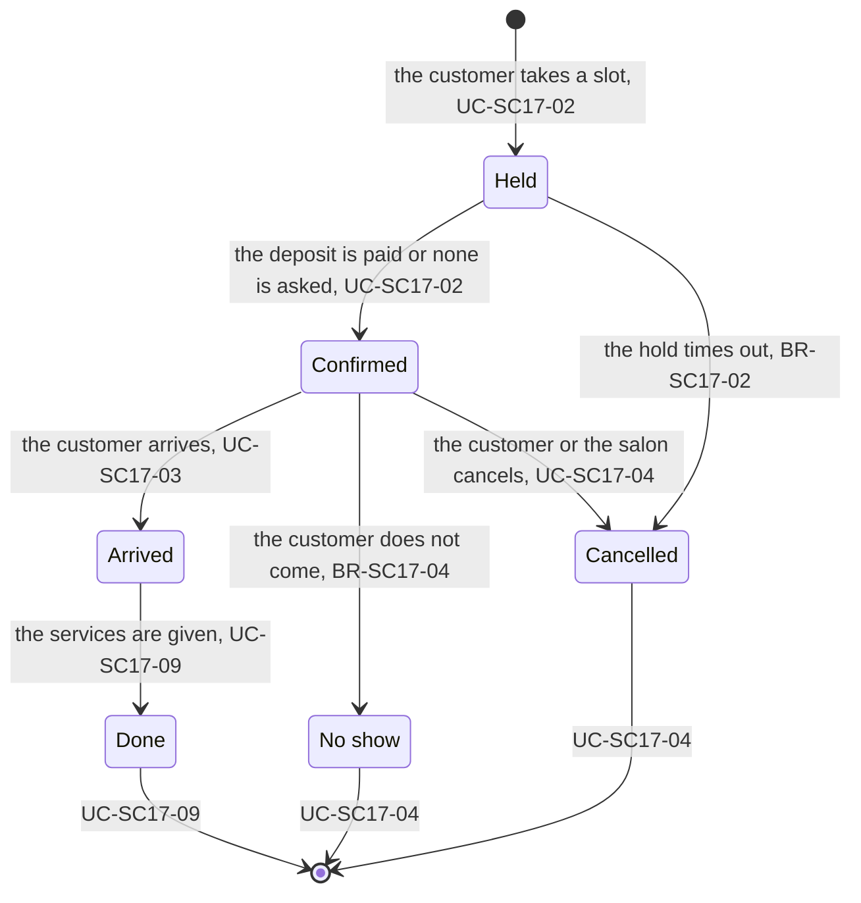

🏠 [Specs](../../../README.md) › 🏷️ [Sectors](../../README.md) › 💇 [SC17 Beauty and wellness](../README.md) ›
🗃️ [Data](README.md) › 🗃️ E-SC17-02 Salon booking

# 🗃️ E-SC17-02 Salon booking

**Status:** ✅ specified

## Purpose

One visit of a customer: the services, the staff member, the cabin, the time and the state. It uses the resource
bookings of the shared booking engine for the staff member and the cabin
([E-F2-18](../../../02-functional/f02-no-code-configuration/data/e-f02-18-resource-booking.md)) and adds the customer,
the services and the deposit; it does not replace them
([D561](../../../06-decisions/sectors/d561-benchmark-gaps-sc17-beauty-and-wellness.md)).

## Fields

| Name | Type | Required | Validation | Default | Example | Personal data | Custom fields |
|---|---|---|---|---|---|---|---|
| customer | customer record (E-F6-01) | yes | a customer of the company | - | Camille R. | yes | no |
| services | appointment types (E-F4-11) | yes | at least one | - | Facial, Cut | no | no |
| staff member | employee (E-F9-01) | yes | has every skill of the services | assigned | Ines B. | no | no |
| cabin | cabin (E-SC17-01) | yes | free for the whole visit | assigned | Rose | no | no |
| starts at | date and time | yes | inside the opening hours | - | 2026-11-21 14:30 | no | no |
| duration minutes | number | yes | sum of the services and cleaning | from the services | 105 | no | no |
| channel | choice | yes | online, desk, phone | online | online | no | no |
| price | amount | no | 0 or more | from the services | 87.00 EUR | no | no |
| state | Held, Confirmed, Cancelled, Arrived, Done, No show | yes | the lifecycle below | Held | Confirmed | no | no |
| owner | user | yes | a user of the company | the creator | Claire P. | yes | no |

## Relations

- [E-F2-18](../../../02-functional/f02-no-code-configuration/data/e-f02-18-resource-booking.md)
- [E-F6-01](../../../02-functional/f06-customers-and-sales/data/e-f06-01-customer-record.md)
- [E-SC17-01 Cabin](e-sc17-01-cabin.md)
- [E-SC17-03 Booking deposit](e-sc17-03-booking-deposit.md)

## Lifecycle

## Indexes and search

By customer, staff member, cabin, day and state.

## Retention

Kept with the sales records
([CR-FR-002](../../../10-country-packs/france/accounting/cr-fr-002-accounting-records-kept-ten-years.md)); the
customer's personal data follows the retention of the client file
([UC-SC17-19](../use-cases/05-rentals-care-records-and-loyalty/uc-sc17-19-keep-the-client-file-with-photos.md)).

## Audit

Every hold, confirmation, move, cancellation and no-show, with who and when.

## Import and export

Export of the bookings of a period; no import.

## Used by

- [UC-SC17-02](../use-cases/01-book-staff-and-cabins/uc-sc17-02-let-customers-book-online.md)
- [UC-SC17-03](../use-cases/01-book-staff-and-cabins/uc-sc17-03-book-at-the-desk.md)
- [UC-SC17-04](../use-cases/01-book-staff-and-cabins/uc-sc17-04-take-deposits-and-charge-no-shows.md)

## Open questions

None.

---

⬅️ [E-SC17-01 Cabin](e-sc17-01-cabin.md) · ⬆️ [Up](README.md) ·
➡️ [E-SC17-03 Booking deposit](e-sc17-03-booking-deposit.md)
