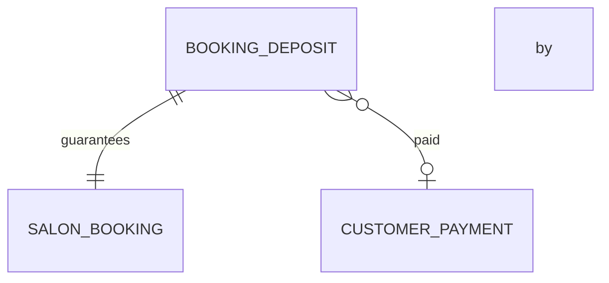
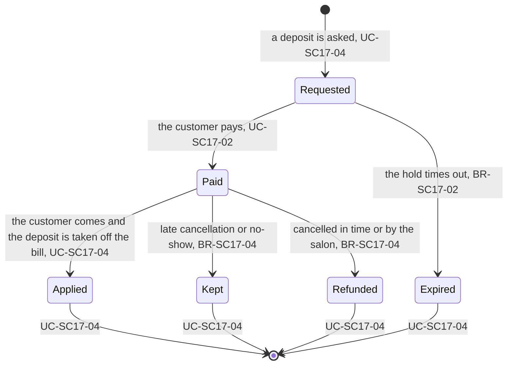

🏠 [Specs](../../../README.md) › 🏷️ [Sectors](../../README.md) › 💇 [SC17 Beauty and wellness](../README.md) ›
🗃️ [Data](README.md) › 🗃️ E-SC17-03 Booking deposit

# 🗃️ E-SC17-03 Booking deposit

**Status:** 🔄 waiting for the owner

## Purpose

The money a customer pays to hold a booking, and what became of it: applied to the bill, kept as a fee or refunded. It
records the terms shown at the time; the payment itself is a customer payment
([E-F6-06](../../../02-functional/f06-customers-and-sales/data/e-f06-06-customer-payment.md)) and this record is the
rule applied to it ([D561](../../../06-decisions/sectors/d561-benchmark-gaps-sc17-beauty-and-wellness.md)).

## Fields

| Name | Type | Required | Validation | Default | Example | Personal data | Custom fields |
|---|---|---|---|---|---|---|---|
| booking | salon booking (E-SC17-02) | yes | a confirmed or held booking | - | B-2026-210 | no | no |
| amount | amount | yes | above 0 | from the terms | 10.00 EUR | no | no |
| payment | customer payment (E-F6-06) | no | set when paid | - | P-88231 | no | no |
| terms shown on | date and time | yes | before the booking was confirmed | the booking time | 2026-11-18 09:12 | no | no |
| free cancellation until | date and time | yes | before the visit | from the terms | 2026-11-20 14:30 | no | no |
| fee | amount | no | 0 or more | from the terms | 20.00 EUR | no | no |
| waiver reason | text | no | needed to waive | - | - | no | no |
| state | Requested, Paid, Expired, Applied, Kept, Refunded | yes | the lifecycle below | Requested | Paid | no | no |
| owner | user | yes | a user of the company | the creator | Claire P. | yes | no |

## Relations

- [E-SC17-02 Salon booking](e-sc17-02-salon-booking.md)
- [E-F6-06](../../../02-functional/f06-customers-and-sales/data/e-f06-06-customer-payment.md)
- [E-F10-04 Till payment](../../../02-functional/f10-point-of-sale/data/e-f10-04-till-payment.md)

## Lifecycle

## Indexes and search

By booking, customer, state and visit date.

## Retention

Kept with the accounting records
([CR-FR-002](../../../10-country-packs/france/accounting/cr-fr-002-accounting-records-kept-ten-years.md)).

## Audit

Every request, payment, application, keeping, refund and waiver, with who, when and the terms.

## Import and export

Export of the deposits of a period for the books; no import.

## Used by

- [UC-SC17-04](../use-cases/01-book-staff-and-cabins/uc-sc17-04-take-deposits-and-charge-no-shows.md)
- [UC-SC17-02](../use-cases/01-book-staff-and-cabins/uc-sc17-02-let-customers-book-online.md)
- [UC-SC17-03](../use-cases/01-book-staff-and-cabins/uc-sc17-03-book-at-the-desk.md)

## Open questions

None.

---

⬅️ [E-SC17-02 Salon booking](e-sc17-02-salon-booking.md) · ⬆️ [Up](README.md) ·
➡️ [E-SC17-04 Session package](e-sc17-04-session-package.md)
