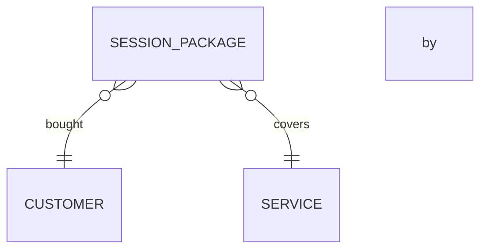
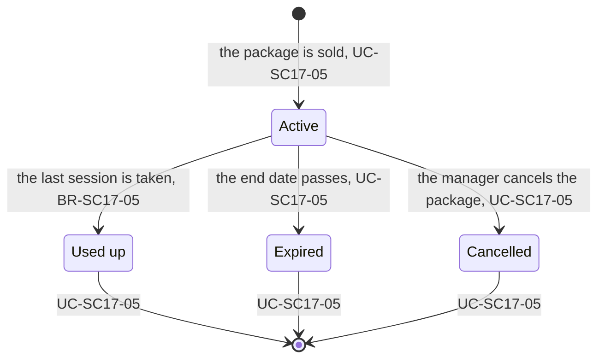

🏠 [Specs](../../../README.md) › 🏷️ [Sectors](../../README.md) › 💇 [SC17 Beauty and wellness](../README.md) ›
🗃️ [Data](README.md) › 🗃️ E-SC17-04 Session package

# 🗃️ E-SC17-04 Session package

**Status:** 🔄 waiting for the owner

## Purpose

A package of sessions of one service bought by a customer, with the sessions left and the end date. It is prepaid
sessions of a service, not a sum of money: a sum of money is a gift or loyalty card
([E-F10-10](../../../02-functional/f10-point-of-sale/data/e-f10-10-loyalty-card-and-gift-card.md)), and a package
differs by counting sessions of one service
([D561](../../../06-decisions/sectors/d561-benchmark-gaps-sc17-beauty-and-wellness.md)).

## Fields

| Name | Type | Required | Validation | Default | Example | Personal data | Custom fields |
|---|---|---|---|---|---|---|---|
| customer | customer record (E-F6-01) | yes | a customer of the company | - | Camille R. | yes | no |
| service | appointment type (E-F4-11) | yes | an existing service | - | Facial 60 min | no | no |
| sessions bought | number | yes | 1 or more | - | 5 | no | no |
| sessions left | number | yes | 0 to sessions bought | sessions bought | 4 | no | no |
| valid to | date | yes | after the sale date | sale date plus the validity | 2027-05-21 | no | no |
| price | amount | yes | 0 or more | from the catalogue | 220.00 EUR | no | no |
| sale | point of sale order (E-F10-03) | yes | the order that sold it | - | O-2026-5521 | no | no |
| shared with | customer record (E-F6-01) | no | a named family member | - | - | yes | no |
| state | Active, Used up, Expired, Cancelled | yes | the lifecycle below | Active | Used up | no | no |
| owner | user | yes | a user of the company | the creator | Claire P. | yes | no |

## Relations

- [E-F6-01](../../../02-functional/f06-customers-and-sales/data/e-f06-01-customer-record.md)
- [E-F4-11](../../../02-functional/f04-meetings/data/e-f04-11-appointment-type.md)
- [E-F10-03](../../../02-functional/f10-point-of-sale/data/e-f10-03-point-of-sale-order.md)
- [E-F10-10](../../../02-functional/f10-point-of-sale/data/e-f10-10-loyalty-card-and-gift-card.md)

## Lifecycle

## Indexes and search

By customer, service, state and end date.

## Retention

Kept with the sales records
([CR-FR-002](../../../10-country-packs/france/accounting/cr-fr-002-accounting-records-kept-ten-years.md)).

## Audit

Every sale, session taken, override, correction, expiry and cancellation, with who and when.

## Import and export

Export of the sessions owed at a date for the books; no import.

## Used by

- [UC-SC17-05](../use-cases/02-packages-and-memberships/uc-sc17-05-sell-packages-and-prepaid-sessions.md)
- [UC-SC17-08](../use-cases/02-packages-and-memberships/uc-sc17-08-follow-customer-balances.md)

## Open questions

None.

---

⬅️ [E-SC17-03 Booking deposit](e-sc17-03-booking-deposit.md) · ⬆️ [Up](README.md) ·
➡️ [E-SC17-05 Salon membership](e-sc17-05-salon-membership.md)
