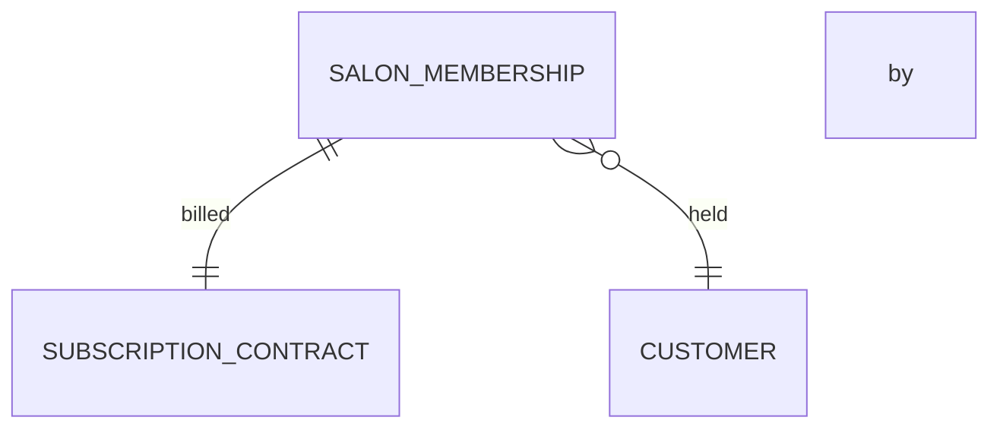
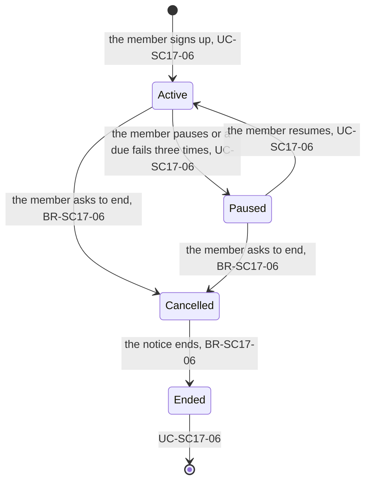

🏠 [Specs](../../../README.md) › 🏷️ [Sectors](../../README.md) › 💇 [SC17 Beauty and wellness](../README.md) ›
🗃️ [Data](README.md) › 🗃️ E-SC17-05 Salon membership

# 🗃️ E-SC17-05 Salon membership

**Status:** 🔄 waiting for the owner

## Purpose

A customer's membership of the salon: the plan, the included services and the state. The billing is the subscription
contract of customers and sales
([E-F6-07](../../../02-functional/f06-customers-and-sales/data/e-f06-07-subscription-contract.md)); this record adds
what is particular to a salon (the included services each month, the discount and the pause) and is linked to its
subscription ([D561](../../../06-decisions/sectors/d561-benchmark-gaps-sc17-beauty-and-wellness.md)).

## Fields

| Name | Type | Required | Validation | Default | Example | Personal data | Custom fields |
|---|---|---|---|---|---|---|---|
| member | customer record (E-F6-01) | yes | a customer of the company | - | Camille R. | yes | no |
| plan | text | yes | a plan of the salon | - | Glow | no | no |
| subscription | subscription contract (E-F6-07) | yes | created with the membership | - | SUB-2026-114 | no | no |
| starts on | date | yes | not in the past | today | 2026-11-21 | no | no |
| next due | date | no | after the start date | start plus one month | 2026-12-21 | no | no |
| included used this month | number | no | 0 to the plan's quota | 0 | 1 | no | no |
| terms accepted on | date and time | yes | before the start | - | 2026-11-21 10:05 | no | no |
| ends on | date | no | set at cancellation | - | - | no | no |
| state | Active, Paused, Cancelled, Ended | yes | the lifecycle below | Active | Paused | no | no |
| owner | user | yes | a user of the company | the creator | Claire P. | yes | no |

## Relations

- [E-F6-07](../../../02-functional/f06-customers-and-sales/data/e-f06-07-subscription-contract.md)
- [E-F6-01](../../../02-functional/f06-customers-and-sales/data/e-f06-01-customer-record.md)
- [E-F6-05 Invoice](../../../02-functional/f06-customers-and-sales/data/e-f06-05-invoice.md)

## Lifecycle

## Indexes and search

By member, plan, state and next due date.

## Retention

Kept with the contracts and invoices
([CR-FR-002](../../../10-country-packs/france/accounting/cr-fr-002-accounting-records-kept-ten-years.md)).

## Audit

Every sign-up, due, pause, resume, cancellation and end, with who, when and the terms accepted.

## Import and export

Export of the members and dues; no import.

## Used by

- [UC-SC17-06](../use-cases/02-packages-and-memberships/uc-sc17-06-run-memberships.md)
- [UC-SC17-08](../use-cases/02-packages-and-memberships/uc-sc17-08-follow-customer-balances.md)

## Open questions

None.

---

⬅️ [E-SC17-04 Session package](e-sc17-04-session-package.md) · ⬆️ [Up](README.md) ·
➡️ [E-SC17-06 Gift voucher](e-sc17-06-gift-voucher.md)
