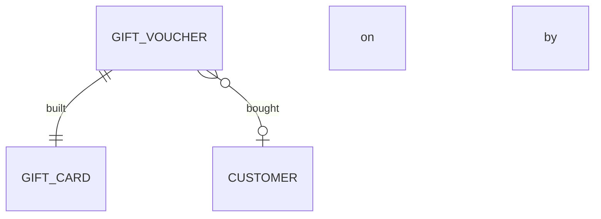
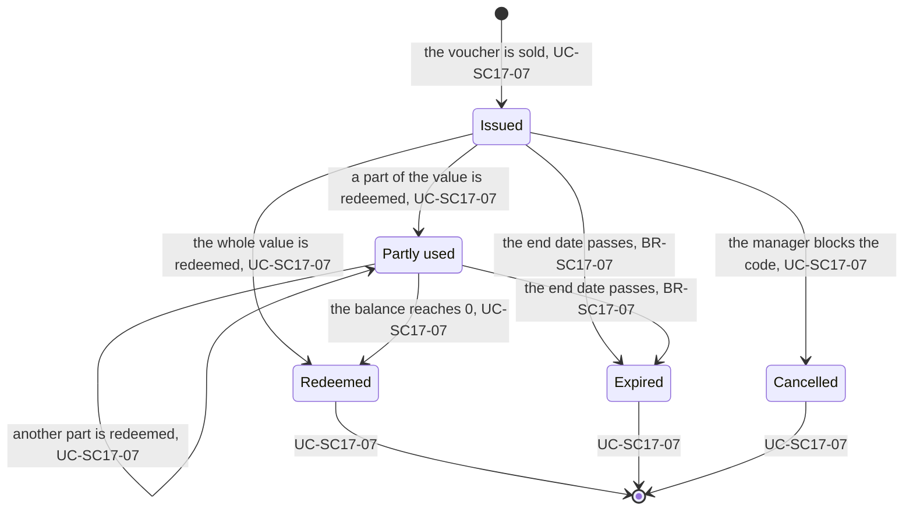

🏠 [Specs](../../../README.md) › 🏷️ [Sectors](../../README.md) › 💇 [SC17 Beauty and wellness](../README.md) ›
🗃️ [Data](README.md) › 🗃️ E-SC17-06 Gift voucher

# 🗃️ E-SC17-06 Gift voucher

**Status:** 🔄 waiting for the owner

## Purpose

A gift voucher for an amount or for a service, with its code, balance and end date. It builds on the gift card of the
point of sale ([E-F10-10](../../../02-functional/f10-point-of-sale/data/e-f10-10-loyalty-card-and-gift-card.md)) and
differs from it by being able to be for a service and by carrying the legal validity period of the voucher
([D561](../../../06-decisions/sectors/d561-benchmark-gaps-sc17-beauty-and-wellness.md)).

## Fields

| Name | Type | Required | Validation | Default | Example | Personal data | Custom fields |
|---|---|---|---|---|---|---|---|
| code | text | yes | unique, not guessable | generated | G-4471 | no | no |
| kind | choice | yes | amount or service | amount | amount | no | no |
| service | appointment type (E-F4-11) | no | needed when the kind is service | - | - | no | no |
| value | amount | yes | above 0 | - | 50.00 EUR | no | no |
| balance | amount | yes | 0 to the value | the value | 18.00 EUR | no | no |
| valid to | date | yes | not shorter than the legal period | sale date plus the period | 2027-11-21 | no | no |
| buyer | customer record (E-F6-01) | no | a customer or a guest | - | Noor A. | yes | no |
| holder | text | no | free text | - | Camille R. | yes | no |
| card | loyalty or gift card (E-F10-10) | yes | created with the voucher | - | GC-9912 | no | no |
| state | Issued, Partly used, Redeemed, Expired, Cancelled | yes | the lifecycle below | Issued | Partly used | no | no |
| owner | user | yes | a user of the company | the creator | Claire P. | yes | no |

## Relations

- [E-F10-10](../../../02-functional/f10-point-of-sale/data/e-f10-10-loyalty-card-and-gift-card.md)
- [E-F6-01](../../../02-functional/f06-customers-and-sales/data/e-f06-01-customer-record.md)
- [E-F4-11](../../../02-functional/f04-meetings/data/e-f04-11-appointment-type.md)

## Lifecycle

## Indexes and search

By code, buyer, state and end date.

## Retention

Kept with the sales and accounting records
([CR-FR-002](../../../10-country-packs/france/accounting/cr-fr-002-accounting-records-kept-ten-years.md)).

## Audit

Every sale, redemption, balance, extension, exchange, blocking and expiry, with who and when.

## Import and export

Export of the vouchers outstanding at a date for the books; no import.

## Used by

- [UC-SC17-07](../use-cases/02-packages-and-memberships/uc-sc17-07-sell-and-redeem-gift-vouchers.md)
- [UC-SC17-08](../use-cases/02-packages-and-memberships/uc-sc17-08-follow-customer-balances.md)

## Open questions

None.

---

⬅️ [E-SC17-05 Salon membership](e-sc17-05-salon-membership.md) · ⬆️ [Up](README.md) ·
➡️ [E-SC17-07 Product use](e-sc17-07-product-use.md)
