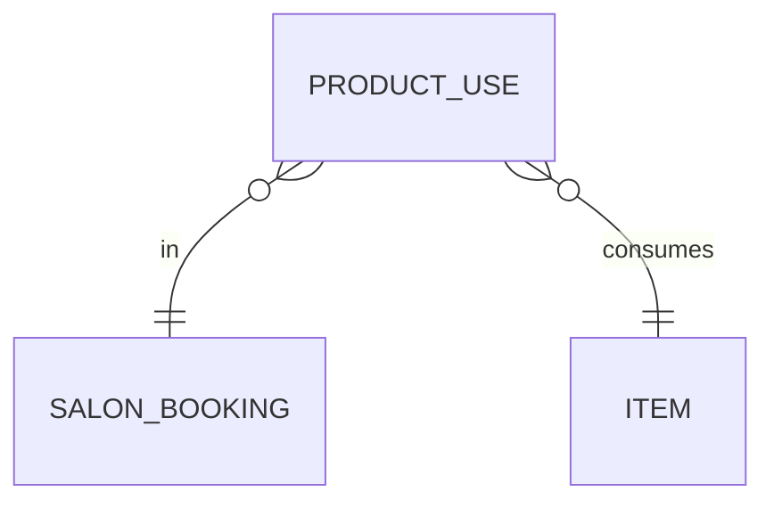
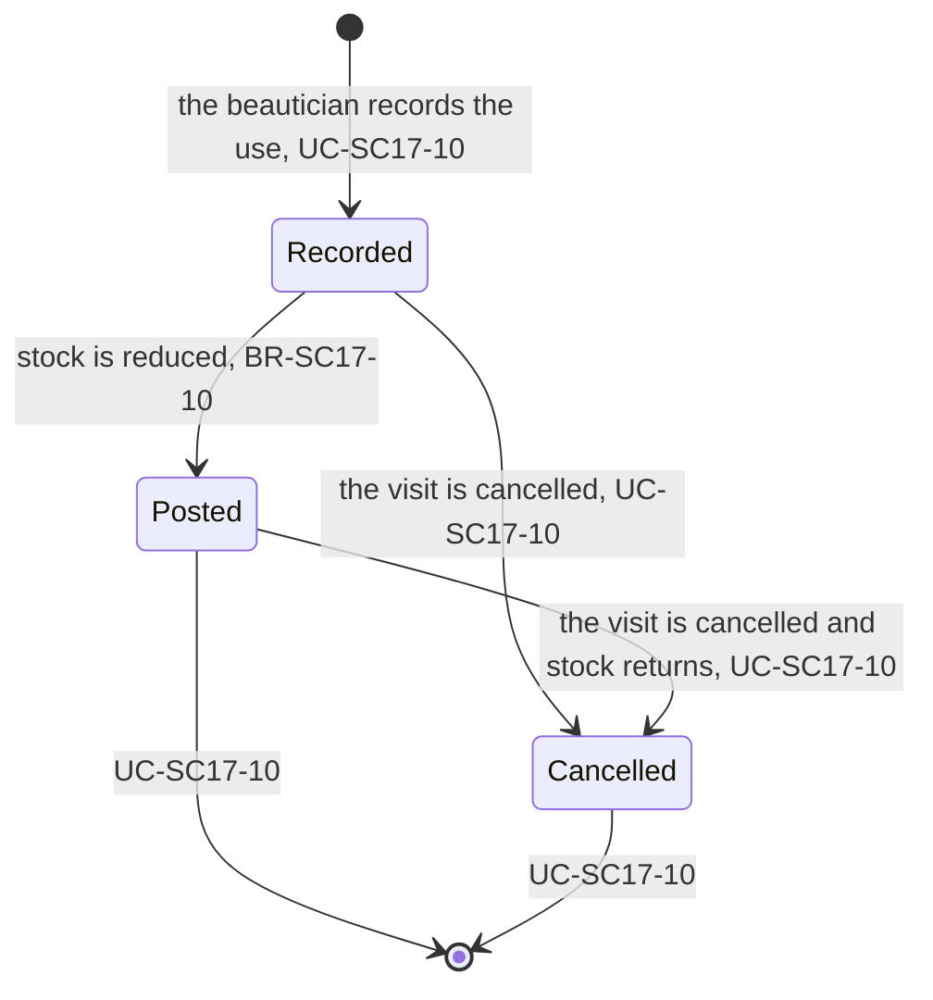

🏠 [Specs](../../../README.md) › 🏷️ [Sectors](../../README.md) › 💇 [SC17 Beauty and wellness](../README.md) ›
🗃️ [Data](README.md) › 🗃️ E-SC17-07 Product use

# 🗃️ E-SC17-07 Product use

**Status:** ✅ specified

## Purpose

The quantity of a product used up in one service, with its lot, so that stock and the cost of the service are right and
the lot can be traced to the client
([D561](../../../06-decisions/sectors/d561-benchmark-gaps-sc17-beauty-and-wellness.md)). The stock movement itself
belongs to purchasing and stock ([E-F7-06 Item](../../../02-functional/f07-purchasing-and-stock/data/e-f07-06-item.md));
this record says why the movement was made.

## Fields

| Name | Type | Required | Validation | Default | Example | Personal data | Custom fields |
|---|---|---|---|---|---|---|---|
| visit | salon booking (E-SC17-02) | yes | a visit of the salon | - | B-2026-210 | no | no |
| product | item (E-F7-06) | yes | a back-bar product | - | Colour 6.3 | no | no |
| quantity | number | yes | above 0 | recipe quantity | 65 | no | no |
| unit | choice | yes | g, ml or unit | from the product | g | no | no |
| lot | lot or serial (E-F7-10) | yes | not expired, not recalled | oldest lot | L-7782 | no | no |
| recipe quantity | number | no | 0 or more | from the service | 60 | no | no |
| recorded by | employee (E-F9-01) | yes | a member of the salon | the user | Ines B. | no | no |
| state | Recorded, Posted, Cancelled | yes | the lifecycle below | Recorded | Posted | no | no |
| owner | user | yes | a user of the company | the creator | Claire P. | yes | no |

## Relations

- [E-SC17-02 Salon booking](e-sc17-02-salon-booking.md)
- [E-F7-06 Item](../../../02-functional/f07-purchasing-and-stock/data/e-f07-06-item.md)
- [E-F7-10](../../../02-functional/f07-purchasing-and-stock/data/e-f07-10-lot-or-serial.md)

## Lifecycle

## Indexes and search

By visit, product, lot and date.

## Retention

Kept with the client file for the retention of that file
([UC-SC17-19](../use-cases/05-rentals-care-records-and-loyalty/uc-sc17-19-keep-the-client-file-with-photos.md)) and the
stock records ([CR-FR-002](../../../10-country-packs/france/accounting/cr-fr-002-accounting-records-kept-ten-years.md)).

## Audit

Every use, correction and cancellation, with who, when, the lot and the quantity.

## Import and export

Export of the uses of a period; no import.

## Used by

- [UC-SC17-10](../use-cases/03-salon-retail-and-stock/uc-sc17-10-record-products-used-in-services.md)
- [UC-SC17-12](../use-cases/03-salon-retail-and-stock/uc-sc17-12-keep-cosmetics-safety-records.md)

## Open questions

None.

---

⬅️ [E-SC17-06 Gift voucher](e-sc17-06-gift-voucher.md) · ⬆️ [Up](README.md) ·
➡️ [E-SC17-08 Safety record](e-sc17-08-safety-record.md)
