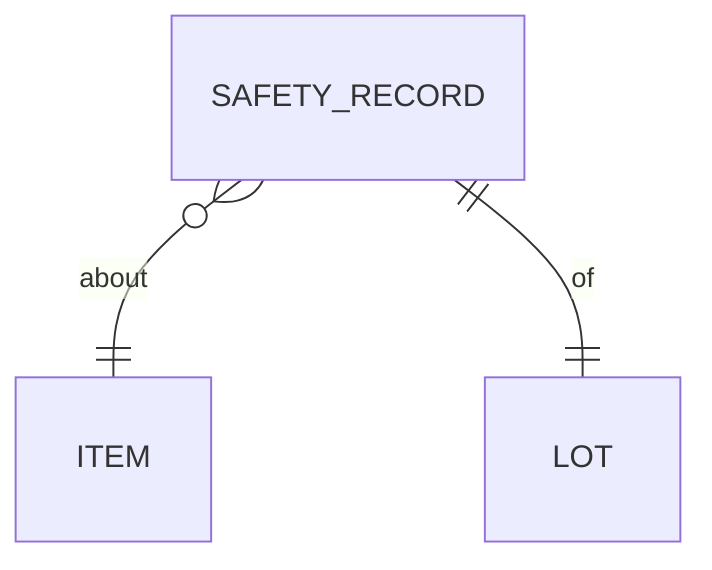
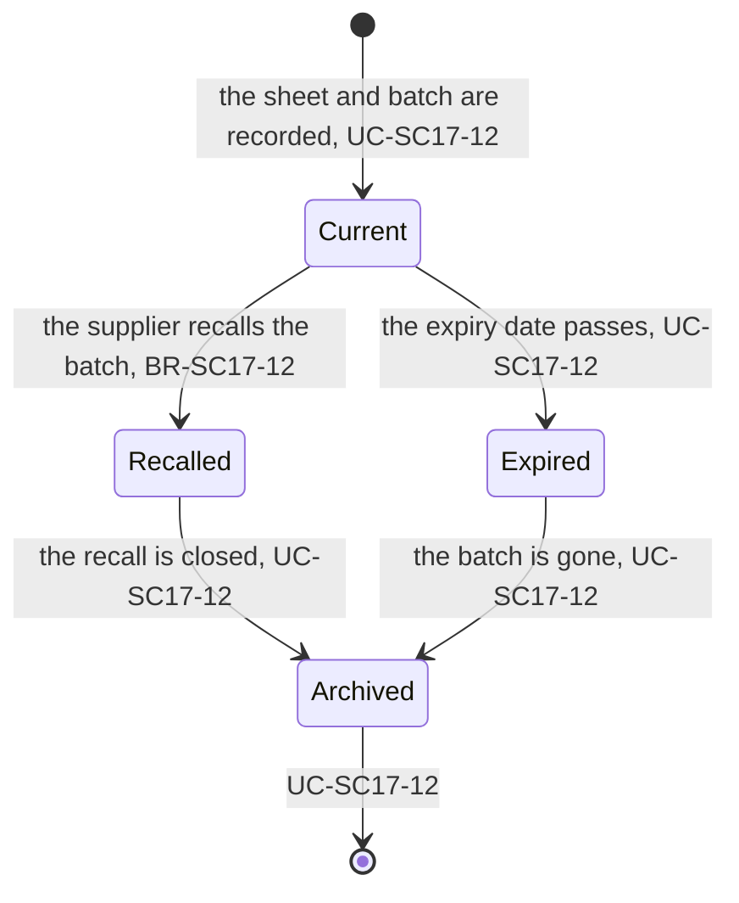

🏠 [Specs](../../../README.md) › 🏷️ [Sectors](../../README.md) › 💇 [SC17 Beauty and wellness](../README.md) ›
🗃️ [Data](README.md) › 🗃️ E-SC17-08 Safety record

# 🗃️ E-SC17-08 Safety record

**Status:** ✅ specified

## Purpose

The safety record of one batch of a cosmetic product: its sheet, supplier, expiry, responsible company and recall state.
The lot itself is a stock record
([E-F7-10](../../../02-functional/f07-purchasing-and-stock/data/e-f07-10-lot-or-serial.md)); this record adds the safety
information and the recall that purchasing and stock do not hold
([D561](../../../06-decisions/sectors/d561-benchmark-gaps-sc17-beauty-and-wellness.md)).

## Fields

| Name | Type | Required | Validation | Default | Example | Personal data | Custom fields |
|---|---|---|---|---|---|---|---|
| product | item (E-F7-06) | yes | a product of the salon | - | Colour 6.3 | no | no |
| batch | text | yes | the batch printed on the label | - | L-7782 | no | no |
| expiry | month | yes | not past at reception | - | 2028-03 | no | no |
| supplier | supplier record (E-F7-01) | yes | a supplier of the company | - | Beta Hair Supply | no | no |
| responsible company | text | yes | name and address printed on the label | - | Beta Cosmetics SARL | no | no |
| safety sheet | document (E-F2-13) | yes | attached | - | colour-6-3-sheet.pdf | no | no |
| recall notice | document (E-F2-13) | no | needed to mark Recalled | - | - | no | no |
| recalled on | date | no | set when recalled | - | - | no | no |
| state | Current, Recalled, Expired, Archived | yes | the lifecycle below | Current | Recalled | no | no |
| owner | user | yes | a user of the company | the creator | Claire P. | yes | no |

## Relations

- [E-F7-06 Item](../../../02-functional/f07-purchasing-and-stock/data/e-f07-06-item.md)
- [E-F7-10](../../../02-functional/f07-purchasing-and-stock/data/e-f07-10-lot-or-serial.md)
- [E-F7-01](../../../02-functional/f07-purchasing-and-stock/data/e-f07-01-supplier-record.md)
- [E-F2-13 Document](../../../02-functional/f02-no-code-configuration/data/e-f02-13-document.md)

## Lifecycle

## Indexes and search

By product, batch, supplier, state and expiry.

## Retention

Kept for the period the law sets for traceability and recalls; the value is read later
([CR-FR-002](../../../10-country-packs/france/accounting/cr-fr-002-accounting-records-kept-ten-years.md)).

## Audit

Every record, sheet, recall, block, client contacted and archive, with who and when.

## Import and export

Export of the records for an inspection; no import.

## Used by

- [UC-SC17-12](../use-cases/03-salon-retail-and-stock/uc-sc17-12-keep-cosmetics-safety-records.md)
- [UC-SC17-10](../use-cases/03-salon-retail-and-stock/uc-sc17-10-record-products-used-in-services.md)

## Open questions

None.

---

⬅️ [E-SC17-07 Product use](e-sc17-07-product-use.md) · ⬆️ [Up](README.md) ·
➡️ [E-SC17-09 Salon commission plan](e-sc17-09-commission-plan.md)
