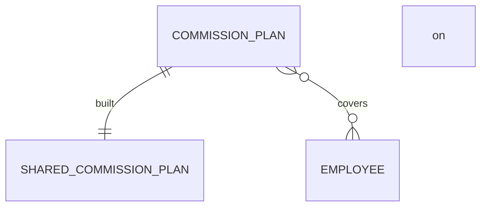
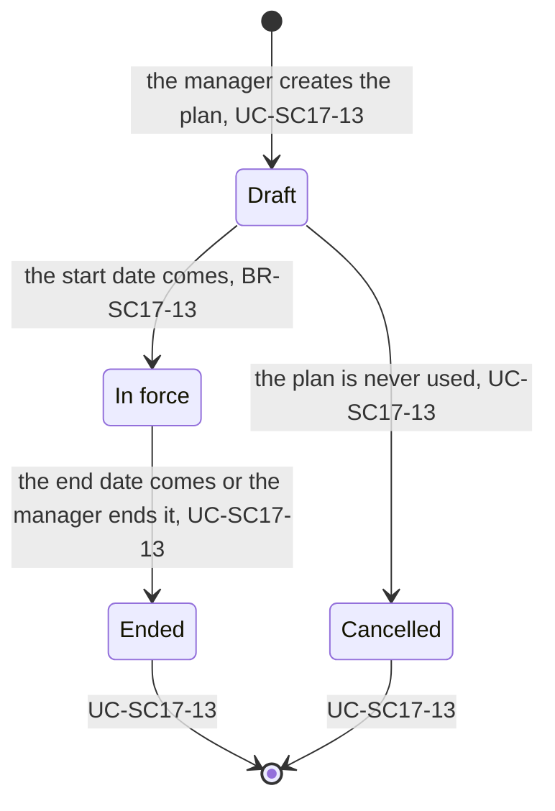

🏠 [Specs](../../../README.md) › 🏷️ [Sectors](../../README.md) › 💇 [SC17 Beauty and wellness](../README.md) ›
🗃️ [Data](README.md) › 🗃️ E-SC17-09 Salon commission plan

# 🗃️ E-SC17-09 Salon commission plan

**Status:** ✅ specified

## Purpose

A commission plan of the salon: the rates on services and on products, the tiers and the dates. It builds on the shared
commission plan and target of customers and sales
([E-F6-18](../../../02-functional/f06-customers-and-sales/data/e-f06-18-commission-plan-and-target.md)) and differs by
separating the rate on services from the rate on products and by excluding independents who rent a chair
([D561](../../../06-decisions/sectors/d561-benchmark-gaps-sc17-beauty-and-wellness.md)).

## Fields

| Name | Type | Required | Validation | Default | Example | Personal data | Custom fields |
|---|---|---|---|---|---|---|---|
| name | text | yes | unique in the salon | - | Spring | no | no |
| service rate | percent | yes | 0 to 100 | 0 | 8 | no | no |
| product rate | percent | yes | 0 to 100 | 0 | 12 | no | no |
| tiers | thresholds and rates | no | increasing thresholds | none | above 6,000 EUR a month +2% | no | no |
| starts on | date | yes | no overlap for a person | - | 2027-03-01 | no | no |
| ends on | date | no | after the start | - | - | no | no |
| staff | employees (E-F9-01) | yes | employees only, not renters | - | Ines B., Louis T. | no | no |
| shared plan | commission plan and target (E-F6-18) | yes | created with the plan | - | CP-2027-03 | no | no |
| state | Draft, In force, Ended, Cancelled | yes | the lifecycle below | Draft | In force | no | no |
| owner | user | yes | a user of the company | the creator | Claire P. | yes | no |

## Relations

- [E-F6-18](../../../02-functional/f06-customers-and-sales/data/e-f06-18-commission-plan-and-target.md)
- [E-F6-19](../../../02-functional/f06-customers-and-sales/data/e-f06-19-commission-line.md)
- [E-F9-01](../../../02-functional/f09-hr-and-projects/data/e-f09-01-employee-record.md)

## Lifecycle

## Indexes and search

By name, staff member, state and dates.

## Retention

Kept with the pay records ([CR-FR-047](../../../10-country-packs/france/labour/cr-fr-047-hr-records-retention.md)).

## Audit

Every plan, assignment, end and cancellation, with who, when and the old rates.

## Import and export

Export of the plans and lines of a period for payroll; no import.

## Used by

- [UC-SC17-13](../use-cases/04-commissions-and-tips/uc-sc17-13-set-commission-plans.md)
- [UC-SC17-14 Share tips](../use-cases/04-commissions-and-tips/uc-sc17-14-share-tips.md)
- [UC-SC17-15](../use-cases/04-commissions-and-tips/uc-sc17-15-follow-staff-targets.md)

## Open questions

None.

---

⬅️ [E-SC17-08 Safety record](e-sc17-08-safety-record.md) · ⬆️ [Up](README.md) · ➡️ [E-SC17-10 Tip](e-sc17-10-tip.md)
