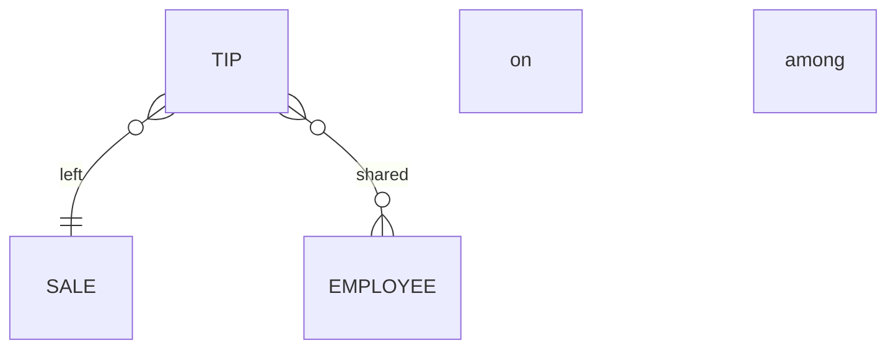
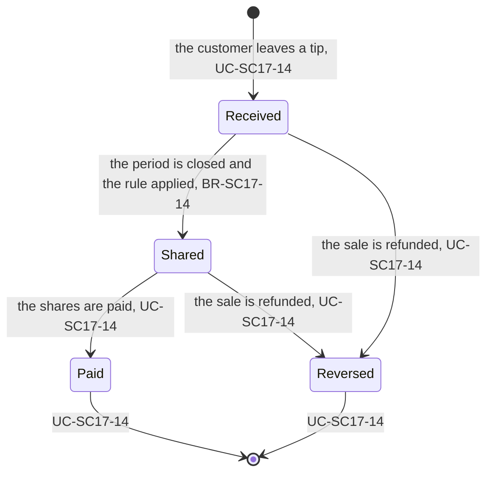

🏠 [Specs](../../../README.md) › 🏷️ [Sectors](../../README.md) › 💇 [SC17 Beauty and wellness](../README.md) ›
🗃️ [Data](README.md) › 🗃️ E-SC17-10 Tip

# 🗃️ E-SC17-10 Tip

**Status:** ✅ specified

## Purpose

One tip left by a customer, and what became of it: received, shared among the staff and paid
([D561](../../../06-decisions/sectors/d561-benchmark-gaps-sc17-beauty-and-wellness.md)). The card payment that carried
it is a till payment ([E-F10-04 Till payment](../../../02-functional/f10-point-of-sale/data/e-f10-04-till-payment.md));
this record keeps the tip apart from the takings and applies the sharing key.

## Fields

| Name | Type | Required | Validation | Default | Example | Personal data | Custom fields |
|---|---|---|---|---|---|---|---|
| sale | point of sale order (E-F10-03) | yes | a sale of the salon | - | O-2026-5601 | no | no |
| amount | amount | yes | above 0 | - | 5.00 EUR | no | no |
| received on | date | yes | not in the future | today | 2026-11-16 | no | no |
| given to | choice | yes | the team or a named staff member | the team | the team | no | no |
| period | text | no | the sharing period | the current week | 2026-W46 | no | no |
| shares | amounts per person | no | sum equals the amount | - | - | yes | no |
| rule | text | no | the posted rule when shared | - | by hours worked | no | no |
| state | Received, Shared, Paid, Reversed | yes | the lifecycle below | Received | Shared | no | no |
| owner | user | yes | a user of the company | the creator | Claire P. | yes | no |

## Relations

- [E-F10-03](../../../02-functional/f10-point-of-sale/data/e-f10-03-point-of-sale-order.md)
- [E-F10-04 Till payment](../../../02-functional/f10-point-of-sale/data/e-f10-04-till-payment.md)
- [E-F9-16 Shift](../../../02-functional/f09-hr-and-projects/data/e-f09-16-shift.md)

## Lifecycle

## Indexes and search

By period, person, state and date.

## Retention

Kept with the pay records ([CR-FR-047](../../../10-country-packs/france/labour/cr-fr-047-hr-records-retention.md)).

## Audit

Every tip, sharing, payment and reversal, with who, when and the rule.

## Import and export

Export of the shares for payroll; no import.

## Used by

- [UC-SC17-14 Share tips](../use-cases/04-commissions-and-tips/uc-sc17-14-share-tips.md)
- [UC-SC17-15](../use-cases/04-commissions-and-tips/uc-sc17-15-follow-staff-targets.md)

## Open questions

None.

---

⬅️ [E-SC17-09 Salon commission plan](e-sc17-09-commission-plan.md) · ⬆️ [Up](README.md) ·
➡️ [E-SC17-11 Rental contract](e-sc17-11-rental-contract.md)
