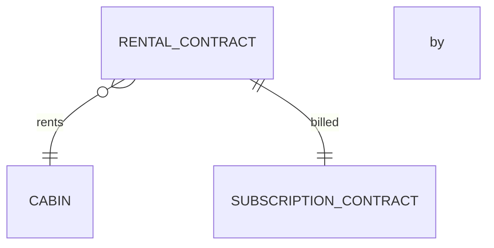
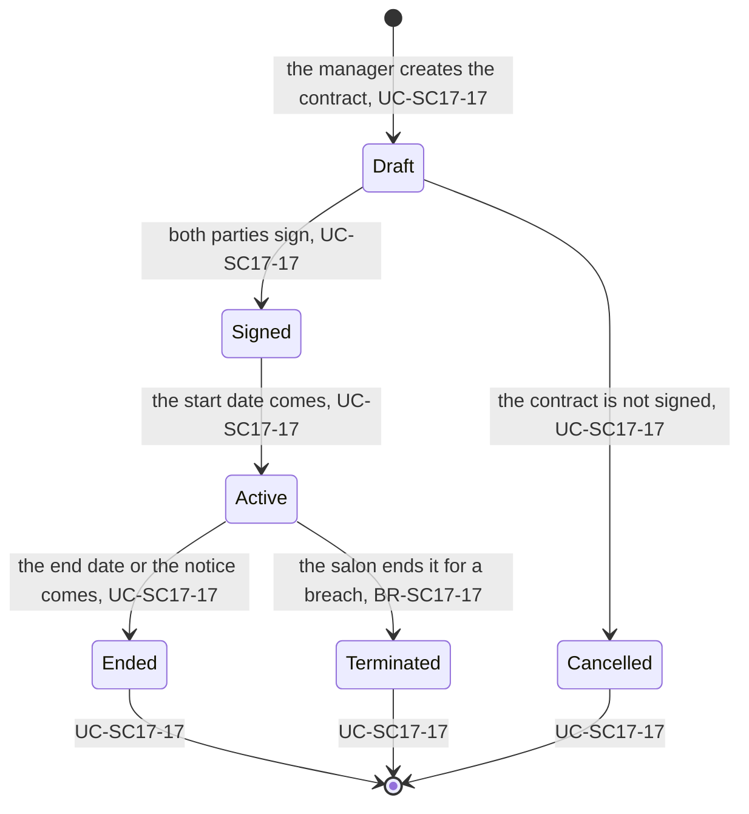

🏠 [Specs](../../../README.md) › 🏷️ [Sectors](../../README.md) › 💇 [SC17 Beauty and wellness](../README.md) ›
🗃️ [Data](README.md) › 🗃️ E-SC17-11 Rental contract

# 🗃️ E-SC17-11 Rental contract

**Status:** ✅ specified

## Purpose

A contract by which an independent rents a chair or a cabin of the salon: the place, the period, the rent, the notice
and the checks of independence. The rent is billed by a subscription contract
([E-F6-07](../../../02-functional/f06-customers-and-sales/data/e-f06-07-subscription-contract.md)) and the place is a
cabin ([E-SC17-01 Cabin](e-sc17-01-cabin.md)); this record is the rental relationship that neither holds
([D561](../../../06-decisions/sectors/d561-benchmark-gaps-sc17-beauty-and-wellness.md)).

## Fields

| Name | Type | Required | Validation | Default | Example | Personal data | Custom fields |
|---|---|---|---|---|---|---|---|
| renter | customer record (E-F6-01) | yes | an independent with a business identity | - | Lea D. | yes | no |
| place | cabin (E-SC17-01) | yes | free for the whole period | - | Chair 2 | no | no |
| starts on | date | yes | not in the past | - | 2026-09-01 | no | no |
| ends on | date | no | after the start | open | 2027-08-31 | no | no |
| rent | amount | yes | 0 or more | from the price list | 380.00 EUR | no | no |
| billing period | choice | yes | week or month | month | month | no | no |
| notice months | number | yes | 0 or more | 2 | 2 | no | no |
| business identity | text | yes | a valid business number | - | 123 456 789 00012 | yes | no |
| insurance valid to | date | yes | after the start date | - | 2027-06-30 | no | no |
| independence checks | list of yes or no | yes | each answered | - | all answered | no | no |
| subscription | subscription contract (E-F6-07) | yes | created at signature | - | SUB-2026-130 | no | no |
| state | Draft, Signed, Active, Ended, Terminated, Cancelled | yes | the lifecycle below | Draft | Signed | no | no |
| owner | user | yes | a user of the company | the creator | Claire P. | yes | no |

## Relations

- [E-SC17-01 Cabin](e-sc17-01-cabin.md)
- [E-F6-07](../../../02-functional/f06-customers-and-sales/data/e-f06-07-subscription-contract.md)
- [E-F6-01](../../../02-functional/f06-customers-and-sales/data/e-f06-01-customer-record.md)
- [E-F2-18](../../../02-functional/f02-no-code-configuration/data/e-f02-18-resource-booking.md)

## Lifecycle

## Indexes and search

By renter, place, state and dates.

## Retention

Kept with the contracts of the salon
([CR-FR-002](../../../10-country-packs/france/accounting/cr-fr-002-accounting-records-kept-ten-years.md)).

## Audit

Every contract, signature, rent invoice, check, access change, end and termination, with who and when.

## Import and export

Export of the contracts and the rent invoices; no import.

## Used by

- [UC-SC17-17](../use-cases/05-rentals-care-records-and-loyalty/uc-sc17-17-rent-chairs-and-cabins-to-independents.md)
- [UC-SC17-01](../use-cases/01-book-staff-and-cabins/uc-sc17-01-set-up-services-staff-and-cabins.md)

## Open questions

None.

---

⬅️ [E-SC17-10 Tip](e-sc17-10-tip.md) · ⬆️ [Up](README.md) ·
➡️ [E-SC17-12 Regulated care record](e-sc17-12-care-record.md)
