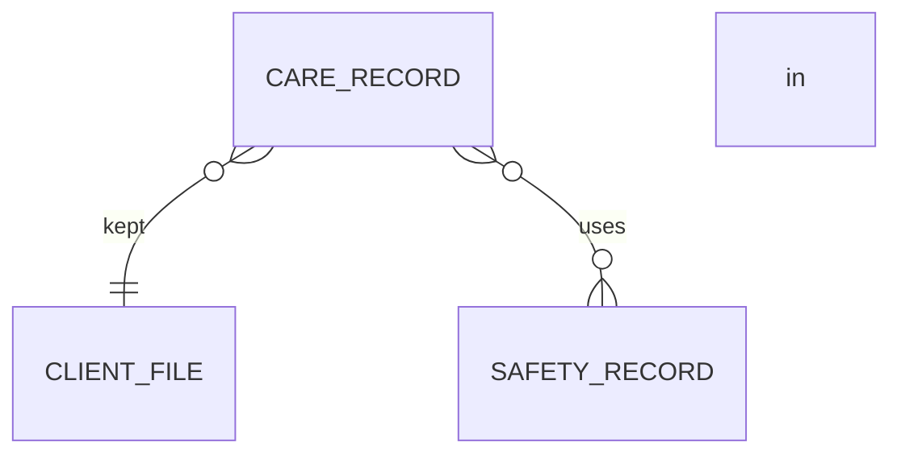
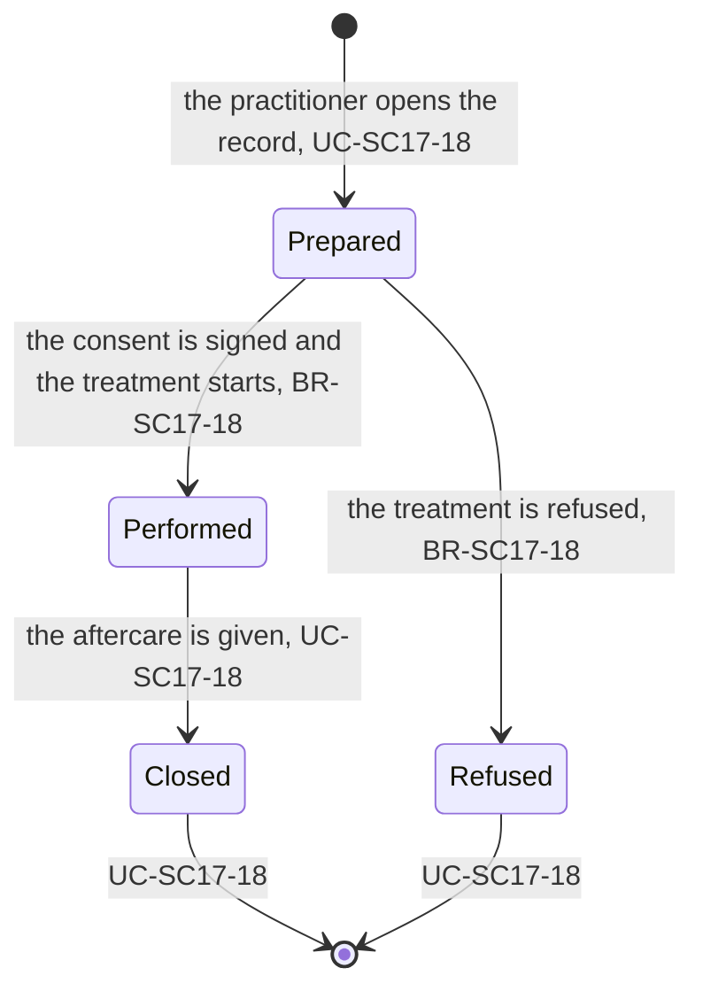

🏠 [Specs](../../../README.md) › 🏷️ [Sectors](../../README.md) › 💇 [SC17 Beauty and wellness](../README.md) ›
🗃️ [Data](README.md) › 🗃️ E-SC17-12 Regulated care record

# 🗃️ E-SC17-12 Regulated care record

**Status:** ✅ specified

## Purpose

The record of one regulated treatment (tattoo, piercing or laser): who did it, the consent, the batches used and the
aftercare. It holds health-related data of the client
([D561](../../../06-decisions/sectors/d561-benchmark-gaps-sc17-beauty-and-wellness.md)); the client file
([E-SC17-13 Salon client file](e-sc17-13-client-file.md)) keeps it with the rest of the client's history.

## Fields

| Name | Type | Required | Validation | Default | Example | Personal data | Custom fields |
|---|---|---|---|---|---|---|---|
| client | client file (E-SC17-13) | yes | an existing file | - | Noor A. | yes | no |
| kind | choice | yes | tattoo, piercing or laser | - | piercing | no | no |
| practitioner | employee or renter (E-F9-01) | yes | holds the hygiene training | the user | Ines B. | no | no |
| place on the body | text | yes | free text | - | ear, helix | yes | no |
| consent signed on | date and time | yes | before the treatment | - | 2026-11-21 10:12 | no | no |
| guardian | text | no | needed for a minor | - | - | yes | no |
| batches | list of batches (E-SC17-08) | yes | not recalled | - | N-220, J-17 | no | no |
| aftercare given on | date | no | set when given | - | 2026-11-21 | no | no |
| follow-up | text | no | free text | - | - | yes | no |
| state | Prepared, Performed, Refused, Closed | yes | the lifecycle below | Prepared | Performed | no | no |
| owner | user | yes | a user of the company | the creator | Claire P. | yes | no |

## Relations

- [E-SC17-13 Salon client file](e-sc17-13-client-file.md)
- [E-SC17-08 Safety record](e-sc17-08-safety-record.md)
- [E-F9-12](../../../02-functional/f09-hr-and-projects/data/e-f09-12-certification.md)
- [E-F5-10](../../../02-functional/f05-social-media/data/e-f05-10-consent-and-suppression-record.md)

## Lifecycle

## Indexes and search

By client, kind, practitioner, state and date; the personal and health fields are never searched by users without a care
role.

## Retention

Kept for the period the law sets for such records, then erased on request when allowed
([CR-FR-052](../../../10-country-packs/france/data-protection/cr-fr-052-storage-limitation.md)).

## Audit

Every record, consent, batch, aftercare, reading and export, with who and when.

## Import and export

Export of one client's record at their request
([CR-FR-051](../../../10-country-packs/france/data-protection/cr-fr-051-access-and-erasure.md)); no import.

## Used by

- [UC-SC17-18](../use-cases/05-rentals-care-records-and-loyalty/uc-sc17-18-keep-regulated-care-records.md)
- [UC-SC17-19](../use-cases/05-rentals-care-records-and-loyalty/uc-sc17-19-keep-the-client-file-with-photos.md)

## Open questions

None.

---

⬅️ [E-SC17-11 Rental contract](e-sc17-11-rental-contract.md) · ⬆️ [Up](README.md) ·
➡️ [E-SC17-13 Salon client file](e-sc17-13-client-file.md)
