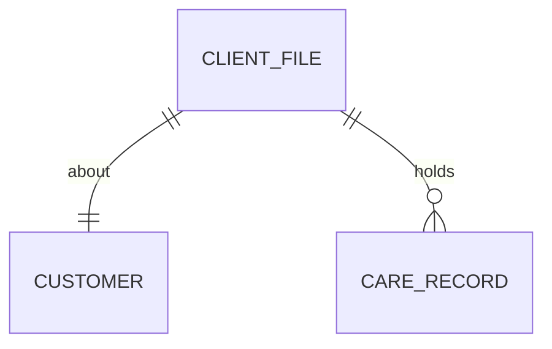
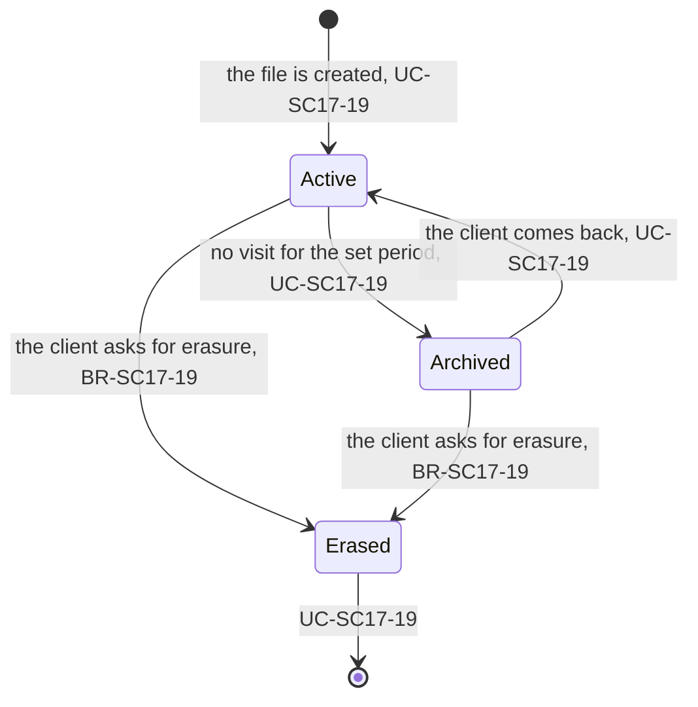

🏠 [Specs](../../../README.md) › 🏷️ [Sectors](../../README.md) › 💇 [SC17 Beauty and wellness](../README.md) ›
🗃️ [Data](README.md) › 🗃️ E-SC17-13 Salon client file

# 🗃️ E-SC17-13 Salon client file

**Status:** ✅ specified

## Purpose

The file of one client of the salon: allergies and notes, hair formulas, photos with their consent, and the link to the
care records ([D561](../../../06-decisions/sectors/d561-benchmark-gaps-sc17-beauty-and-wellness.md)). It adds the
salon's notes to the customer record
([E-F6-01](../../../02-functional/f06-customers-and-sales/data/e-f06-01-customer-record.md)), which holds only the
identity and the sales; the consent itself is recorded in the shared consent record
([E-F5-10](../../../02-functional/f05-social-media/data/e-f05-10-consent-and-suppression-record.md)).

## Fields

| Name | Type | Required | Validation | Default | Example | Personal data | Custom fields |
|---|---|---|---|---|---|---|---|
| client | customer record (E-F6-01) | yes | a customer of the company | - | Noor A. | yes | no |
| allergies | text | no | free text | - | Nickel, hair dye PPD | yes | no |
| skin and hair notes | text | no | free text | - | Sensitive scalp | yes | no |
| formulas | text | no | free text | - | Colour 6.3 + 20 vol | yes | no |
| photos | images | no | each covered by a consent | none | 3 | yes | no |
| photo consent | choice | yes | none, file only or communication | none | file only | no | no |
| consent signed on | date and time | no | needed unless none | - | 2026-11-21 10:12 | no | no |
| last visit | date | no | not in the future | - | 2026-11-21 | no | no |
| state | Active, Archived, Erased | yes | the lifecycle below | Active | Archived | no | no |
| owner | user | yes | a user of the company | the creator | Claire P. | yes | no |

## Relations

- [E-F6-01](../../../02-functional/f06-customers-and-sales/data/e-f06-01-customer-record.md)
- [E-F5-10](../../../02-functional/f05-social-media/data/e-f05-10-consent-and-suppression-record.md)
- [E-SC17-12 Regulated care record](e-sc17-12-care-record.md)

## Lifecycle

## Indexes and search

By client, state and last visit; allergies, notes and photos are never searched by users without a care role.

## Retention

Kept while the client is active and for a set period after the last visit, then archived and erased
([CR-FR-052](../../../10-country-packs/france/data-protection/cr-fr-052-storage-limitation.md)).

## Audit

Every opening, note, photo, consent, withdrawal, export, archive and erasure, with who and when.

## Import and export

Export of one file at the client's request
([CR-FR-051](../../../10-country-packs/france/data-protection/cr-fr-051-access-and-erasure.md)); no import.

## Used by

- [UC-SC17-19](../use-cases/05-rentals-care-records-and-loyalty/uc-sc17-19-keep-the-client-file-with-photos.md)
- [UC-SC17-18](../use-cases/05-rentals-care-records-and-loyalty/uc-sc17-18-keep-regulated-care-records.md)

## Open questions

None.

---

⬅️ [E-SC17-12 Regulated care record](e-sc17-12-care-record.md) · ⬆️ [Up](README.md)
