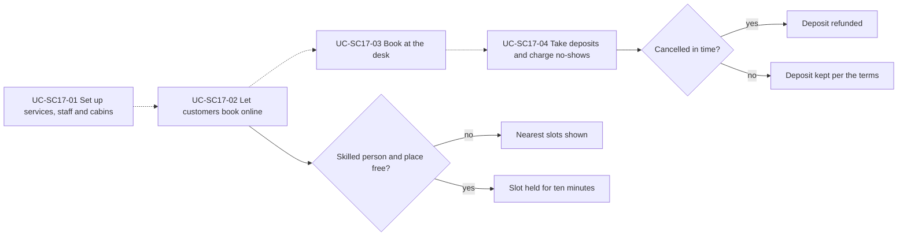
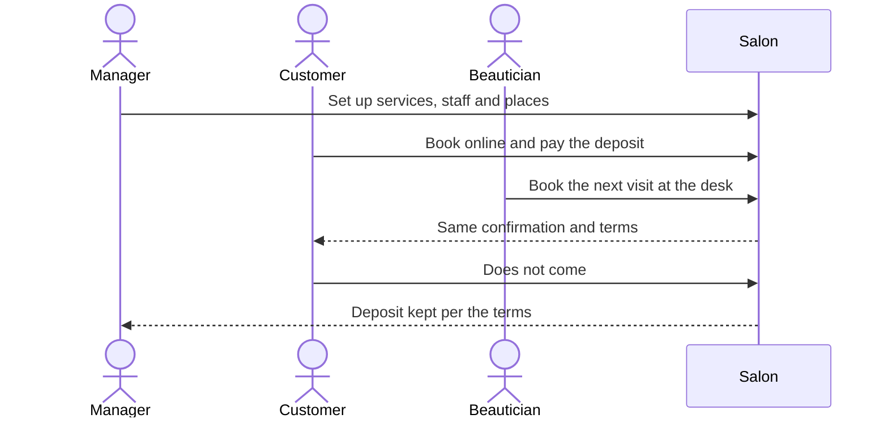

🏠 [Specs](../../../README.md) › 🏷️ [Sectors](../../README.md) › 💇 [SC17 Beauty and wellness](../README.md) ›
🔀 [Flows](README.md) › 🔀 FL-SC17-01 Book staff and cabins

# 🔀 FL-SC17-01 Book staff and cabins

**Status:** ✅ specified

## Summary

Four situations of booking in a salon: setting up the services, staff and cabins, letting customers book online, booking
at the desk, and taking deposits and charging no-shows
([D561](../../../06-decisions/sectors/d561-benchmark-gaps-sc17-beauty-and-wellness.md)).

## Personas

- [U23 Store manager](../../../01-users/personas/u23-store-manager.md), who sets up the salon and settles the deposits
- [U09 Customer](../../../01-users/personas/u09-customer.md), who books online and pays the deposit
- [U52 Beautician](../../../01-users/personas/u52-beautician.md), who books at the desk

## Flowchart

## Sequence diagram

## Steps

| Step | Persona | Screen | Use case | What happens |
|---|---|---|---|---|
| 1 | [U23](../../../01-users/personas/u23-store-manager.md) | [S-SC17-01](../screens/01-book-staff-and-cabins/s-sc17-01-salon-setup.md) | [UC-SC17-01](../use-cases/01-book-staff-and-cabins/uc-sc17-01-set-up-services-staff-and-cabins.md) | The manager lists the services, the staff skills and the cabins that can be booked |
| 2 | [U09](../../../01-users/personas/u09-customer.md) | [S-SC17-02](../screens/01-book-staff-and-cabins/s-sc17-02-online-booking.md) | [UC-SC17-02](../use-cases/01-book-staff-and-cabins/uc-sc17-02-let-customers-book-online.md) | The customer chooses services and a free slot on the phone and pays the deposit |
| 3 | [U52](../../../01-users/personas/u52-beautician.md) | [S-SC17-03](../screens/01-book-staff-and-cabins/s-sc17-03-desk-booking.md) | [UC-SC17-03](../use-cases/01-book-staff-and-cabins/uc-sc17-03-book-at-the-desk.md) | The beautician books the next visit at the chair with the same rules and confirmation |
| 4 | [U23](../../../01-users/personas/u23-store-manager.md) | [S-SC17-04](../screens/01-book-staff-and-cabins/s-sc17-04-deposits-and-no-shows.md) | [UC-SC17-04](../use-cases/01-book-staff-and-cabins/uc-sc17-04-take-deposits-and-charge-no-shows.md) | The manager sets the deposit terms and keeps or refunds each deposit |

### Entities and screens

| Entity | States in this flow | Shown at step and screen | Aggregated view |
|---|---|---|---|
| [E-SC17-01 Cabin](../data/e-sc17-01-cabin.md) | Active, Out of service, Retired | 1 [S-SC17-01](../screens/01-book-staff-and-cabins/s-sc17-01-salon-setup.md) | Cabins |
| [E-SC17-02 Salon booking](../data/e-sc17-02-salon-booking.md) | Held, Confirmed, Cancelled, Arrived, Done, No show | 2 [S-SC17-02](../screens/01-book-staff-and-cabins/s-sc17-02-online-booking.md) | Salon bookings |
| [E-SC17-03 Booking deposit](../data/e-sc17-03-booking-deposit.md) | Requested, Paid, Expired, Applied, Kept, Refunded | 4 [S-SC17-04](../screens/01-book-staff-and-cabins/s-sc17-04-deposits-and-no-shows.md) | Booking deposits |

## Errors

- **E1 The customer did not come.** The visit passes with nobody arrived: the booking becomes No show and the deposit is
  kept, or the fee is blocked when the terms were not shown
  ([BR-SC17-04](../business-rules/br-sc17-04-no-show-fees-follow-the-published-terms.md), step 4).

## Images

Every step and error, for each persona taking part, in light and dark mode (D120). Steps are numbered as in the Steps
table; E rows are the error cases.

| Step | Persona | Device | Light | Dark |
|---|---|---|---|---|
| 1 | U23 | desktop | [light](../images/01-book-staff-and-cabins/u23-store-manager/1-salon-setup-desktop-light.png) | [dark](../images/01-book-staff-and-cabins/u23-store-manager/1-salon-setup-desktop-dark.png) |
| 1 | U23 | phone | [light](../images/01-book-staff-and-cabins/u23-store-manager/1-salon-setup-phone-light.png) | [dark](../images/01-book-staff-and-cabins/u23-store-manager/1-salon-setup-phone-dark.png) |
| 1 | U23 | tablet | [light](../images/01-book-staff-and-cabins/u23-store-manager/1-salon-setup-tablet-light.png) | [dark](../images/01-book-staff-and-cabins/u23-store-manager/1-salon-setup-tablet-dark.png) |
| 2 | U09 | phone | [light](../images/01-book-staff-and-cabins/u09-customer/2-online-booking-phone-light.png) | [dark](../images/01-book-staff-and-cabins/u09-customer/2-online-booking-phone-dark.png) |
| 3 | U52 | tablet | [light](../images/01-book-staff-and-cabins/u52-beautician/3-desk-booking-tablet-light.png) | [dark](../images/01-book-staff-and-cabins/u52-beautician/3-desk-booking-tablet-dark.png) |
| 3 | U52 | phone | [light](../images/01-book-staff-and-cabins/u52-beautician/3-desk-booking-phone-light.png) | [dark](../images/01-book-staff-and-cabins/u52-beautician/3-desk-booking-phone-dark.png) |
| 4 | U23 | desktop | [light](../images/01-book-staff-and-cabins/u23-store-manager/4-deposits-and-no-shows-desktop-light.png) | [dark](../images/01-book-staff-and-cabins/u23-store-manager/4-deposits-and-no-shows-desktop-dark.png) |
| 4 | U09 | phone | [light](../images/01-book-staff-and-cabins/u09-customer/4-deposits-and-no-shows-phone-light.png) | [dark](../images/01-book-staff-and-cabins/u09-customer/4-deposits-and-no-shows-phone-dark.png) |
| 4 | U23 | phone | [light](../images/01-book-staff-and-cabins/u23-store-manager/4-deposits-and-no-shows-phone-light.png) | [dark](../images/01-book-staff-and-cabins/u23-store-manager/4-deposits-and-no-shows-phone-dark.png) |
| 4 | U23 | tablet | [light](../images/01-book-staff-and-cabins/u23-store-manager/4-deposits-and-no-shows-tablet-light.png) | [dark](../images/01-book-staff-and-cabins/u23-store-manager/4-deposits-and-no-shows-tablet-dark.png) |
| E1 | U23 | desktop | [light](../images/01-book-staff-and-cabins/u23-store-manager/e1-the-customer-did-not-come-desktop-light.png) | [dark](../images/01-book-staff-and-cabins/u23-store-manager/e1-the-customer-did-not-come-desktop-dark.png) |
| E1 | U23 | phone | [light](../images/01-book-staff-and-cabins/u23-store-manager/e1-the-customer-did-not-come-phone-light.png) | [dark](../images/01-book-staff-and-cabins/u23-store-manager/e1-the-customer-did-not-come-phone-dark.png) |
| E1 | U23 | tablet | [light](../images/01-book-staff-and-cabins/u23-store-manager/e1-the-customer-did-not-come-tablet-light.png) | [dark](../images/01-book-staff-and-cabins/u23-store-manager/e1-the-customer-did-not-come-tablet-dark.png) |

## Open questions

None.

---

⬆️ [Up](README.md) · ➡️ [FL-SC17-02 Packages and memberships](fl-sc17-02-packages-and-memberships.md)
