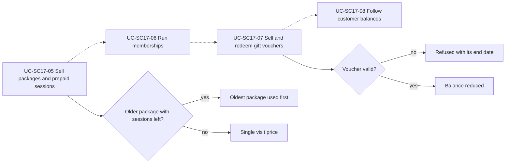
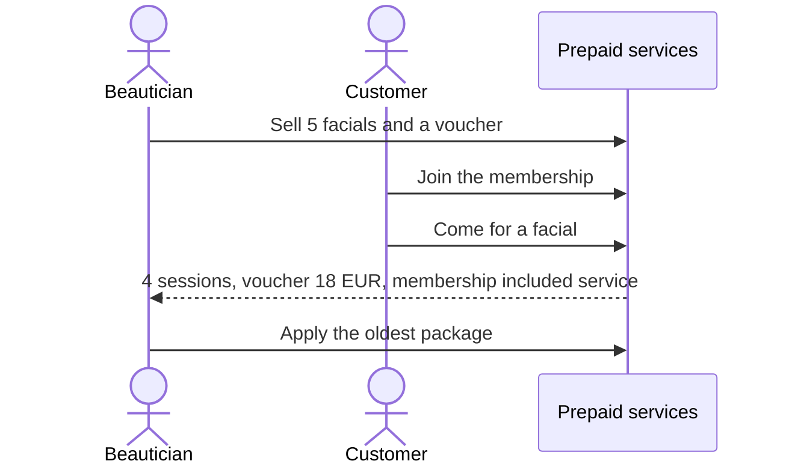

🏠 [Specs](../../../README.md) › 🏷️ [Sectors](../../README.md) › 💇 [SC17 Beauty and wellness](../README.md) ›
🔀 [Flows](README.md) › 🔀 FL-SC17-02 Packages and memberships

# 🔀 FL-SC17-02 Packages and memberships

**Status:** 🔄 waiting for the owner

## Summary

Four situations of prepaid services: selling packages of sessions, running memberships, selling and redeeming gift
vouchers, and showing the customer's balances before each sale
([D561](../../../06-decisions/sectors/d561-benchmark-gaps-sc17-beauty-and-wellness.md)).

## Personas

- [U52 Beautician](../../../01-users/personas/u52-beautician.md), who sells packages and vouchers
- [U09 Customer](../../../01-users/personas/u09-customer.md), who buys and uses them
- [U23 Store manager](../../../01-users/personas/u23-store-manager.md), who runs memberships and reads the balances

## Flowchart

## Sequence diagram

## Steps

| Step | Persona | Screen | Use case | What happens |
|---|---|---|---|---|
| 1 | [U52](../../../01-users/personas/u52-beautician.md) | [S-SC17-05](../screens/02-packages-and-memberships/s-sc17-05-packages.md) | [UC-SC17-05](../use-cases/02-packages-and-memberships/uc-sc17-05-sell-packages-and-prepaid-sessions.md) | The beautician sells a package of sessions and each visit takes one, oldest first |
| 2 | [U23](../../../01-users/personas/u23-store-manager.md) | [S-SC17-06](../screens/02-packages-and-memberships/s-sc17-06-salon-memberships.md) | [UC-SC17-06](../use-cases/02-packages-and-memberships/uc-sc17-06-run-memberships.md) | The manager sets the plans and signs members up, and the dues are billed monthly |
| 3 | [U52](../../../01-users/personas/u52-beautician.md) | [S-SC17-07](../screens/02-packages-and-memberships/s-sc17-07-gift-vouchers.md) | [UC-SC17-07](../use-cases/02-packages-and-memberships/uc-sc17-07-sell-and-redeem-gift-vouchers.md) | The beautician sells a voucher and redeems it later, with its legal validity |
| 4 | [U23](../../../01-users/personas/u23-store-manager.md) | [S-SC17-08](../screens/02-packages-and-memberships/s-sc17-08-customer-balances.md) | [UC-SC17-08](../use-cases/02-packages-and-memberships/uc-sc17-08-follow-customer-balances.md) | The manager reads each customer's sessions, vouchers and points before a sale |

### Entities and screens

| Entity | States in this flow | Shown at step and screen | Aggregated view |
|---|---|---|---|
| [E-SC17-04 Session package](../data/e-sc17-04-session-package.md) | Active, Used up, Expired, Cancelled | 1 [S-SC17-05](../screens/02-packages-and-memberships/s-sc17-05-packages.md) | Session packages |
| [E-SC17-05 Salon membership](../data/e-sc17-05-salon-membership.md) | Active, Paused, Cancelled, Ended | 2 [S-SC17-06](../screens/02-packages-and-memberships/s-sc17-06-salon-memberships.md) | Salon memberships |
| [E-SC17-06 Gift voucher](../data/e-sc17-06-gift-voucher.md) | Issued, Partly used, Redeemed, Expired, Cancelled | 3 [S-SC17-07](../screens/02-packages-and-memberships/s-sc17-07-gift-vouchers.md) | Gift vouchers |

## Errors

- **E1 The package is used up.** The customer's last session was taken: the screen shows no session left and offers a
  new package or the single visit price
  ([BR-SC17-08](../business-rules/br-sc17-08-balances-are-shown-before-each-sale.md), step 4).

## Images

Every step and error, for each persona taking part, in light and dark mode (D120). Steps are numbered as in the Steps
table; E rows are the error cases.

| Step | Persona | Device | Light | Dark |
|---|---|---|---|---|
| 1 | U52 | tablet | [light](../images/02-packages-and-memberships/u52-beautician/1-packages-tablet-light.png) | [dark](../images/02-packages-and-memberships/u52-beautician/1-packages-tablet-dark.png) |
| 1 | U09 | phone | [light](../images/02-packages-and-memberships/u09-customer/1-packages-phone-light.png) | [dark](../images/02-packages-and-memberships/u09-customer/1-packages-phone-dark.png) |
| 1 | U52 | phone | [light](../images/02-packages-and-memberships/u52-beautician/1-packages-phone-light.png) | [dark](../images/02-packages-and-memberships/u52-beautician/1-packages-phone-dark.png) |
| 2 | U23 | desktop | [light](../images/02-packages-and-memberships/u23-store-manager/2-salon-memberships-desktop-light.png) | [dark](../images/02-packages-and-memberships/u23-store-manager/2-salon-memberships-desktop-dark.png) |
| 2 | U09 | phone | [light](../images/02-packages-and-memberships/u09-customer/2-salon-memberships-phone-light.png) | [dark](../images/02-packages-and-memberships/u09-customer/2-salon-memberships-phone-dark.png) |
| 2 | U23 | phone | [light](../images/02-packages-and-memberships/u23-store-manager/2-salon-memberships-phone-light.png) | [dark](../images/02-packages-and-memberships/u23-store-manager/2-salon-memberships-phone-dark.png) |
| 2 | U23 | tablet | [light](../images/02-packages-and-memberships/u23-store-manager/2-salon-memberships-tablet-light.png) | [dark](../images/02-packages-and-memberships/u23-store-manager/2-salon-memberships-tablet-dark.png) |
| 3 | U52 | tablet | [light](../images/02-packages-and-memberships/u52-beautician/3-gift-vouchers-tablet-light.png) | [dark](../images/02-packages-and-memberships/u52-beautician/3-gift-vouchers-tablet-dark.png) |
| 3 | U52 | phone | [light](../images/02-packages-and-memberships/u52-beautician/3-gift-vouchers-phone-light.png) | [dark](../images/02-packages-and-memberships/u52-beautician/3-gift-vouchers-phone-dark.png) |
| 4 | U23 | desktop | [light](../images/02-packages-and-memberships/u23-store-manager/4-customer-balances-desktop-light.png) | [dark](../images/02-packages-and-memberships/u23-store-manager/4-customer-balances-desktop-dark.png) |
| 4 | U23 | phone | [light](../images/02-packages-and-memberships/u23-store-manager/4-customer-balances-phone-light.png) | [dark](../images/02-packages-and-memberships/u23-store-manager/4-customer-balances-phone-dark.png) |
| 4 | U23 | tablet | [light](../images/02-packages-and-memberships/u23-store-manager/4-customer-balances-tablet-light.png) | [dark](../images/02-packages-and-memberships/u23-store-manager/4-customer-balances-tablet-dark.png) |
| E1 | U52 | tablet | [light](../images/02-packages-and-memberships/u52-beautician/e1-the-package-is-used-up-tablet-light.png) | [dark](../images/02-packages-and-memberships/u52-beautician/e1-the-package-is-used-up-tablet-dark.png) |
| E1 | U52 | phone | [light](../images/02-packages-and-memberships/u52-beautician/e1-the-package-is-used-up-phone-light.png) | [dark](../images/02-packages-and-memberships/u52-beautician/e1-the-package-is-used-up-phone-dark.png) |

## Open questions

None.

---

⬅️ [FL-SC17-01 Book staff and cabins](fl-sc17-01-book-staff-and-cabins.md) · ⬆️ [Up](README.md) ·
➡️ [FL-SC17-03 Salon retail and stock](fl-sc17-03-salon-retail-and-stock.md)
