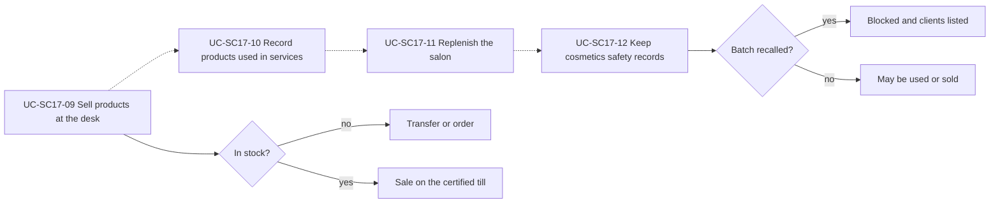
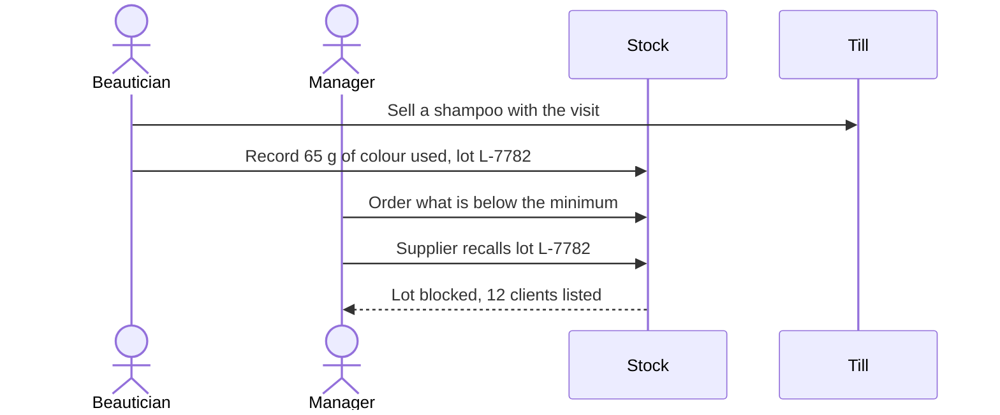

🏠 [Specs](../../../README.md) › 🏷️ [Sectors](../../README.md) › 💇 [SC17 Beauty and wellness](../README.md) ›
🔀 [Flows](README.md) › 🔀 FL-SC17-03 Salon retail and stock

# 🔀 FL-SC17-03 Salon retail and stock

**Status:** 🔄 waiting for the owner

## Summary

Four situations of products in a salon: selling products at the desk on the certified till, recording the products used
in services, replenishing each salon from its own minimum, and keeping the cosmetics safety records
([D561](../../../06-decisions/sectors/d561-benchmark-gaps-sc17-beauty-and-wellness.md)).

## Personas

- [U52 Beautician](../../../01-users/personas/u52-beautician.md), who sells products and records what is used
- [U23 Store manager](../../../01-users/personas/u23-store-manager.md), who orders and keeps the safety records

## Flowchart

## Sequence diagram

## Steps

| Step | Persona | Screen | Use case | What happens |
|---|---|---|---|---|
| 1 | [U52](../../../01-users/personas/u52-beautician.md) | [S-SC17-09](../screens/03-salon-retail-and-stock/s-sc17-09-salon-retail.md) | [UC-SC17-09](../use-cases/03-salon-retail-and-stock/uc-sc17-09-sell-products-at-the-desk.md) | The beautician sells products with the visit on the certified till |
| 2 | [U52](../../../01-users/personas/u52-beautician.md) | [S-SC17-10](../screens/03-salon-retail-and-stock/s-sc17-10-back-bar.md) | [UC-SC17-10](../use-cases/03-salon-retail-and-stock/uc-sc17-10-record-products-used-in-services.md) | The beautician records the products used up in each service, with the lot |
| 3 | [U23](../../../01-users/personas/u23-store-manager.md) | [S-SC17-11](../screens/03-salon-retail-and-stock/s-sc17-11-salon-replenishment.md) | [UC-SC17-11](../use-cases/03-salon-retail-and-stock/uc-sc17-11-replenish-the-salon.md) | The manager orders what is below the minimum of the salon and receives it |
| 4 | [U23](../../../01-users/personas/u23-store-manager.md) | [S-SC17-12](../screens/03-salon-retail-and-stock/s-sc17-12-cosmetics-safety.md) | [UC-SC17-12](../use-cases/03-salon-retail-and-stock/uc-sc17-12-keep-cosmetics-safety-records.md) | The manager keeps the sheets and batches and blocks and traces a recalled batch |

### Entities and screens

| Entity | States in this flow | Shown at step and screen | Aggregated view |
|---|---|---|---|
| [E-SC17-07 Product use](../data/e-sc17-07-product-use.md) | Recorded, Posted, Cancelled | 2 [S-SC17-10](../screens/03-salon-retail-and-stock/s-sc17-10-back-bar.md) | Product uses |
| [E-SC17-08 Safety record](../data/e-sc17-08-safety-record.md) | Current, Recalled, Expired, Archived | 4 [S-SC17-12](../screens/03-salon-retail-and-stock/s-sc17-12-cosmetics-safety.md) | Safety records |

## Errors

- **E1 The product is out of stock.** The line cannot be sold: the screen shows the stock of the other salons and
  proposes a transfer or an order
  ([BR-SC17-09](../business-rules/br-sc17-09-retail-sales-go-through-the-certified-till.md), step 1).

## Images

Every step and error, for each persona taking part, in light and dark mode (D120). Steps are numbered as in the Steps
table; E rows are the error cases.

| Step | Persona | Device | Light | Dark |
|---|---|---|---|---|
| 1 | U52 | tablet | [light](../images/03-salon-retail-and-stock/u52-beautician/1-salon-retail-tablet-light.png) | [dark](../images/03-salon-retail-and-stock/u52-beautician/1-salon-retail-tablet-dark.png) |
| 1 | U52 | phone | [light](../images/03-salon-retail-and-stock/u52-beautician/1-salon-retail-phone-light.png) | [dark](../images/03-salon-retail-and-stock/u52-beautician/1-salon-retail-phone-dark.png) |
| 2 | U52 | tablet | [light](../images/03-salon-retail-and-stock/u52-beautician/2-back-bar-tablet-light.png) | [dark](../images/03-salon-retail-and-stock/u52-beautician/2-back-bar-tablet-dark.png) |
| 2 | U52 | phone | [light](../images/03-salon-retail-and-stock/u52-beautician/2-back-bar-phone-light.png) | [dark](../images/03-salon-retail-and-stock/u52-beautician/2-back-bar-phone-dark.png) |
| 3 | U23 | desktop | [light](../images/03-salon-retail-and-stock/u23-store-manager/3-salon-replenishment-desktop-light.png) | [dark](../images/03-salon-retail-and-stock/u23-store-manager/3-salon-replenishment-desktop-dark.png) |
| 3 | U23 | phone | [light](../images/03-salon-retail-and-stock/u23-store-manager/3-salon-replenishment-phone-light.png) | [dark](../images/03-salon-retail-and-stock/u23-store-manager/3-salon-replenishment-phone-dark.png) |
| 3 | U23 | tablet | [light](../images/03-salon-retail-and-stock/u23-store-manager/3-salon-replenishment-tablet-light.png) | [dark](../images/03-salon-retail-and-stock/u23-store-manager/3-salon-replenishment-tablet-dark.png) |
| 4 | U23 | desktop | [light](../images/03-salon-retail-and-stock/u23-store-manager/4-cosmetics-safety-desktop-light.png) | [dark](../images/03-salon-retail-and-stock/u23-store-manager/4-cosmetics-safety-desktop-dark.png) |
| 4 | U23 | phone | [light](../images/03-salon-retail-and-stock/u23-store-manager/4-cosmetics-safety-phone-light.png) | [dark](../images/03-salon-retail-and-stock/u23-store-manager/4-cosmetics-safety-phone-dark.png) |
| 4 | U23 | tablet | [light](../images/03-salon-retail-and-stock/u23-store-manager/4-cosmetics-safety-tablet-light.png) | [dark](../images/03-salon-retail-and-stock/u23-store-manager/4-cosmetics-safety-tablet-dark.png) |
| E1 | U52 | tablet | [light](../images/03-salon-retail-and-stock/u52-beautician/e1-the-product-is-out-of-stock-tablet-light.png) | [dark](../images/03-salon-retail-and-stock/u52-beautician/e1-the-product-is-out-of-stock-tablet-dark.png) |
| E1 | U52 | phone | [light](../images/03-salon-retail-and-stock/u52-beautician/e1-the-product-is-out-of-stock-phone-light.png) | [dark](../images/03-salon-retail-and-stock/u52-beautician/e1-the-product-is-out-of-stock-phone-dark.png) |

## Open questions

None.

---

⬅️ [FL-SC17-02 Packages and memberships](fl-sc17-02-packages-and-memberships.md) · ⬆️ [Up](README.md) ·
➡️ [FL-SC17-04 Commissions and tips](fl-sc17-04-commissions-and-tips.md)
