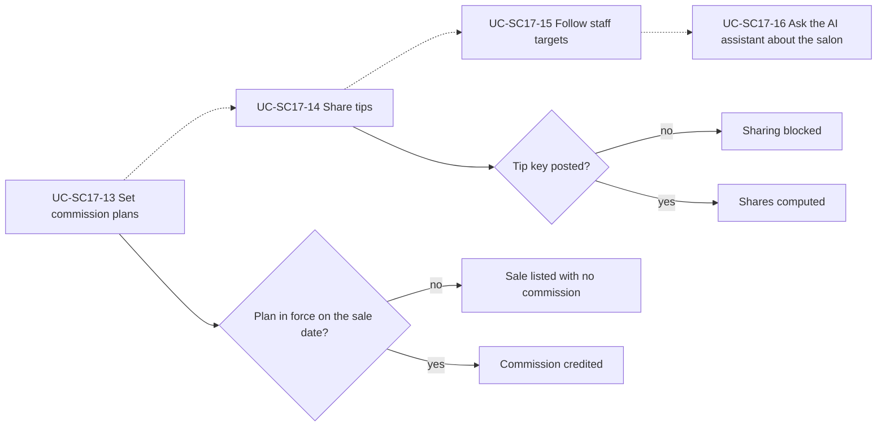
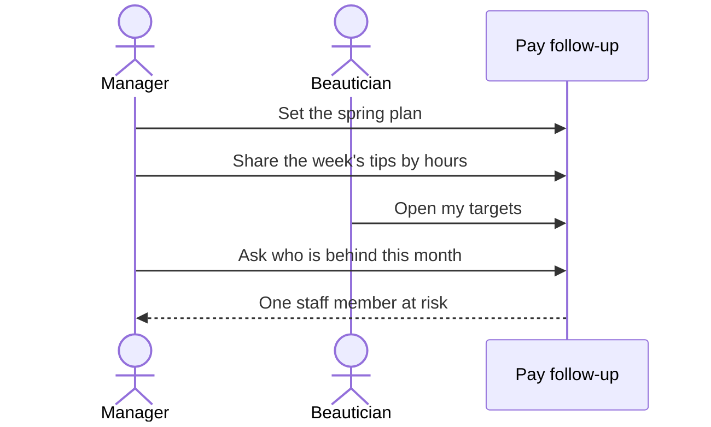

🏠 [Specs](../../../README.md) › 🏷️ [Sectors](../../README.md) › 💇 [SC17 Beauty and wellness](../README.md) ›
🔀 [Flows](README.md) › 🔀 FL-SC17-04 Commissions and tips

# 🔀 FL-SC17-04 Commissions and tips

**Status:** ✅ specified

## Summary

Four situations of staff pay and follow-up: setting commission plans, sharing tips, following staff targets, and asking
the AI assistant about the salon
([D561](../../../06-decisions/sectors/d561-benchmark-gaps-sc17-beauty-and-wellness.md)).

## Personas

- [U23 Store manager](../../../01-users/personas/u23-store-manager.md), who sets plans, shares tips and asks the AI
  assistant
- [U52 Beautician](../../../01-users/personas/u52-beautician.md), who reads their own tips and targets

## Flowchart

## Sequence diagram

## Steps

| Step | Persona | Screen | Use case | What happens |
|---|---|---|---|---|
| 1 | [U23](../../../01-users/personas/u23-store-manager.md) | [S-SC17-13](../screens/04-commissions-and-tips/s-sc17-13-commission-plans.md) | [UC-SC17-13](../use-cases/04-commissions-and-tips/uc-sc17-13-set-commission-plans.md) | The manager sets the rates, the tiers and the dates of each commission plan |
| 2 | [U23](../../../01-users/personas/u23-store-manager.md) | [S-SC17-14](../screens/04-commissions-and-tips/s-sc17-14-salon-tips.md) | [UC-SC17-14](../use-cases/04-commissions-and-tips/uc-sc17-14-share-tips.md) | The manager shares the tips of the period by the posted rule and pays the shares |
| 3 | [U23](../../../01-users/personas/u23-store-manager.md) | [S-SC17-15](../screens/04-commissions-and-tips/s-sc17-15-staff-targets.md) | [UC-SC17-15](../use-cases/04-commissions-and-tips/uc-sc17-15-follow-staff-targets.md) | The manager and each beautician follow targets, each seeing what their role allows |
| 4 | [U23](../../../01-users/personas/u23-store-manager.md) | [S-SC17-16](../screens/04-commissions-and-tips/s-sc17-16-salon-assistant.md) | [UC-SC17-16](../use-cases/04-commissions-and-tips/uc-sc17-16-ask-the-assistant-about-the-salon.md) | The manager asks the AI assistant about the salon and confirms what it prepares |

### Entities and screens

| Entity | States in this flow | Shown at step and screen | Aggregated view |
|---|---|---|---|
| [E-SC17-09 Salon commission plan](../data/e-sc17-09-commission-plan.md) | Draft, In force, Ended, Cancelled | 1 [S-SC17-13](../screens/04-commissions-and-tips/s-sc17-13-commission-plans.md) | Commission plans |
| [E-SC17-10 Tip](../data/e-sc17-10-tip.md) | Received, Shared, Paid, Reversed | 2 [S-SC17-14](../screens/04-commissions-and-tips/s-sc17-14-salon-tips.md) | Tips |

## Errors

- **E1 No commission plan is in force.** A sale has no plan for its seller on its date: it is listed to the manager and
  no commission is credited until a plan is assigned
  ([BR-SC17-13](../business-rules/br-sc17-13-commissions-follow-the-plan-in-force-on-the-sale-date.md), step 1).

## Images

Every step and error, for each persona taking part, in light and dark mode (D120). Steps are numbered as in the Steps
table; E rows are the error cases.

| Step | Persona | Device | Light | Dark |
|---|---|---|---|---|
| 1 | U23 | desktop | [light](../images/04-commissions-and-tips/u23-store-manager/1-commission-plans-desktop-light.png) | [dark](../images/04-commissions-and-tips/u23-store-manager/1-commission-plans-desktop-dark.png) |
| 1 | U23 | phone | [light](../images/04-commissions-and-tips/u23-store-manager/1-commission-plans-phone-light.png) | [dark](../images/04-commissions-and-tips/u23-store-manager/1-commission-plans-phone-dark.png) |
| 1 | U23 | tablet | [light](../images/04-commissions-and-tips/u23-store-manager/1-commission-plans-tablet-light.png) | [dark](../images/04-commissions-and-tips/u23-store-manager/1-commission-plans-tablet-dark.png) |
| 2 | U23 | desktop | [light](../images/04-commissions-and-tips/u23-store-manager/2-salon-tips-desktop-light.png) | [dark](../images/04-commissions-and-tips/u23-store-manager/2-salon-tips-desktop-dark.png) |
| 2 | U52 | tablet | [light](../images/04-commissions-and-tips/u52-beautician/2-salon-tips-tablet-light.png) | [dark](../images/04-commissions-and-tips/u52-beautician/2-salon-tips-tablet-dark.png) |
| 2 | U23 | phone | [light](../images/04-commissions-and-tips/u23-store-manager/2-salon-tips-phone-light.png) | [dark](../images/04-commissions-and-tips/u23-store-manager/2-salon-tips-phone-dark.png) |
| 2 | U23 | tablet | [light](../images/04-commissions-and-tips/u23-store-manager/2-salon-tips-tablet-light.png) | [dark](../images/04-commissions-and-tips/u23-store-manager/2-salon-tips-tablet-dark.png) |
| 3 | U23 | desktop | [light](../images/04-commissions-and-tips/u23-store-manager/3-staff-targets-desktop-light.png) | [dark](../images/04-commissions-and-tips/u23-store-manager/3-staff-targets-desktop-dark.png) |
| 3 | U52 | tablet | [light](../images/04-commissions-and-tips/u52-beautician/3-staff-targets-tablet-light.png) | [dark](../images/04-commissions-and-tips/u52-beautician/3-staff-targets-tablet-dark.png) |
| 3 | U23 | phone | [light](../images/04-commissions-and-tips/u23-store-manager/3-staff-targets-phone-light.png) | [dark](../images/04-commissions-and-tips/u23-store-manager/3-staff-targets-phone-dark.png) |
| 3 | U23 | tablet | [light](../images/04-commissions-and-tips/u23-store-manager/3-staff-targets-tablet-light.png) | [dark](../images/04-commissions-and-tips/u23-store-manager/3-staff-targets-tablet-dark.png) |
| 4 | U23 | phone | [light](../images/04-commissions-and-tips/u23-store-manager/4-salon-assistant-phone-light.png) | [dark](../images/04-commissions-and-tips/u23-store-manager/4-salon-assistant-phone-dark.png) |
| 4 | U23 | desktop | [light](../images/04-commissions-and-tips/u23-store-manager/4-salon-assistant-desktop-light.png) | [dark](../images/04-commissions-and-tips/u23-store-manager/4-salon-assistant-desktop-dark.png) |
| 4 | U23 | tablet | [light](../images/04-commissions-and-tips/u23-store-manager/4-salon-assistant-tablet-light.png) | [dark](../images/04-commissions-and-tips/u23-store-manager/4-salon-assistant-tablet-dark.png) |
| E1 | U23 | desktop | [light](../images/04-commissions-and-tips/u23-store-manager/e1-no-commission-plan-is-in-force-desktop-light.png) | [dark](../images/04-commissions-and-tips/u23-store-manager/e1-no-commission-plan-is-in-force-desktop-dark.png) |
| E1 | U23 | phone | [light](../images/04-commissions-and-tips/u23-store-manager/e1-no-commission-plan-is-in-force-phone-light.png) | [dark](../images/04-commissions-and-tips/u23-store-manager/e1-no-commission-plan-is-in-force-phone-dark.png) |
| E1 | U23 | tablet | [light](../images/04-commissions-and-tips/u23-store-manager/e1-no-commission-plan-is-in-force-tablet-light.png) | [dark](../images/04-commissions-and-tips/u23-store-manager/e1-no-commission-plan-is-in-force-tablet-dark.png) |

## Open questions

None.

---

⬅️ [FL-SC17-03 Salon retail and stock](fl-sc17-03-salon-retail-and-stock.md) · ⬆️ [Up](README.md) ·
➡️ [FL-SC17-05 Rentals, care records, client files and loyalty](fl-sc17-05-rentals-care-records-and-loyalty.md)
