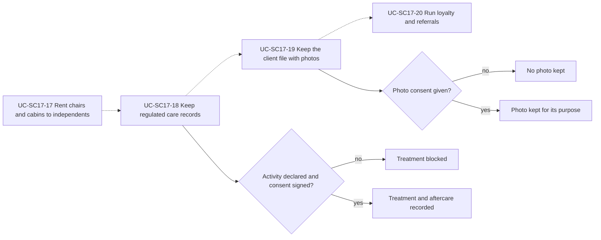
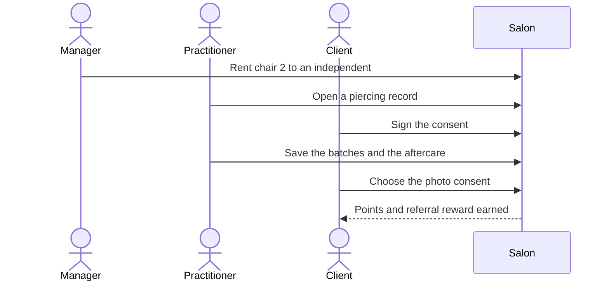

🏠 [Specs](../../../README.md) › 🏷️ [Sectors](../../README.md) › 💇 [SC17 Beauty and wellness](../README.md) ›
🔀 [Flows](README.md) › 🔀 FL-SC17-05 Rentals, care records, client files and loyalty

# 🔀 FL-SC17-05 Rentals, care records, client files and loyalty

**Status:** ✅ specified

## Summary

Four situations the owner added to the salon: renting chairs and cabins to independents, keeping regulated care records,
keeping the client file with photos, and running loyalty and referrals. Employees and renters work side by side
([D561](../../../06-decisions/sectors/d561-benchmark-gaps-sc17-beauty-and-wellness.md)).

## Personas

- [U23 Store manager](../../../01-users/personas/u23-store-manager.md), who signs renters and runs loyalty
- [U52 Beautician](../../../01-users/personas/u52-beautician.md), who records care and keeps client files
- [U09 Customer](../../../01-users/personas/u09-customer.md), who consents to photos and earns rewards

## Flowchart

## Sequence diagram

## Steps

| Step | Persona | Screen | Use case | What happens |
|---|---|---|---|---|
| 1 | [U23](../../../01-users/personas/u23-store-manager.md) | [S-SC17-17](../screens/05-rentals-care-records-and-loyalty/s-sc17-17-chair-rental.md) | [UC-SC17-17](../use-cases/05-rentals-care-records-and-loyalty/uc-sc17-17-rent-chairs-and-cabins-to-independents.md) | The manager signs a rental contract with an independent who keeps their own clients and invoices |
| 2 | [U52](../../../01-users/personas/u52-beautician.md) | [S-SC17-18](../screens/05-rentals-care-records-and-loyalty/s-sc17-18-regulated-care.md) | [UC-SC17-18](../use-cases/05-rentals-care-records-and-loyalty/uc-sc17-18-keep-regulated-care-records.md) | The practitioner records a regulated treatment with the consent, the batches and the aftercare |
| 3 | [U52](../../../01-users/personas/u52-beautician.md) | [S-SC17-19](../screens/05-rentals-care-records-and-loyalty/s-sc17-19-client-file.md) | [UC-SC17-19](../use-cases/05-rentals-care-records-and-loyalty/uc-sc17-19-keep-the-client-file-with-photos.md) | The beautician keeps the client file and photos only with the client's consent |
| 4 | [U23](../../../01-users/personas/u23-store-manager.md) | [S-SC17-20](../screens/05-rentals-care-records-and-loyalty/s-sc17-20-salon-loyalty.md) | [UC-SC17-20](../use-cases/05-rentals-care-records-and-loyalty/uc-sc17-20-run-loyalty-and-referrals.md) | The manager runs the salon's points and referral rewards within the shared loyalty rules |

### Entities and screens

| Entity | States in this flow | Shown at step and screen | Aggregated view |
|---|---|---|---|
| [E-SC17-11 Rental contract](../data/e-sc17-11-rental-contract.md) | Draft, Signed, Active, Ended, Terminated, Cancelled | 1 [S-SC17-17](../screens/05-rentals-care-records-and-loyalty/s-sc17-17-chair-rental.md) | Rental contracts |
| [E-SC17-12 Regulated care record](../data/e-sc17-12-care-record.md) | Prepared, Performed, Refused, Closed | 2 [S-SC17-18](../screens/05-rentals-care-records-and-loyalty/s-sc17-18-regulated-care.md) | Care records |
| [E-SC17-13 Salon client file](../data/e-sc17-13-client-file.md) | Active, Archived, Erased | 3 [S-SC17-19](../screens/05-rentals-care-records-and-loyalty/s-sc17-19-client-file.md) | Client files |

## Errors

- **E1 The consent is missing.** The client has not signed the consent: the treatment or the photo is blocked and
  nothing is saved
  ([BR-SC17-18](../business-rules/br-sc17-18-tattoo-piercing-and-laser-need-the-declared-activity-and-consent.md), step
  2, and [BR-SC17-19](../business-rules/br-sc17-19-photos-are-kept-only-with-the-clients-consent.md), step 3).

## Images

Every step and error, for each persona taking part, in light and dark mode (D120). Steps are numbered as in the Steps
table; E rows are the error cases.

| Step | Persona | Device | Light | Dark |
|---|---|---|---|---|
| 1 | U23 | desktop | [light](../images/05-rentals-care-records-and-loyalty/u23-store-manager/1-chair-rental-desktop-light.png) | [dark](../images/05-rentals-care-records-and-loyalty/u23-store-manager/1-chair-rental-desktop-dark.png) |
| 1 | U52 | tablet | [light](../images/05-rentals-care-records-and-loyalty/u52-beautician/1-chair-rental-tablet-light.png) | [dark](../images/05-rentals-care-records-and-loyalty/u52-beautician/1-chair-rental-tablet-dark.png) |
| 1 | U23 | phone | [light](../images/05-rentals-care-records-and-loyalty/u23-store-manager/1-chair-rental-phone-light.png) | [dark](../images/05-rentals-care-records-and-loyalty/u23-store-manager/1-chair-rental-phone-dark.png) |
| 1 | U23 | tablet | [light](../images/05-rentals-care-records-and-loyalty/u23-store-manager/1-chair-rental-tablet-light.png) | [dark](../images/05-rentals-care-records-and-loyalty/u23-store-manager/1-chair-rental-tablet-dark.png) |
| 2 | U52 | tablet | [light](../images/05-rentals-care-records-and-loyalty/u52-beautician/2-regulated-care-tablet-light.png) | [dark](../images/05-rentals-care-records-and-loyalty/u52-beautician/2-regulated-care-tablet-dark.png) |
| 2 | U52 | phone | [light](../images/05-rentals-care-records-and-loyalty/u52-beautician/2-regulated-care-phone-light.png) | [dark](../images/05-rentals-care-records-and-loyalty/u52-beautician/2-regulated-care-phone-dark.png) |
| 3 | U52 | tablet | [light](../images/05-rentals-care-records-and-loyalty/u52-beautician/3-client-file-tablet-light.png) | [dark](../images/05-rentals-care-records-and-loyalty/u52-beautician/3-client-file-tablet-dark.png) |
| 3 | U09 | phone | [light](../images/05-rentals-care-records-and-loyalty/u09-customer/3-client-file-phone-light.png) | [dark](../images/05-rentals-care-records-and-loyalty/u09-customer/3-client-file-phone-dark.png) |
| 3 | U52 | phone | [light](../images/05-rentals-care-records-and-loyalty/u52-beautician/3-client-file-phone-light.png) | [dark](../images/05-rentals-care-records-and-loyalty/u52-beautician/3-client-file-phone-dark.png) |
| 4 | U23 | desktop | [light](../images/05-rentals-care-records-and-loyalty/u23-store-manager/4-salon-loyalty-desktop-light.png) | [dark](../images/05-rentals-care-records-and-loyalty/u23-store-manager/4-salon-loyalty-desktop-dark.png) |
| 4 | U09 | phone | [light](../images/05-rentals-care-records-and-loyalty/u09-customer/4-salon-loyalty-phone-light.png) | [dark](../images/05-rentals-care-records-and-loyalty/u09-customer/4-salon-loyalty-phone-dark.png) |
| 4 | U23 | phone | [light](../images/05-rentals-care-records-and-loyalty/u23-store-manager/4-salon-loyalty-phone-light.png) | [dark](../images/05-rentals-care-records-and-loyalty/u23-store-manager/4-salon-loyalty-phone-dark.png) |
| 4 | U23 | tablet | [light](../images/05-rentals-care-records-and-loyalty/u23-store-manager/4-salon-loyalty-tablet-light.png) | [dark](../images/05-rentals-care-records-and-loyalty/u23-store-manager/4-salon-loyalty-tablet-dark.png) |
| E1 | U23 | desktop | [light](../images/05-rentals-care-records-and-loyalty/u23-store-manager/e1-the-consent-is-missing-desktop-light.png) | [dark](../images/05-rentals-care-records-and-loyalty/u23-store-manager/e1-the-consent-is-missing-desktop-dark.png) |
| E1 | U23 | phone | [light](../images/05-rentals-care-records-and-loyalty/u23-store-manager/e1-the-consent-is-missing-phone-light.png) | [dark](../images/05-rentals-care-records-and-loyalty/u23-store-manager/e1-the-consent-is-missing-phone-dark.png) |
| E1 | U23 | tablet | [light](../images/05-rentals-care-records-and-loyalty/u23-store-manager/e1-the-consent-is-missing-tablet-light.png) | [dark](../images/05-rentals-care-records-and-loyalty/u23-store-manager/e1-the-consent-is-missing-tablet-dark.png) |

## Open questions

None.

---

⬅️ [FL-SC17-04 Commissions and tips](fl-sc17-04-commissions-and-tips.md) · ⬆️ [Up](README.md)
