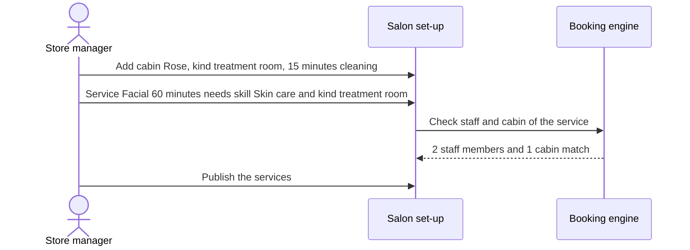

🏠 [Specs](../../../../README.md) › 🏷️ [Sectors](../../../README.md) › 💇 [SC17 Beauty and wellness](../../README.md) ›
📝 [Use cases](../README.md) › 📝 [Use cases: FL-SC17-01 Book staff and cabins](README.md) ›
📝 UC-SC17-01 Set up services, staff and cabins

# 📝 UC-SC17-01 Set up services, staff and cabins

**Status:** ✅ specified

## Summary

The salon manager lists what the salon sells and who and what it needs for each service. A service has a duration, a
cleaning time after it, a price, the skills the staff member needs and the kind of cabin or chair it takes. Staff
members and cabins are bookable resources, so a booking can only land where both are free. The manager also sets the
opening hours, the staff's working days and the cabins that are out of service.

## Personas

- [U23 Store manager](../../../../01-users/personas/u23-store-manager.md)

## Goal

Every service can be booked only where a skilled staff member and a suitable cabin are free, so no customer arrives to
find nobody and nowhere to be served.

## Trigger

The salon opens, a new service or cabin is added, a staff member joins or leaves, or a cabin is closed for works.

## Frequency

Once at set-up, then a few changes a month.

## Preconditions

- The salon exists as a point of sale
  ([E-F10-01](../../../../02-functional/f10-point-of-sale/data/e-f10-01-point-of-sale.md)) with its opening hours.
- The staff members are employee records
  ([E-F9-01](../../../../02-functional/f09-hr-and-projects/data/e-f09-01-employee-record.md)) with their qualifications
  ([E-F9-12](../../../../02-functional/f09-hr-and-projects/data/e-f09-12-certification.md)).
- Services use the appointment types of the shared booking engine
  ([E-F4-11](../../../../02-functional/f04-meetings/data/e-f04-11-appointment-type.md),
  [E-F2-17](../../../../02-functional/f02-no-code-configuration/data/e-f02-17-bookable-resource-setting.md)).

## Postconditions

- **Succeeded:** the cabin is saved ([E-SC17-01 Cabin](../../data/e-sc17-01-cabin.md)) and every service lists its staff
  skills and cabin kind; the calendars of staff and cabins are ready to be booked.
- **Failed:** nothing is bookable for the incomplete service; the missing skill, duration or cabin kind is shown.

## Main flow

1. The manager opens the salon set-up screen
   ([S-SC17-01 Salon set-up](../../screens/01-book-staff-and-cabins/s-sc17-01-salon-setup.md)) and adds a cabin, a chair
   or a treatment room with its kind, its equipment and the cleaning time between two clients.
2. The manager opens a service (an appointment type) and sets its duration, its price, the skills it needs and the kind
   of cabin it takes
   [UC-F2-18](../../../../02-functional/f02-no-code-configuration/use-cases/08-views-and-bookings/uc-f02-18-make-a-record-type-bookable.md).
3. The manager sets each staff member's skills, working days and the cabins they may use.
4. SimpleERP checks the set-up: every service has at least one staff member and one cabin kind that match
   ([BR-SC17-01](../../business-rules/br-sc17-01-a-booking-needs-a-free-staff-member-and-cabin.md)).
5. The manager publishes the services; staff and cabins appear in the booking calendars.
6. Later, the manager marks a cabin Out of service for works and its future bookings are listed to move.

## Alternative flows

- 2a. A service needs two staff members at once (a duo massage): both skills are listed and both calendars must be free.
- 3a. A staff member is an independent who rents a chair: their own services and calendar are set from their rental
  contract ([UC-SC17-17](../05-rentals-care-records-and-loyalty/uc-sc17-17-rent-chairs-and-cabins-to-independents.md)),
  not by the manager.
- 6a. The cabin is closed for one day only: the bookings of that day are moved to another cabin of the same kind when
  one is free.

## Error flows

- 4e. A service has no staff member with the skill: it stays hidden from online booking and the manager is told which
  skill is missing.
- 4e. A cabin kind has no cabin left: the services that need it are flagged as not bookable.
- 6e. A closed cabin has future bookings with no other cabin free: the bookings are listed and the manager must move or
  cancel each one.
- Any step: a service does not answer; the call is retried first
  ([BR-F3-32](../../../../02-functional/f03-assistant/business-rules/br-f03-32-retry-before-an-error.md)), then the
  message follows the error pattern ([D122](../../../../06-decisions/ux/d122-error-message-standard.md)) and what the
  user typed stays on the screen.

## Business rules

- [BR-SC17-01](../../business-rules/br-sc17-01-a-booking-needs-a-free-staff-member-and-cabin.md)
- [BR-SC17-02](../../business-rules/br-sc17-02-online-slots-follow-staff-skills.md)

## Entities

- [E-SC17-01 Cabin](../../data/e-sc17-01-cabin.md): created, changed
- [E-F4-11](../../../../02-functional/f04-meetings/data/e-f04-11-appointment-type.md): read and changed, the services as
  appointment types
- [E-F2-17](../../../../02-functional/f02-no-code-configuration/data/e-f02-17-bookable-resource-setting.md): read, the
  booking settings of the cabin and the staff calendars
- [E-F9-01](../../../../02-functional/f09-hr-and-projects/data/e-f09-01-employee-record.md): read, the staff members and
  their skills

## Permissions

Store manager creates and changes cabins, services and skills; the beautician reads them. An independent
renter changes only their own services.

## Notifications

The manager, in the app: a service has no free staff member for the next two weeks; a cabin out of service still has
bookings.

## Audit events

Each cabin, service, skill and opening-hour change, with who, when and the old value; each cabin closure and the
bookings it affected.

## AI involvement

No AI step of its own. The AI assistant may open the screen and prefill it from the user's words; the user checks and
confirms
[BR-F3-07](../../../../02-functional/f03-assistant/business-rules/br-f03-07-no-deletes-no-irreversible-acts.md).

## API, MCP and A2A exposure

T5 operations of the capability for the personas above: create, read, update and list. The MCP tool of the
capability may read and propose, never confirm alone. No A2A skill.

## Screens

- [S-SC17-01 Salon set-up](../../screens/01-book-staff-and-cabins/s-sc17-01-salon-setup.md)

## Flowchart

See [FL-SC17-01 Book staff and cabins](../../flows/fl-sc17-01-book-staff-and-cabins.md#flowchart).

## Sequence diagram

## Acceptance criteria

1. **Given** a service that needs the skill Skin care and one staff member who has it **when** the manager publishes it
   **then** the service is bookable in that staff member's free slots.
2. **Given** a service with no matching staff member **when** the manager publishes it **then** it stays hidden and the
   missing skill is named.
3. **Given** a cabin set Out of service for a week with 3 bookings in it **when** the manager saves **then** the 3
   bookings are listed to move.
4. **Given** a cleaning time of 15 minutes after a service **when** two bookings follow in the same cabin **then** the
   second one starts 15 minutes after the first ends.

## Non-functional notes

The screen answers within 2 seconds for 10,000 records; every change is audited.

## Regulatory references

None specific to this use case beyond the rules above.

## Related use cases

- [UC-SC17-02 Let customers book online](uc-sc17-02-let-customers-book-online.md)
- [UC-F4-18](../../../../02-functional/f04-meetings/use-cases/10-benchmark-additions/uc-f04-18-let-customers-book-appointments.md)
- [UC-F2-19](../../../../02-functional/f02-no-code-configuration/use-cases/08-views-and-bookings/uc-f02-19-book-a-resource.md)

## Open questions

None.

---

⬆️ [Up](README.md) · ➡️ [UC-SC17-02 Let customers book online](uc-sc17-02-let-customers-book-online.md)
