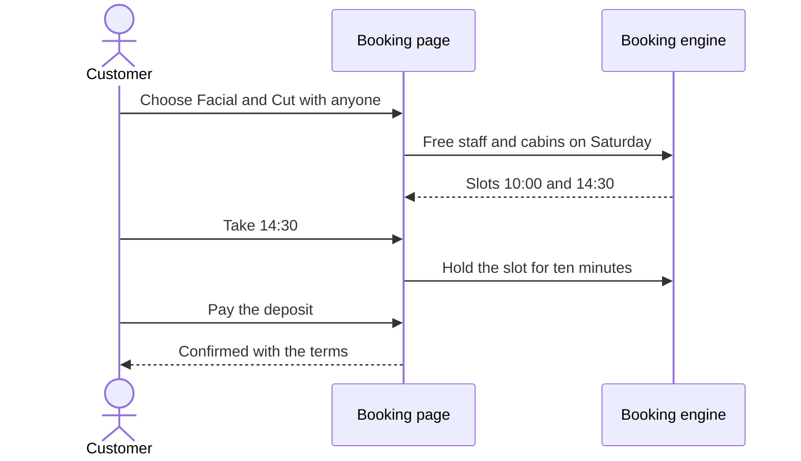

🏠 [Specs](../../../../README.md) › 🏷️ [Sectors](../../../README.md) › 💇 [SC17 Beauty and wellness](../../README.md) ›
📝 [Use cases](../README.md) › 📝 [Use cases: FL-SC17-01 Book staff and cabins](README.md) ›
📝 UC-SC17-02 Let customers book online

# 📝 UC-SC17-02 Let customers book online

**Status:** ✅ specified

## Summary

A customer books a visit on the salon's page, on a phone. They choose one or more services, a staff member or 'anyone',
and a time among the slots the salon offers. The slot is held while the customer pays the deposit, when the salon asks
for one, and is confirmed by a message. The customer can move or cancel the visit from the same page until the free
cancellation time.

## Personas

- [U09 Customer](../../../../01-users/personas/u09-customer.md)

## Goal

A customer books a visit in a minute, on a slot that is really free, and receives a confirmation; the salon fills its
calendar without answering the phone.

## Trigger

A customer opens the salon's booking page or follows a link from a message or a social post.

## Frequency

Dozens of bookings a day in a busy salon, most outside opening hours.

## Preconditions

- Services, staff skills and cabins are set up ([UC-SC17-01](uc-sc17-01-set-up-services-staff-and-cabins.md)).
- The customer has a customer record or creates one at booking
  ([E-F6-01](../../../../02-functional/f06-customers-and-sales/data/e-f06-01-customer-record.md)).
- The salon's deposit and cancellation terms are published
  ([UC-SC17-04](uc-sc17-04-take-deposits-and-charge-no-shows.md)).

## Postconditions

- **Succeeded:** the booking is saved ([E-SC17-02 Salon booking](../../data/e-sc17-02-salon-booking.md)) with its
  services, staff member, cabin and time, and the customer has a confirmation.
- **Failed:** no slot is kept; the customer sees why (slot taken, deposit not paid) and the nearest free slots.

## Main flow

1. The customer opens the online booking screen
   ([S-SC17-02 Online booking](../../screens/01-book-staff-and-cabins/s-sc17-02-online-booking.md)) and chooses the
   services.
2. SimpleERP shows only the slots where a staff member with the skills and a suitable cabin are free
   ([BR-SC17-02](../../business-rules/br-sc17-02-online-slots-follow-staff-skills.md),
   [BR-SC17-01](../../business-rules/br-sc17-01-a-booking-needs-a-free-staff-member-and-cabin.md)).
3. The customer chooses a staff member or 'anyone' and a slot; the slot is Held for ten minutes.
4. If the salon asks for a deposit, the customer pays it online
   ([UC-SC17-04](uc-sc17-04-take-deposits-and-charge-no-shows.md)).
5. The booking becomes Confirmed and the customer receives the confirmation with the terms and a link to move or cancel.
6. A reminder is sent before the visit, with the same link.

## Alternative flows

- 3a. The customer picks 'anyone': the first free staff member with the skill is assigned and shown on the confirmation.
- 3b. The customer books two services in a row (a cut then a colour): the slots are chained and both staff members and
  cabins are held together.
- 5a. The customer moves the visit before the free cancellation time: the old slot is released and the deposit stays on
  the new booking.

## Error flows

- 3e. The slot is taken while the customer pays: the booking is refused and the nearest free slots are shown
  ([BR-SC17-02](../../business-rules/br-sc17-02-online-slots-follow-staff-skills.md)).
- 4e. The deposit payment fails: the hold ends after ten minutes and the slot is released.
- 5e. The customer has a history of no-shows: the salon may ask a deposit for every booking of that customer, shown
  before they choose.
- Any step: a service does not answer; the call is retried first
  ([BR-F3-32](../../../../02-functional/f03-assistant/business-rules/br-f03-32-retry-before-an-error.md)), then the
  message follows the error pattern ([D122](../../../../06-decisions/ux/d122-error-message-standard.md)) and what the
  user typed stays on the screen.

## Business rules

- [BR-SC17-02](../../business-rules/br-sc17-02-online-slots-follow-staff-skills.md)
- [BR-SC17-01](../../business-rules/br-sc17-01-a-booking-needs-a-free-staff-member-and-cabin.md)
- [BR-SC17-04](../../business-rules/br-sc17-04-no-show-fees-follow-the-published-terms.md)

## Entities

- [E-SC17-02 Salon booking](../../data/e-sc17-02-salon-booking.md): created, changed
- [E-F2-18](../../../../02-functional/f02-no-code-configuration/data/e-f02-18-resource-booking.md): created, the
  resource bookings of the staff member and the cabin
- [E-F6-01](../../../../02-functional/f06-customers-and-sales/data/e-f06-01-customer-record.md): read and changed, the
  customer
- [E-F5-10](../../../../02-functional/f05-social-media/data/e-f05-10-consent-and-suppression-record.md): read, the
  customer's consent for reminders

## Permissions

The customer books and changes their own visits; the beautician and the manager read and change every booking of the
salon. A renter sees only their own bookings.

## Notifications

The customer, with their consent: the confirmation, the reminder 24 hours before, a message if the salon moves the
visit. The beautician: a new booking in their calendar.

## Audit events

Each booking, hold, confirmation, move and cancellation, with who, when and the slot.

## AI involvement

No AI step of its own. The AI assistant may open the screen and prefill it from the user's words; the user checks and
confirms
[BR-F3-07](../../../../02-functional/f03-assistant/business-rules/br-f03-07-no-deletes-no-irreversible-acts.md).

## API, MCP and A2A exposure

T5 operations of the capability for the personas above: create, read, update and list. The MCP tool of the
capability may read and propose, never confirm alone. No A2A skill.

## Screens

- [S-SC17-02 Online booking](../../screens/01-book-staff-and-cabins/s-sc17-02-online-booking.md)

## Flowchart

See [FL-SC17-01 Book staff and cabins](../../flows/fl-sc17-01-book-staff-and-cabins.md#flowchart).

## Sequence diagram

## Acceptance criteria

1. **Given** a service that needs skill Colour and only one colourist on Saturday **when** a customer chooses 'anyone'
   **then** only that colourist's free slots are shown.
2. **Given** a slot held for a customer who has not paid after ten minutes **when** the hold ends **then** the slot is
   free again.
3. **Given** two customers choosing the same last slot **when** both pay **then** the first payment wins and the second
   customer is offered the nearest slots.
4. **Given** a visit moved before the free cancellation time **when** the customer confirms **then** the old slot is
   released and the deposit is kept for the new slot.

## Non-functional notes

The screen answers within 2 seconds for 10,000 records; every change is audited.

## Regulatory references

A booking made online is a distance contract for a service: the customer is told the price, the deposit and
the cancellation terms before they confirm. A service that must be done on a set date may limit the right to withdraw
([CR-FR-036](../../../../10-country-packs/france/consumer/cr-fr-036-withdrawal-right.md)); the pack carries the wording.
Reminders go only to customers who agreed
([CR-FR-063](../../../../10-country-packs/france/consumer/cr-fr-063-electronic-marketing-consent.md)).

## Related use cases

- [UC-SC17-01 Set up services, staff and cabins](uc-sc17-01-set-up-services-staff-and-cabins.md)
- [UC-SC17-03 Book at the desk](uc-sc17-03-book-at-the-desk.md)
- [UC-SC17-03 Book at the desk](uc-sc17-03-book-at-the-desk.md)
- [UC-F4-18](../../../../02-functional/f04-meetings/use-cases/10-benchmark-additions/uc-f04-18-let-customers-book-appointments.md)

## Open questions

None.

---

⬅️ [UC-SC17-01 Set up services, staff and cabins](uc-sc17-01-set-up-services-staff-and-cabins.md) · ⬆️ [Up](README.md) ·
➡️ [UC-SC17-03 Book at the desk](uc-sc17-03-book-at-the-desk.md)
