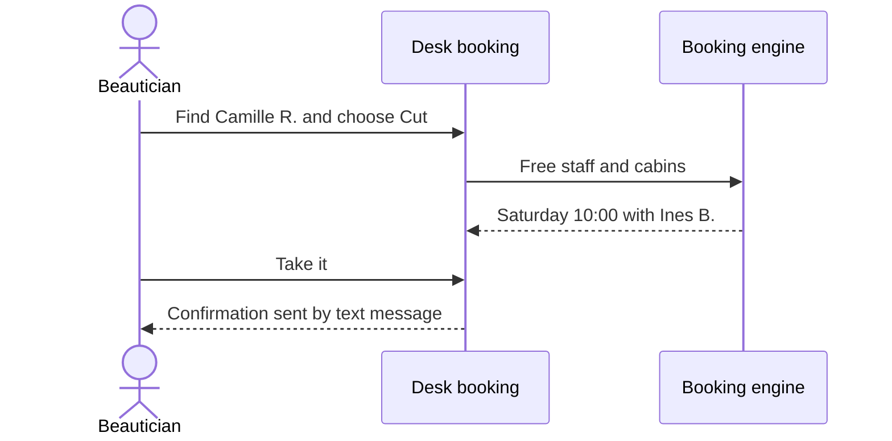

🏠 [Specs](../../../../README.md) › 🏷️ [Sectors](../../../README.md) › 💇 [SC17 Beauty and wellness](../../README.md) ›
📝 [Use cases](../README.md) › 📝 [Use cases: FL-SC17-01 Book staff and cabins](README.md) ›
📝 UC-SC17-03 Book at the desk

# 📝 UC-SC17-03 Book at the desk

**Status:** ✅ specified

## Summary

The beautician or the manager books a visit at the desk or on the phone. The screen proposes the same free slots as the
online page, takes the customer from the customer list, and sends the same confirmation. The beautician can also rebook
the next visit while the customer is still at the chair.

## Personas

- [U52 Beautician](../../../../01-users/personas/u52-beautician.md)

## Goal

A booking made at the desk is as safe as an online one and the customer receives the same confirmation and the same
terms.

## Trigger

A customer asks for a visit at the desk, on the phone, or at the end of a service.

## Frequency

Dozens a day in a salon.

## Preconditions

- Services, staff and cabins are set up ([UC-SC17-01](uc-sc17-01-set-up-services-staff-and-cabins.md)).
- The customer exists or is created on the spot
  ([E-F6-01](../../../../02-functional/f06-customers-and-sales/data/e-f06-01-customer-record.md)).

## Postconditions

- **Succeeded:** the booking is saved ([E-SC17-02 Salon booking](../../data/e-sc17-02-salon-booking.md)) with the
  channel Desk, and the customer receives the same confirmation as an online booking.
- **Failed:** no booking is made; the reason (no free slot, no consent to message) is shown.

## Main flow

1. The beautician opens the desk booking screen
   ([S-SC17-03 Desk booking](../../screens/01-book-staff-and-cabins/s-sc17-03-desk-booking.md)) and finds the customer
   by name or phone.
2. The beautician chooses the services; the screen shows the free staff and cabins with the same rule as the online page
   ([BR-SC17-02](../../business-rules/br-sc17-02-online-slots-follow-staff-skills.md)).
3. The beautician picks a slot, or 'rebook in four weeks' at the chair.
4. If the salon asks a deposit, the beautician sends the payment link or takes the card at the till
   ([UC-SC17-04](uc-sc17-04-take-deposits-and-charge-no-shows.md)).
5. The booking is saved and the confirmation goes out by the customer's chosen channel
   ([BR-SC17-03](../../business-rules/br-sc17-03-desk-bookings-send-the-same-confirmation.md)).
6. The customer's balances are shown before the end
   ([UC-SC17-08](../02-packages-and-memberships/uc-sc17-08-follow-customer-balances.md)).

## Alternative flows

- 2a. The customer has no account: a customer record is created with the name and one contact.
- 5a. The customer refuses messages: the confirmation is printed or read out and the refusal is kept
  ([CR-FR-063](../../../../10-country-packs/france/consumer/cr-fr-063-electronic-marketing-consent.md)).
- 3a. The customer asks for a person who is away: the screen proposes the nearest slots with a colleague who has the
  skills.

## Error flows

- 3e. The slot is taken meanwhile: the screen shows the nearest free slots.
- 4e. The deposit is not paid: the booking stays Held for ten minutes and is then released.
- 5e. The customer has no email or phone: the booking is saved and the confirmation is printed.
- Any step: a service does not answer; the call is retried first
  ([BR-F3-32](../../../../02-functional/f03-assistant/business-rules/br-f03-32-retry-before-an-error.md)), then the
  message follows the error pattern ([D122](../../../../06-decisions/ux/d122-error-message-standard.md)) and what the
  user typed stays on the screen.

## Business rules

- [BR-SC17-03](../../business-rules/br-sc17-03-desk-bookings-send-the-same-confirmation.md)
- [BR-SC17-02](../../business-rules/br-sc17-02-online-slots-follow-staff-skills.md)

## Entities

- [E-SC17-02 Salon booking](../../data/e-sc17-02-salon-booking.md): created and changed, the booking
- [E-F6-01](../../../../02-functional/f06-customers-and-sales/data/e-f06-01-customer-record.md): read and changed, the
  customer
- [E-F5-10](../../../../02-functional/f05-social-media/data/e-f05-10-consent-and-suppression-record.md): read, the
  consent for messages

## Permissions

Beautician and manager book for any customer; a renter books only on their own calendar.

## Notifications

The customer, with their consent: the same confirmation and reminder as an online booking.

## Audit events

Each desk booking with the person who made it, the channel and the time.

## AI involvement

No AI step of its own. The AI assistant may open the screen and prefill it from the user's words; the user checks and
confirms
[BR-F3-07](../../../../02-functional/f03-assistant/business-rules/br-f03-07-no-deletes-no-irreversible-acts.md).

## API, MCP and A2A exposure

T5 operations of the capability for the personas above: create, read, update and list. The MCP tool of the
capability may read and propose, never confirm alone. No A2A skill.

## Screens

- [S-SC17-03 Desk booking](../../screens/01-book-staff-and-cabins/s-sc17-03-desk-booking.md)

## Flowchart

See [FL-SC17-01 Book staff and cabins](../../flows/fl-sc17-01-book-staff-and-cabins.md#flowchart).

## Sequence diagram

## Acceptance criteria

1. **Given** a customer standing at the desk **when** the beautician books the next visit **then** the customer gets the
   same confirmation as online.
2. **Given** a customer who refused messages **when** the beautician saves the booking **then** the confirmation is
   printed and no message is sent.
3. **Given** a slot taken meanwhile **when** the beautician saves **then** the nearest slots are shown.
4. **Given** a desk booking with a deposit asked **when** the card is declined **then** the booking is released after
   ten minutes.

## Non-functional notes

The screen answers within 2 seconds for 10,000 records; every change is audited.

## Regulatory references

The same information before the booking as online: price, deposit and cancellation terms
([CR-FR-036](../../../../10-country-packs/france/consumer/cr-fr-036-withdrawal-right.md)); messages only with consent
([CR-FR-063](../../../../10-country-packs/france/consumer/cr-fr-063-electronic-marketing-consent.md)).

## Related use cases

- [UC-SC17-02 Let customers book online](uc-sc17-02-let-customers-book-online.md)
- [UC-SC17-04 Take deposits and charge no-shows](uc-sc17-04-take-deposits-and-charge-no-shows.md)
- [UC-SC17-02 Let customers book online](uc-sc17-02-let-customers-book-online.md)
- [UC-SC17-04 Take deposits and charge no-shows](uc-sc17-04-take-deposits-and-charge-no-shows.md)

## Open questions

None.

---

⬅️ [UC-SC17-02 Let customers book online](uc-sc17-02-let-customers-book-online.md) · ⬆️ [Up](README.md) ·
➡️ [UC-SC17-04 Take deposits and charge no-shows](uc-sc17-04-take-deposits-and-charge-no-shows.md)
