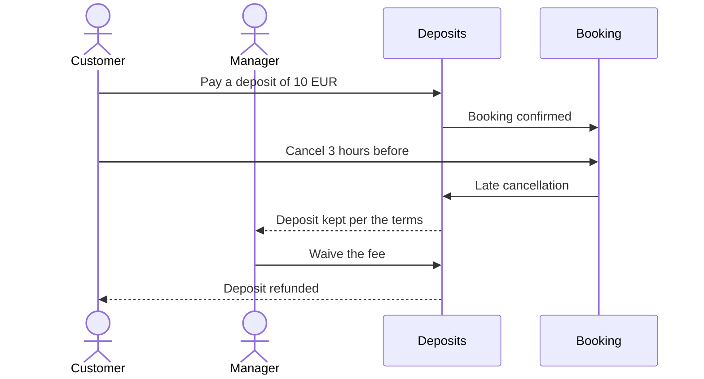

🏠 [Specs](../../../../README.md) › 🏷️ [Sectors](../../../README.md) › 💇 [SC17 Beauty and wellness](../../README.md) ›
📝 [Use cases](../README.md) › 📝 [Use cases: FL-SC17-01 Book staff and cabins](README.md) ›
📝 UC-SC17-04 Take deposits and charge no-shows

# 📝 UC-SC17-04 Take deposits and charge no-shows

**Status:** ✅ specified

## Summary

A salon can ask for a deposit when a customer books and can charge a no-show fee when the customer neither comes nor
cancels in time. The manager sets the terms once: which services need a deposit, its amount, the free cancellation time
and the fee. The terms are shown to the customer before they book and the fee is applied from the booking's own record.

## Personas

- [U23 Store manager](../../../../01-users/personas/u23-store-manager.md)
- [U09 Customer](../../../../01-users/personas/u09-customer.md)

## Goal

Salons lose fewer slots to no-shows, and a customer is never charged a fee they were not told about.

## Trigger

A booking needs a deposit, a customer cancels, or a booking passes its time with nobody arrived.

## Frequency

A deposit on every long service, a few no-shows a week.

## Preconditions

- Deposit and cancellation terms are set by the manager.
- The booking exists ([E-SC17-02 Salon booking](../../data/e-sc17-02-salon-booking.md)).
- The customer paid or gave a card for the deposit
  ([E-F6-06](../../../../02-functional/f06-customers-and-sales/data/e-f06-06-customer-payment.md)).

## Postconditions

- **Succeeded:** the deposit is saved ([E-SC17-03 Booking deposit](../../data/e-sc17-03-booking-deposit.md)) and is
  applied to the bill, kept or refunded as the terms say.
- **Failed:** no fee is charged; the missing terms or the late notice is shown to the manager.

## Main flow

1. The manager opens the deposits screen
   ([S-SC17-04](../../screens/01-book-staff-and-cabins/s-sc17-04-deposits-and-no-shows.md)) and sets the terms: the
   services that need a deposit, its amount, the free cancellation time and the no-show fee.
2. When a customer books, SimpleERP shows the terms and takes the deposit
   ([UC-SC17-02](uc-sc17-02-let-customers-book-online.md)).
3. If the customer cancels before the free cancellation time, the deposit is refunded or kept as credit.
4. If the customer cancels late or does not come, the booking becomes No show and the deposit is Kept
   ([BR-SC17-04](../../business-rules/br-sc17-04-no-show-fees-follow-the-published-terms.md)).
5. If the customer comes, the deposit is Applied to the final bill at the till.
6. The manager reads the list of deposits to settle and the no-show rate.

## Alternative flows

- 3a. The salon cancels the visit: the deposit is always refunded in full.
- 4a. The manager waives the fee for a good reason: the deposit is refunded and the reason is recorded.
- 4b. The no-show fee is higher than the deposit: the difference is invoiced to the customer only if the published terms
  said so.

## Error flows

- 4e. The terms were not shown before the booking: the fee is blocked and the manager is told.
- 2e. The deposit payment fails: the booking is not confirmed and the slot is released.
- 5e. The refund cannot go to the original card: the manager chooses a credit note or a transfer.
- Any step: a service does not answer; the call is retried first
  ([BR-F3-32](../../../../02-functional/f03-assistant/business-rules/br-f03-32-retry-before-an-error.md)), then the
  message follows the error pattern ([D122](../../../../06-decisions/ux/d122-error-message-standard.md)) and what the
  user typed stays on the screen.

## Business rules

- [BR-SC17-04](../../business-rules/br-sc17-04-no-show-fees-follow-the-published-terms.md)
- [BR-SC17-02](../../business-rules/br-sc17-02-online-slots-follow-staff-skills.md)

## Entities

- [E-SC17-03 Booking deposit](../../data/e-sc17-03-booking-deposit.md): created, changed
- [E-SC17-02 Salon booking](../../data/e-sc17-02-salon-booking.md): read and changed, the booking and its state
- [E-F6-06](../../../../02-functional/f06-customers-and-sales/data/e-f06-06-customer-payment.md): read, the customer's
  payment
- [E-F10-04](../../../../02-functional/f10-point-of-sale/data/e-f10-04-till-payment.md): read, the till payment that
  applies the deposit

## Permissions

Manager sets the terms and waives fees; beautician takes and applies deposits; the customer sees their own deposits.
Only the manager may waive a fee.

## Notifications

The customer, with their consent: the deposit receipt, the refund and the fee notice. The manager: the no-shows of the
day.

## Audit events

Each deposit taken, applied, kept or refunded, each fee and each waiver, with who, when and the terms shown to the
customer.

## AI involvement

No AI step of its own. The AI assistant may open the screen and prefill it from the user's words; the user checks and
confirms
[BR-F3-07](../../../../02-functional/f03-assistant/business-rules/br-f03-07-no-deletes-no-irreversible-acts.md).

## API, MCP and A2A exposure

T5 operations of the capability for the personas above: create, read, update and list. The MCP tool of the
capability may read and propose, never confirm alone. No A2A skill.

## Screens

- [S-SC17-04](../../screens/01-book-staff-and-cabins/s-sc17-04-deposits-and-no-shows.md)

## Flowchart

See [FL-SC17-01 Book staff and cabins](../../flows/fl-sc17-01-book-staff-and-cabins.md#flowchart).

## Sequence diagram

## Acceptance criteria

1. **Given** a deposit of 10 EUR and a free cancellation until 24 hours before **when** the customer cancels 30 hours
   before **then** the deposit is refunded.
2. **Given** the same terms **when** the customer does not come **then** the booking is No show and the deposit is Kept.
3. **Given** a salon that cancels **when** the booking is cancelled by the salon **then** the deposit is refunded in
   full.
4. **Given** terms not shown at booking **when** the manager tries to keep the deposit **then** it is blocked.

## Non-functional notes

The screen answers within 2 seconds for 10,000 records; every change is audited.

## Regulatory references

A deposit is a payment on account of the price and is refunded or kept according to the terms the customer
accepted before paying; the fee for a missed visit must be in those terms. Where the booking is made at a distance, the
withdrawal right and its limits are shown
([CR-FR-036](../../../../10-country-packs/france/consumer/cr-fr-036-withdrawal-right.md)). The France-pack rule is
written later.

## Related use cases

- [UC-SC17-03 Book at the desk](uc-sc17-03-book-at-the-desk.md)
- [UC-SC17-02 Let customers book online](uc-sc17-02-let-customers-book-online.md)
- [UC-SC17-03 Book at the desk](uc-sc17-03-book-at-the-desk.md)
- [UC-SC17-09](../03-salon-retail-and-stock/uc-sc17-09-sell-products-at-the-desk.md)

## Open questions

None.

---

⬅️ [UC-SC17-03 Book at the desk](uc-sc17-03-book-at-the-desk.md) · ⬆️ [Up](README.md) ·
➡️ [UC-SC17-05](../02-packages-and-memberships/uc-sc17-05-sell-packages-and-prepaid-sessions.md)
