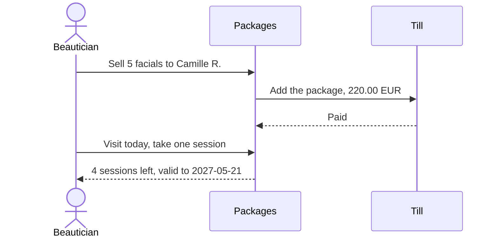

🏠 [Specs](../../../../README.md) › 🏷️ [Sectors](../../../README.md) › 💇 [SC17 Beauty and wellness](../../README.md) ›
📝 [Use cases](../README.md) › 📝 [Use cases: FL-SC17-02 Packages and memberships](README.md) ›
📝 UC-SC17-05 Sell packages and prepaid sessions

# 📝 UC-SC17-05 Sell packages and prepaid sessions

**Status:** ✅ specified

## Summary

A salon sells a package of sessions of one service (five facials, ten massages) at a lower price per session. The
beautician sells it at the desk or the customer buys it online. Each time the customer comes, one session is used,
oldest package first, and the customer always sees how many are left and until when.

## Personas

- [U52 Beautician](../../../../01-users/personas/u52-beautician.md)
- [U09 Customer](../../../../01-users/personas/u09-customer.md)

## Goal

Customers pay for several sessions at once and use them over time, and the salon always knows what it still owes in
sessions.

## Trigger

A customer buys a package, books a visit that can use one, or a package nears its end date.

## Frequency

A few packages a day in a spa or a clinic-style salon.

## Preconditions

- The service the package covers exists
  ([E-F4-11](../../../../02-functional/f04-meetings/data/e-f04-11-appointment-type.md)).
- The customer exists ([E-F6-01](../../../../02-functional/f06-customers-and-sales/data/e-f06-01-customer-record.md)).
- The package's validity and price are set by the manager.

## Postconditions

- **Succeeded:** the package is saved ([E-SC17-04 Session package](../../data/e-sc17-04-session-package.md)) with its
  sessions and end date, invoiced at the till
  ([E-F10-03](../../../../02-functional/f10-point-of-sale/data/e-f10-03-point-of-sale-order.md)), and each visit takes
  one session from it.
- **Failed:** no session is taken; the customer is told the package is used up or expired.

## Main flow

1. The beautician opens the packages screen
   ([S-SC17-05 Packages](../../screens/02-packages-and-memberships/s-sc17-05-packages.md)) and chooses the customer and
   the package.
2. SimpleERP shows the price, the number of sessions and the end date; the customer pays at the till
   ([UC-SC17-09](../03-salon-retail-and-stock/uc-sc17-09-sell-products-at-the-desk.md)).
3. The package becomes Active with all its sessions left.
4. At each visit of the service, the screen proposes to take one session; if the customer holds several packages the
   oldest is used first ([BR-SC17-05](../../business-rules/br-sc17-05-sessions-are-used-oldest-first.md)).
5. The customer sees the sessions left on the confirmation and at the next booking.
6. When the last session is used the package becomes Used up; at its end date it becomes Expired.

## Alternative flows

- 4a. The customer wants to use a newer package first: the beautician may override the order, and the override is
  recorded.
- 4b. The package is shared between two people of a family: both names are on it and each session shows who used it.
- 6a. The package nears its end date: the customer is told 30 days before, with the sessions left.

## Error flows

- 4e. The package is Expired: no session is taken and the beautician is offered a new package or a single visit price.
- 4e. The customer holds no package for the service: the visit is sold at the single price.
- 2e. The payment fails: the package is not created.
- Any step: a service does not answer; the call is retried first
  ([BR-F3-32](../../../../02-functional/f03-assistant/business-rules/br-f03-32-retry-before-an-error.md)), then the
  message follows the error pattern ([D122](../../../../06-decisions/ux/d122-error-message-standard.md)) and what the
  user typed stays on the screen.

## Business rules

- [BR-SC17-05](../../business-rules/br-sc17-05-sessions-are-used-oldest-first.md)
- [BR-SC17-08](../../business-rules/br-sc17-08-balances-are-shown-before-each-sale.md)

## Entities

- [E-SC17-04 Session package](../../data/e-sc17-04-session-package.md): created, changed
- [E-F10-03](../../../../02-functional/f10-point-of-sale/data/e-f10-03-point-of-sale-order.md): created, the sale of the
  package
- [E-F6-01](../../../../02-functional/f06-customers-and-sales/data/e-f06-01-customer-record.md): read, the customer
- [E-F4-11](../../../../02-functional/f04-meetings/data/e-f04-11-appointment-type.md): read, the service the package
  covers

## Permissions

Beautician sells packages and takes sessions; manager sets prices and validity and corrects balances. The customer reads
their own packages.

## Notifications

The customer, with their consent: the sessions left after each visit; a reminder 30 days before the end.

## Audit events

Each sale, session taken, override of the order, correction and expiry, with who and when.

## AI involvement

No AI step of its own. The AI assistant may open the screen and prefill it from the user's words; the user checks and
confirms
[BR-F3-07](../../../../02-functional/f03-assistant/business-rules/br-f03-07-no-deletes-no-irreversible-acts.md).

## API, MCP and A2A exposure

T5 operations of the capability for the personas above: create, read, update and list. The MCP tool of the
capability may read and propose, never confirm alone. No A2A skill.

## Screens

- [S-SC17-05 Packages](../../screens/02-packages-and-memberships/s-sc17-05-packages.md)

## Flowchart

See [FL-SC17-02 Packages and memberships](../../flows/fl-sc17-02-packages-and-memberships.md#flowchart).

## Sequence diagram

## Acceptance criteria

1. **Given** two packages of facials, the older with 1 session left **when** a visit takes a session **then** the older
   package is used and becomes Used up.
2. **Given** a package past its end date **when** the beautician tries to take a session **then** it is refused and a
   new package is offered.
3. **Given** a package of 5 sessions with 2 used **when** the customer asks the balance **then** 3 sessions and the end
   date are shown.
4. **Given** a payment declined at the till **when** the beautician sells the package **then** no package is created.

## Non-functional notes

The screen answers within 2 seconds for 10,000 records; every change is audited.

## Regulatory references

A package is a prepaid service: the price and the validity are shown before the sale, and an unused session
is not simply lost without that information. The France-pack rule is [CR-FR-270 Prepaid service packs](../../../../10-country-packs/france/consumer/cr-fr-270-prepaid-services.md). Related:
[CR-FR-036](../../../../10-country-packs/france/consumer/cr-fr-036-withdrawal-right.md).

## Related use cases

- [UC-SC17-06 Run memberships](uc-sc17-06-run-memberships.md)
- [UC-SC17-06 Run memberships](uc-sc17-06-run-memberships.md)
- [UC-SC17-08 Follow customer balances](uc-sc17-08-follow-customer-balances.md)

## Open questions

None.

---

⬅️ [UC-SC17-04](../01-book-staff-and-cabins/uc-sc17-04-take-deposits-and-charge-no-shows.md) · ⬆️ [Up](README.md) ·
➡️ [UC-SC17-06 Run memberships](uc-sc17-06-run-memberships.md)
