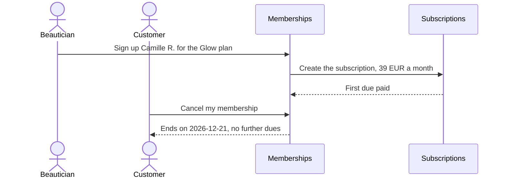

🏠 [Specs](../../../../README.md) › 🏷️ [Sectors](../../../README.md) › 💇 [SC17 Beauty and wellness](../../README.md) ›
📝 [Use cases](../README.md) › 📝 [Use cases: FL-SC17-02 Packages and memberships](README.md) ›
📝 UC-SC17-06 Run memberships

# 📝 UC-SC17-06 Run memberships

**Status:** ✅ specified

## Summary

A salon or spa sells a membership: a monthly fee that gives included services (a monthly massage), a discount on others
and priority booking. The manager sets the plans, the beautician signs a customer up, and the monthly fee is billed as a
subscription. The customer can pause or cancel from their phone and the dues stop at the cancellation date.

## Personas

- [U23 Store manager](../../../../01-users/personas/u23-store-manager.md)
- [U09 Customer](../../../../01-users/personas/u09-customer.md)

## Goal

Regular customers pay a steady fee for their usual services, and the salon sees its membership income and its
cancellations.

## Trigger

A customer asks for a membership, a due date comes, or a customer asks to pause or cancel.

## Frequency

A handful of new members a week; one billing run a month.

## Preconditions

- The membership plans are set
  ([E-F6-10](../../../../02-functional/f06-customers-and-sales/data/e-f06-10-rate-plan-and-meter.md)).
- The customer has a payment method
  ([E-F6-06](../../../../02-functional/f06-customers-and-sales/data/e-f06-06-customer-payment.md)).
- The services included exist ([E-F4-11](../../../../02-functional/f04-meetings/data/e-f04-11-appointment-type.md)).

## Postconditions

- **Succeeded:** the membership is saved ([E-SC17-05 Salon membership](../../data/e-sc17-05-salon-membership.md)) on a
  subscription contract
  ([E-F6-07](../../../../02-functional/f06-customers-and-sales/data/e-f06-07-subscription-contract.md)); each month the
  dues are invoiced and the included services are available.
- **Failed:** no membership starts; the missing payment method or consent is shown.

## Main flow

1. The manager opens the memberships screen
   ([S-SC17-06](../../screens/02-packages-and-memberships/s-sc17-06-salon-memberships.md)) and sets a plan: monthly fee,
   included services, discount and notice.
2. The beautician signs a customer up: terms are shown and accepted, and a subscription contract is created
   [UC-F6-10](../../../../02-functional/f06-customers-and-sales/use-cases/04-subscriptions/uc-f06-10-manage-subscriptions.md).
3. Each month the dues are invoiced and paid; the included services are credited for the month.
4. The customer books an included service; it is free until the month's quota is used.
5. The customer pauses or cancels from the phone; the dues stop at the cancellation date
   ([BR-SC17-06](../../business-rules/br-sc17-06-membership-dues-stop-at-cancellation.md)).
6. The manager reads members, dues paid, cancellations and the income of the month.

## Alternative flows

- 4a. The month's included service is not used: it expires at the end of the month, or carries over when the plan says
  so.
- 5a. The customer pauses for up to three months: no dues are billed and the service quota stops.
- 2a. The customer upgrades to a richer plan: the new fee starts at the next due date.

## Error flows

- 3e. The payment fails: the member is told, the due is retried and, after the third failure, the membership becomes
  Paused.
- 5e. The customer cancels after the due date: the current month is paid and the membership ends at the next date, as
  the terms say.
- 2e. The terms were not accepted: the membership is not started.
- Any step: a service does not answer; the call is retried first
  ([BR-F3-32](../../../../02-functional/f03-assistant/business-rules/br-f03-32-retry-before-an-error.md)), then the
  message follows the error pattern ([D122](../../../../06-decisions/ux/d122-error-message-standard.md)) and what the
  user typed stays on the screen.

## Business rules

- [BR-SC17-06](../../business-rules/br-sc17-06-membership-dues-stop-at-cancellation.md)
- [BR-SC17-04](../../business-rules/br-sc17-04-no-show-fees-follow-the-published-terms.md)

## Entities

- [E-SC17-05 Salon membership](../../data/e-sc17-05-salon-membership.md): created, changed
- [E-F6-07](../../../../02-functional/f06-customers-and-sales/data/e-f06-07-subscription-contract.md): created, the
  subscription contract that bills the dues
- [E-F6-05 Invoice](../../../../02-functional/f06-customers-and-sales/data/e-f06-05-invoice.md): created, the monthly
  invoice
- [E-F6-06](../../../../02-functional/f06-customers-and-sales/data/e-f06-06-customer-payment.md): read, the payments

## Permissions

Manager sets plans and cancels; beautician signs customers up; the customer pauses or cancels their own membership.

## Notifications

The customer, with their consent: the monthly receipt, a failed due, the cancellation date. The manager: cancellations
and failed dues of the week.

## Audit events

Each plan, sign-up, due, pause, cancellation and failed payment, with who, when and the terms accepted.

## AI involvement

No AI step of its own. The AI assistant may open the screen and prefill it from the user's words; the user checks and
confirms
[BR-F3-07](../../../../02-functional/f03-assistant/business-rules/br-f03-07-no-deletes-no-irreversible-acts.md).

## API, MCP and A2A exposure

T5 operations of the capability for the personas above: create, read, update and list. The MCP tool of the
capability may read and propose, never confirm alone. No A2A skill.

## Screens

- [S-SC17-06](../../screens/02-packages-and-memberships/s-sc17-06-salon-memberships.md)

## Flowchart

See [FL-SC17-02 Packages and memberships](../../flows/fl-sc17-02-packages-and-memberships.md#flowchart).

## Sequence diagram

## Acceptance criteria

1. **Given** a membership that includes one massage a month **when** the member books two massages **then** the first is
   free and the second is at the member's discount.
2. **Given** a cancellation asked on 2026-11-30 with a notice of one month **when** the member confirms **then** the
   dues stop after 2026-12-31.
3. **Given** a due that fails three times **when** the third retry fails **then** the membership becomes Paused and the
   manager is told.
4. **Given** terms not accepted **when** the beautician tries to start the membership **then** it is refused.

## Non-functional notes

The screen answers within 2 seconds for 10,000 records; every change is audited.

## Regulatory references

A membership that renews itself must show its price, its duration and how to end it before the customer
signs, and the customer must be able to cancel easily; the notice is the one in the terms. The France-pack rule is
written later. Related: [CR-FR-036](../../../../10-country-packs/france/consumer/cr-fr-036-withdrawal-right.md).

## Related use cases

- [UC-SC17-05](uc-sc17-05-sell-packages-and-prepaid-sessions.md)
- [UC-SC17-07 Sell and redeem gift vouchers](uc-sc17-07-sell-and-redeem-gift-vouchers.md)
- [UC-SC17-05](uc-sc17-05-sell-packages-and-prepaid-sessions.md)
- [UC-SC17-08 Follow customer balances](uc-sc17-08-follow-customer-balances.md)
- [UC-F6-10](../../../../02-functional/f06-customers-and-sales/use-cases/04-subscriptions/uc-f06-10-manage-subscriptions.md)

## Open questions

None.

---

⬅️ [UC-SC17-05 Sell packages and prepaid sessions](uc-sc17-05-sell-packages-and-prepaid-sessions.md) ·
⬆️ [Up](README.md) · ➡️ [UC-SC17-07 Sell and redeem gift vouchers](uc-sc17-07-sell-and-redeem-gift-vouchers.md)
