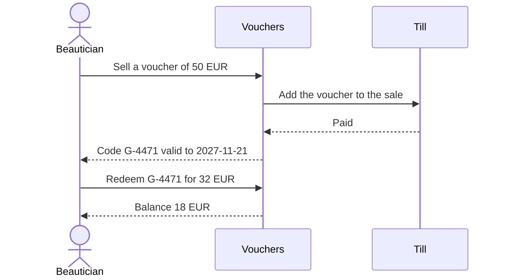

🏠 [Specs](../../../../README.md) › 🏷️ [Sectors](../../../README.md) › 💇 [SC17 Beauty and wellness](../../README.md) ›
📝 [Use cases](../README.md) › 📝 [Use cases: FL-SC17-02 Packages and memberships](README.md) ›
📝 UC-SC17-07 Sell and redeem gift vouchers

# 📝 UC-SC17-07 Sell and redeem gift vouchers

**Status:** ✅ specified

## Summary

A salon sells gift vouchers, for a service or for an amount, at the desk or online, and accepts them later at the till.
A voucher has a code, a value, a validity period that the manager cannot set shorter than the law allows, and a balance
after a partial use. Expired vouchers are listed and treated as the law says.

## Personas

- [U52 Beautician](../../../../01-users/personas/u52-beautician.md)

## Goal

A voucher is sold, given and redeemed without dispute, and no voucher is refused while it is valid.

## Trigger

A customer buys a voucher, or a holder offers one to pay.

## Frequency

Dozens a week, with a peak before holidays.

## Preconditions

- The voucher kinds (amount or service) and their validity are set.
- The till is open ([E-F10-02](../../../../02-functional/f10-point-of-sale/data/e-f10-02-till-session.md)).

## Postconditions

- **Succeeded:** the voucher is saved ([E-SC17-06 Gift voucher](../../data/e-sc17-06-gift-voucher.md)) with its code,
  value and validity; each use reduces its balance and appears on the sale
  ([E-F10-03](../../../../02-functional/f10-point-of-sale/data/e-f10-03-point-of-sale-order.md)).
- **Failed:** no voucher is sold or accepted; the code is unknown, used up or expired and the reason is shown.

## Main flow

1. The beautician opens the vouchers screen
   ([S-SC17-07 Gift vouchers](../../screens/02-packages-and-memberships/s-sc17-07-gift-vouchers.md)) and sells a voucher
   for an amount or a service; the validity is filled in from the legal period
   ([BR-SC17-07](../../business-rules/br-sc17-07-vouchers-keep-their-legal-validity-period.md)).
2. The customer pays at the till; the voucher is Issued with a code, printed or sent to the person who will receive it.
3. The holder gives the code at a later visit; the screen shows the value, the balance and the end date.
4. The beautician applies the voucher to the sale; a partial use leaves a balance and the voucher is Partly used.
5. A used-up voucher is Redeemed; a voucher past its end date is Expired and listed for the manager.
6. The manager reads the unused vouchers as a liability for the books
   ([CR-FR-013](../../../../10-country-packs/france/tax-and-vat/cr-fr-013-vouchers-vat.md)).

## Alternative flows

- 1a. The voucher is bought online: the code is emailed to the buyer or to the person they name.
- 4a. The voucher is for one service and the holder wants another: the manager may exchange it for the same value, and
  the exchange is recorded.
- 5a. A voucher is lost: the manager blocks its code and issues a new one for the balance.

## Error flows

- 3e. The code is unknown or already used up: the sale is not changed and the beautician is told why.
- 3e. The voucher is expired: it is refused with its end date, unless the manager extends it with a recorded reason.
- 1e. The validity is set below the legal period: the screen refuses it.
- Any step: a service does not answer; the call is retried first
  ([BR-F3-32](../../../../02-functional/f03-assistant/business-rules/br-f03-32-retry-before-an-error.md)), then the
  message follows the error pattern ([D122](../../../../06-decisions/ux/d122-error-message-standard.md)) and what the
  user typed stays on the screen.

## Business rules

- [BR-SC17-07](../../business-rules/br-sc17-07-vouchers-keep-their-legal-validity-period.md)
- [BR-SC17-08](../../business-rules/br-sc17-08-balances-are-shown-before-each-sale.md)

## Entities

- [E-SC17-06 Gift voucher](../../data/e-sc17-06-gift-voucher.md): created, changed
- [E-F10-10](../../../../02-functional/f10-point-of-sale/data/e-f10-10-loyalty-card-and-gift-card.md): read and changed,
  the shared gift card record and its balance
- [E-F10-03](../../../../02-functional/f10-point-of-sale/data/e-f10-03-point-of-sale-order.md): read, the sale where the
  voucher is used
- [E-F6-05 Invoice](../../../../02-functional/f06-customers-and-sales/data/e-f06-05-invoice.md): read, the invoice of
  the sale

## Permissions

Beautician sells and redeems; manager extends, exchanges and blocks. The holder sees the balance of a voucher whose code
they hold.

## Notifications

The buyer, with their consent: the code and the end date. The manager: vouchers ending in 30 days.

## Audit events

Each sale, use, balance, extension, exchange, blocking and expiry, with who, when and the code.

## AI involvement

No AI step of its own. The AI assistant may open the screen and prefill it from the user's words; the user checks and
confirms
[BR-F3-07](../../../../02-functional/f03-assistant/business-rules/br-f03-07-no-deletes-no-irreversible-acts.md).

## API, MCP and A2A exposure

T5 operations of the capability for the personas above: create, read, update and list. The MCP tool of the
capability may read and propose, never confirm alone. No A2A skill.

## Screens

- [S-SC17-07 Gift vouchers](../../screens/02-packages-and-memberships/s-sc17-07-gift-vouchers.md)

## Flowchart

See [FL-SC17-02 Packages and memberships](../../flows/fl-sc17-02-packages-and-memberships.md#flowchart).

## Sequence diagram

## Acceptance criteria

1. **Given** a voucher of 50 EUR **when** the holder pays 32 EUR with it **then** the balance is 18 EUR and the voucher
   is Partly used.
2. **Given** a voucher whose end date passed yesterday **when** the holder offers it **then** it is refused with its end
   date.
3. **Given** a validity shorter than the legal period **when** the beautician saves the voucher **then** the screen
   refuses it.
4. **Given** a lost voucher with 18 EUR left **when** the manager blocks it and issues a new one **then** the new code
   carries 18 EUR.

## Non-functional notes

The screen answers within 2 seconds for 10,000 records; every change is audited.

## Regulatory references

A gift voucher shows its value and its end date, and the salon honours it until then; how long the validity
must be at least, and the VAT treatment of a voucher for a given service or for an amount, are rules of the France pack
to read. The France-pack rule is written later. Related:
[CR-FR-097](../../../../10-country-packs/france/consumer/cr-fr-097-gift-card-validity.md),
[CR-FR-013](../../../../10-country-packs/france/tax-and-vat/cr-fr-013-vouchers-vat.md).

## Related use cases

- [UC-SC17-06 Run memberships](uc-sc17-06-run-memberships.md)
- [UC-SC17-08 Follow customer balances](uc-sc17-08-follow-customer-balances.md)
- [UC-SC17-05](uc-sc17-05-sell-packages-and-prepaid-sessions.md)
- [UC-F10-07](../../../../02-functional/f10-point-of-sale/use-cases/03-after-sales/uc-f10-07-use-loyalty-gift-cards-and-e-wallet.md)

## Open questions

None.

---

⬅️ [UC-SC17-06 Run memberships](uc-sc17-06-run-memberships.md) · ⬆️ [Up](README.md) ·
➡️ [UC-SC17-08 Follow customer balances](uc-sc17-08-follow-customer-balances.md)
