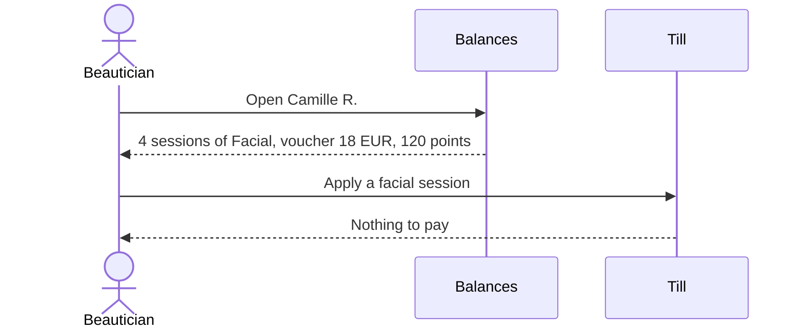

🏠 [Specs](../../../../README.md) › 🏷️ [Sectors](../../../README.md) › 💇 [SC17 Beauty and wellness](../../README.md) ›
📝 [Use cases](../README.md) › 📝 [Use cases: FL-SC17-02 Packages and memberships](README.md) ›
📝 UC-SC17-08 Follow customer balances

# 📝 UC-SC17-08 Follow customer balances

**Status:** ✅ specified

## Summary

Before a sale, the till and the booking screen show what the customer already holds: sessions left in packages, the
voucher balance, the loyalty points, the membership's included services, and any amount they owe. The manager reads the
same figures for all customers to see what the salon owes in sessions and vouchers.

## Personas

- [U23 Store manager](../../../../01-users/personas/u23-store-manager.md)

## Goal

No customer pays for something they already hold, and the salon knows its prepaid liabilities.

## Trigger

A customer is chosen at the till or at the desk, or the manager opens the balances.

## Frequency

At every sale.

## Preconditions

- The customer exists ([E-F6-01](../../../../02-functional/f06-customers-and-sales/data/e-f06-01-customer-record.md)).
- Packages, memberships and vouchers exist ([E-SC17-04 Session package](../../data/e-sc17-04-session-package.md),
  [E-SC17-05 Salon membership](../../data/e-sc17-05-salon-membership.md),
  [E-SC17-06 Gift voucher](../../data/e-sc17-06-gift-voucher.md)).

## Postconditions

- **Succeeded:** the customer's balances are shown before the sale and the user may apply one.
- **Failed:** nothing is applied; a balance that cannot be read is flagged to the manager.

## Main flow

1. The beautician chooses the customer at the till or the desk.
2. The balances screen ([S-SC17-08](../../screens/02-packages-and-memberships/s-sc17-08-customer-balances.md)) lists the
   sessions left per package, the included services left in the month, the vouchers and the loyalty points
   ([BR-SC17-08](../../business-rules/br-sc17-08-balances-are-shown-before-each-sale.md)).
3. The beautician applies a balance to the visit: a session, an included service or a voucher.
4. The sale shows what was taken from each balance and what is still to pay.
5. The manager opens the all-customers view to see sessions and vouchers owed, by end date.
6. A balance that ends within 30 days is flagged so the customer can be told.

## Alternative flows

- 3a. The customer has a package and a voucher: the screen proposes the package first, then the voucher, and the
  beautician may change the order.
- 5a. The manager filters the view to the packages that end this month, for a reminder message.
- 2a. The customer is a guest with no record: only the sale is shown.

## Error flows

- 2e. A balance does not match its sales: it is flagged and the manager must correct it with a reason.
- 3e. A voucher is expired: it is shown greyed with its end date and cannot be applied.
- 5e. The customer owes an unpaid invoice: it is shown first with the amount.
- Any step: a service does not answer; the call is retried first
  ([BR-F3-32](../../../../02-functional/f03-assistant/business-rules/br-f03-32-retry-before-an-error.md)), then the
  message follows the error pattern ([D122](../../../../06-decisions/ux/d122-error-message-standard.md)) and what the
  user typed stays on the screen.

## Business rules

- [BR-SC17-08](../../business-rules/br-sc17-08-balances-are-shown-before-each-sale.md)
- [BR-SC17-05](../../business-rules/br-sc17-05-sessions-are-used-oldest-first.md)

## Entities

- [E-SC17-04 Session package](../../data/e-sc17-04-session-package.md): read, the sessions left
- [E-SC17-05 Salon membership](../../data/e-sc17-05-salon-membership.md): read, the included services left
- [E-SC17-06 Gift voucher](../../data/e-sc17-06-gift-voucher.md): read, the vouchers and their balance
- [E-F10-10](../../../../02-functional/f10-point-of-sale/data/e-f10-10-loyalty-card-and-gift-card.md): read, the loyalty
  points

## Permissions

Beautician reads the balances of a customer at the till; manager reads all customers. The customer sees their own
balances in the portal.

## Notifications

The customer, with their consent: a balance ending in 30 days.

## Audit events

Each balance applied or corrected, with who, when and the amount.

## AI involvement

No AI step of its own. The AI assistant may open the screen and prefill it from the user's words; the user checks and
confirms
[BR-F3-07](../../../../02-functional/f03-assistant/business-rules/br-f03-07-no-deletes-no-irreversible-acts.md).

## API, MCP and A2A exposure

T5 operations of the capability for the personas above: create, read, update and list. The MCP tool of the
capability may read and propose, never confirm alone. No A2A skill.

## Screens

- [S-SC17-08](../../screens/02-packages-and-memberships/s-sc17-08-customer-balances.md)

## Flowchart

See [FL-SC17-02 Packages and memberships](../../flows/fl-sc17-02-packages-and-memberships.md#flowchart).

## Sequence diagram

## Acceptance criteria

1. **Given** a customer with a package, a voucher and points **when** the beautician opens the till **then** the three
   balances are shown before the sale.
2. **Given** an expired voucher **when** the balances are shown **then** it is greyed and cannot be applied.
3. **Given** a package ending in 20 days **when** the manager opens the view **then** it is flagged as ending soon.
4. **Given** a balance that does not match its sales **when** the screen loads **then** it is flagged for correction.

## Non-functional notes

The screen answers within 2 seconds for 10,000 records; every change is audited.

## Regulatory references

None specific to this use case beyond the rules above.

## Related use cases

- [UC-SC17-07 Sell and redeem gift vouchers](uc-sc17-07-sell-and-redeem-gift-vouchers.md)
- [UC-SC17-05](uc-sc17-05-sell-packages-and-prepaid-sessions.md)
- [UC-SC17-06 Run memberships](uc-sc17-06-run-memberships.md)
- [UC-SC17-07 Sell and redeem gift vouchers](uc-sc17-07-sell-and-redeem-gift-vouchers.md)
- [UC-SC17-20](../05-rentals-care-records-and-loyalty/uc-sc17-20-run-loyalty-and-referrals.md)

## Open questions

None.

---

⬅️ [UC-SC17-07 Sell and redeem gift vouchers](uc-sc17-07-sell-and-redeem-gift-vouchers.md) · ⬆️ [Up](README.md) ·
➡️ [UC-SC17-09 Sell products at the desk](../03-salon-retail-and-stock/uc-sc17-09-sell-products-at-the-desk.md)
