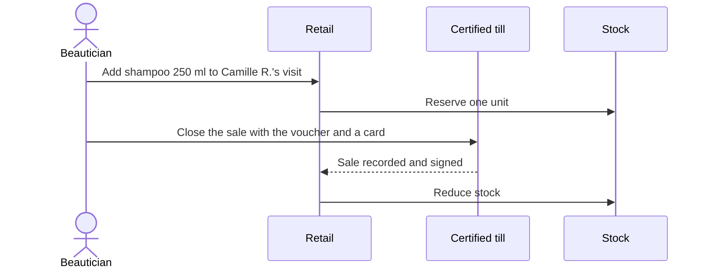

🏠 [Specs](../../../../README.md) › 🏷️ [Sectors](../../../README.md) › 💇 [SC17 Beauty and wellness](../../README.md) ›
📝 [Use cases](../README.md) › 📝 [Use cases: FL-SC17-03 Salon retail and stock](README.md) ›
📝 UC-SC17-09 Sell products at the desk

# 📝 UC-SC17-09 Sell products at the desk

**Status:** ✅ specified

## Summary

The beautician sells the products of the salon (shampoo, creams, nail polish) at the desk at the end of a visit. The
sale goes through the certified till with the services of the visit, uses a package, a voucher or a deposit if the
customer holds one, and credits the commission of the person who sold it.

## Personas

- [U52 Beautician](../../../../01-users/personas/u52-beautician.md)

## Goal

Products and services are sold in one sale on the certified till, with every balance applied and every commission
credited.

## Trigger

A customer finishes a visit, or comes only to buy a product.

## Frequency

Every visit; dozens of product sales a day.

## Preconditions

- The till is open and certified
  ([E-F10-02](../../../../02-functional/f10-point-of-sale/data/e-f10-02-till-session.md)).
- Products are stock items ([E-F7-06 Item](../../../../02-functional/f07-purchasing-and-stock/data/e-f07-06-item.md)).
- The customer's balances are read
  ([UC-SC17-08](../02-packages-and-memberships/uc-sc17-08-follow-customer-balances.md)).

## Postconditions

- **Succeeded:** the sale is saved on the till
  ([E-F10-03](../../../../02-functional/f10-point-of-sale/data/e-f10-03-point-of-sale-order.md)) with the services,
  products, balances applied and the seller; stock is reduced and the commission line is credited
  ([E-F6-19](../../../../02-functional/f06-customers-and-sales/data/e-f06-19-commission-line.md)).
- **Failed:** no sale is closed; the missing payment or the product out of stock is shown.

## Main flow

1. The beautician opens the retail screen
   ([S-SC17-09 Salon retail](../../screens/03-salon-retail-and-stock/s-sc17-09-salon-retail.md)); the visit's services
   are already on the sale.
2. The beautician scans or searches the products the customer takes; the stock and the price are shown.
3. The screen applies the deposit, the package session or the voucher the customer chose.
4. The customer pays by card, cash or a mix; the sale goes through the certified till
   ([BR-SC17-09](../../business-rules/br-sc17-09-retail-sales-go-through-the-certified-till.md)).
5. The receipt or invoice is given; the stock of each product is reduced.
6. The commission of the beautician is credited per the plan in force
   ([UC-SC17-13](../04-commissions-and-tips/uc-sc17-13-set-commission-plans.md)).

## Alternative flows

- 2a. The product is sold with a free sample: the sample is recorded as a stock movement with no price.
- 4a. The customer pays in part by a voucher: the rest is paid by card and both appear on the receipt.
- 5a. The customer asks for an invoice with their company name: an invoice is issued instead of a ticket.

## Error flows

- 2e. The product is out of stock: the sale of that line is refused and the stock of the other salons is shown
  [UC-F10-26](../../../../02-functional/f10-point-of-sale/use-cases/10-clienteling-transfers-and-tax-free/uc-f10-26-look-up-and-transfer-stock-between-stores.md).
- 4e. The card is declined: the sale stays open until another payment is given.
- 1e. The till is not certified or the closure is overdue: no sale can be closed.
- Any step: a service does not answer; the call is retried first
  ([BR-F3-32](../../../../02-functional/f03-assistant/business-rules/br-f03-32-retry-before-an-error.md)), then the
  message follows the error pattern ([D122](../../../../06-decisions/ux/d122-error-message-standard.md)) and what the
  user typed stays on the screen.

## Business rules

- [BR-SC17-09](../../business-rules/br-sc17-09-retail-sales-go-through-the-certified-till.md)
- [BR-SC17-13](../../business-rules/br-sc17-13-commissions-follow-the-plan-in-force-on-the-sale-date.md)

## Entities

- [E-F10-03](../../../../02-functional/f10-point-of-sale/data/e-f10-03-point-of-sale-order.md): created, the sale
- [E-F7-06 Item](../../../../02-functional/f07-purchasing-and-stock/data/e-f07-06-item.md): read and changed, the
  product and its stock
- [E-F6-19](../../../../02-functional/f06-customers-and-sales/data/e-f06-19-commission-line.md): created, the commission
  line
- [E-SC17-02 Salon booking](../../data/e-sc17-02-salon-booking.md): read, the visit sold

## Permissions

Beautician sells at the till; manager corrects and refunds. A renter's own product sales go through their own
invoice series
([UC-SC17-17](../05-rentals-care-records-and-loyalty/uc-sc17-17-rent-chairs-and-cabins-to-independents.md)).

## Notifications

The manager, in the app: a product below its minimum after the sale.

## Audit events

Each sale, line, payment, refund and correction, with who, when and the till.

## AI involvement

No AI step of its own. The AI assistant may open the screen and prefill it from the user's words; the user checks and
confirms
[BR-F3-07](../../../../02-functional/f03-assistant/business-rules/br-f03-07-no-deletes-no-irreversible-acts.md).

## API, MCP and A2A exposure

T5 operations of the capability for the personas above: create, read, update and list. The MCP tool of the
capability may read and propose, never confirm alone. No A2A skill.

## Screens

- [S-SC17-09 Salon retail](../../screens/03-salon-retail-and-stock/s-sc17-09-salon-retail.md)

## Flowchart

See [FL-SC17-03 Salon retail and stock](../../flows/fl-sc17-03-salon-retail-and-stock.md#flowchart).

## Sequence diagram

## Acceptance criteria

1. **Given** a visit with a facial and a shampoo **when** the customer pays **then** one sale is closed with both lines
   on the certified till.
2. **Given** a product out of stock **when** the beautician adds it **then** the line is refused and other salons' stock
   is shown.
3. **Given** a voucher of 18 EUR on a sale of 40 EUR **when** the customer pays the rest by card **then** both payments
   appear on the receipt.
4. **Given** a sale closed **when** the commission plan applies **then** the seller's commission line is created.

## Non-functional notes

The screen answers within 2 seconds for 10,000 records; every change is audited.

## Regulatory references

The till software of a salon is certified and its sales cannot be altered
([CR-FR-024](../../../../10-country-packs/france/point-of-sale/cr-fr-024-certified-till-software.md)); the French rules
for the data of each sale and the closures are in the point of sale capability
[UC-F10-07](../../../../02-functional/f10-point-of-sale/use-cases/03-after-sales/uc-f10-07-use-loyalty-gift-cards-and-e-wallet.md).

## Related use cases

- [UC-SC17-10 Record products used in services](uc-sc17-10-record-products-used-in-services.md)
- [UC-SC17-08](../02-packages-and-memberships/uc-sc17-08-follow-customer-balances.md)
- [UC-SC17-10 Record products used in services](uc-sc17-10-record-products-used-in-services.md)
- [UC-F10-07](../../../../02-functional/f10-point-of-sale/use-cases/03-after-sales/uc-f10-07-use-loyalty-gift-cards-and-e-wallet.md)

## Open questions

None.

---

⬅️ [UC-SC17-08 Follow customer balances](../02-packages-and-memberships/uc-sc17-08-follow-customer-balances.md) ·
⬆️ [Up](README.md) · ➡️ [UC-SC17-10 Record products used in services](uc-sc17-10-record-products-used-in-services.md)
