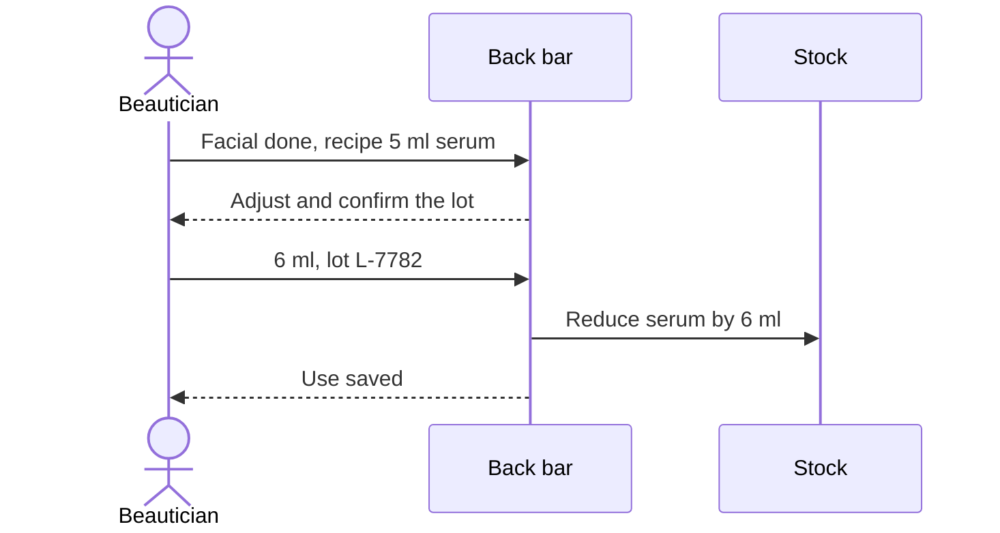

🏠 [Specs](../../../../README.md) › 🏷️ [Sectors](../../../README.md) › 💇 [SC17 Beauty and wellness](../../README.md) ›
📝 [Use cases](../README.md) › 📝 [Use cases: FL-SC17-03 Salon retail and stock](README.md) ›
📝 UC-SC17-10 Record products used in services

# 📝 UC-SC17-10 Record products used in services

**Status:** ✅ specified

## Summary

Some products are not sold but used up in services: hair colour, wax, nail gel, massage oil. The beautician records the
quantity used for each service, from a standard recipe the salon defines. Stock falls by the quantity used and the lot
used is kept for the client's file.

## Personas

- [U52 Beautician](../../../../01-users/personas/u52-beautician.md)

## Goal

Stock of back-bar products matches reality, the cost of each service is known, and the lot used on a client can be found
if a product is recalled.

## Trigger

A service that uses a product is done, or the stock is counted.

## Frequency

Several records a day per beautician.

## Preconditions

- The service has a recipe of products and quantities.
- The products are stock items with lots
  ([E-F7-06 Item](../../../../02-functional/f07-purchasing-and-stock/data/e-f07-06-item.md),
  [E-F7-10](../../../../02-functional/f07-purchasing-and-stock/data/e-f07-10-lot-or-serial.md)).
- The visit exists ([E-SC17-02 Salon booking](../../data/e-sc17-02-salon-booking.md)).

## Postconditions

- **Succeeded:** the use is saved ([E-SC17-07 Product use](../../data/e-sc17-07-product-use.md)) with the product,
  quantity and lot; stock is reduced.
- **Failed:** no use is recorded; the missing product or lot is shown.

## Main flow

1. After a service, the beautician opens the back-bar screen
   ([S-SC17-10 Back bar](../../screens/03-salon-retail-and-stock/s-sc17-10-back-bar.md)) on the tablet.
2. The screen proposes the recipe of the service (for example 60 g of colour and 90 ml of developer).
3. The beautician adjusts the real quantities and confirms the lot
   ([BR-SC17-10](../../business-rules/br-sc17-10-back-bar-use-lowers-stock-per-service.md)).
4. The use is saved and stock falls by those quantities; the lot is attached to the client's file
   ([UC-SC17-19](../05-rentals-care-records-and-loyalty/uc-sc17-19-keep-the-client-file-with-photos.md)).
5. The manager reads the cost of each service and the products used above the recipe.
6. A use that took more than the recipe by a large margin is flagged for the manager.

## Alternative flows

- 3a. The beautician uses a product not in the recipe: it is added to this use and flagged.
- 3b. A half-used tube is left open: the remaining quantity is recorded so the next use starts from it.
- 6a. A salon records all uses at the end of the day: the uses are saved in one batch with their visits.

## Error flows

- 3e. The lot is expired or recalled: the use is refused and another lot is proposed
  [UC-F7-08](../../../../02-functional/f07-purchasing-and-stock/use-cases/05-count-trace-and-analyse/uc-f07-08-trace-lots-and-serials-recall.md).
- 3e. The stock is below the quantity used: the use is saved with a warning and the manager is told.
- 4e. The visit is cancelled afterwards: the use is cancelled and the stock returns.
- Any step: a service does not answer; the call is retried first
  ([BR-F3-32](../../../../02-functional/f03-assistant/business-rules/br-f03-32-retry-before-an-error.md)), then the
  message follows the error pattern ([D122](../../../../06-decisions/ux/d122-error-message-standard.md)) and what the
  user typed stays on the screen.

## Business rules

- [BR-SC17-10](../../business-rules/br-sc17-10-back-bar-use-lowers-stock-per-service.md)
- [BR-SC17-12](../../business-rules/br-sc17-12-products-keep-their-safety-sheet-and-batch.md)

## Entities

- [E-SC17-07 Product use](../../data/e-sc17-07-product-use.md): created, changed
- [E-F7-06 Item](../../../../02-functional/f07-purchasing-and-stock/data/e-f07-06-item.md): read and changed, the
  product stock
- [E-F7-10](../../../../02-functional/f07-purchasing-and-stock/data/e-f07-10-lot-or-serial.md): read, the lot used
- [E-SC17-02 Salon booking](../../data/e-sc17-02-salon-booking.md): read, the visit the product was used in

## Permissions

Beautician records uses; manager changes recipes and corrects uses. A renter records uses of their own
products only.

## Notifications

The manager: a back-bar product is below its minimum, a use above the recipe.

## Audit events

Each use with the product, quantity, lot, person and visit; each correction.

## AI involvement

No AI step of its own. The AI assistant may open the screen and prefill it from the user's words; the user checks and
confirms
[BR-F3-07](../../../../02-functional/f03-assistant/business-rules/br-f03-07-no-deletes-no-irreversible-acts.md).

## API, MCP and A2A exposure

T5 operations of the capability for the personas above: create, read, update and list. The MCP tool of the
capability may read and propose, never confirm alone. No A2A skill.

## Screens

- [S-SC17-10 Back bar](../../screens/03-salon-retail-and-stock/s-sc17-10-back-bar.md)

## Flowchart

See [FL-SC17-03 Salon retail and stock](../../flows/fl-sc17-03-salon-retail-and-stock.md#flowchart).

## Sequence diagram

## Acceptance criteria

1. **Given** a recipe of 5 ml serum **when** the beautician records 6 ml of lot L-7782 **then** stock falls by 6 ml and
   the lot is attached to the visit.
2. **Given** a recalled lot **when** the beautician picks it **then** it is refused and another lot is proposed.
3. **Given** a use of 50% more than the recipe **when** the use is saved **then** it is flagged for the manager.
4. **Given** a cancelled visit **when** the uses are cancelled **then** stock returns.

## Non-functional notes

The screen answers within 2 seconds for 10,000 records; every change is audited.

## Regulatory references

A salon that uses cosmetic products keeps the batch used so that a product withdrawn or recalled can be
traced to the clients who received it. The France-pack rule is [CR-FR-290 Cosmetic products used and sold](../../../../10-country-packs/france/products/cr-fr-290-cosmetic-products.md). Related:
[UC-SC17-12](uc-sc17-12-keep-cosmetics-safety-records.md).

## Related use cases

- [UC-SC17-09 Sell products at the desk](uc-sc17-09-sell-products-at-the-desk.md)
- [UC-SC17-11 Replenish the salon](uc-sc17-11-replenish-the-salon.md)
- [UC-SC17-09 Sell products at the desk](uc-sc17-09-sell-products-at-the-desk.md)
- [UC-SC17-12 Keep cosmetics safety records](uc-sc17-12-keep-cosmetics-safety-records.md)
- [UC-F7-08](../../../../02-functional/f07-purchasing-and-stock/use-cases/05-count-trace-and-analyse/uc-f07-08-trace-lots-and-serials-recall.md)

## Open questions

None.

---

⬅️ [UC-SC17-09 Sell products at the desk](uc-sc17-09-sell-products-at-the-desk.md) · ⬆️ [Up](README.md) ·
➡️ [UC-SC17-11 Replenish the salon](uc-sc17-11-replenish-the-salon.md)
