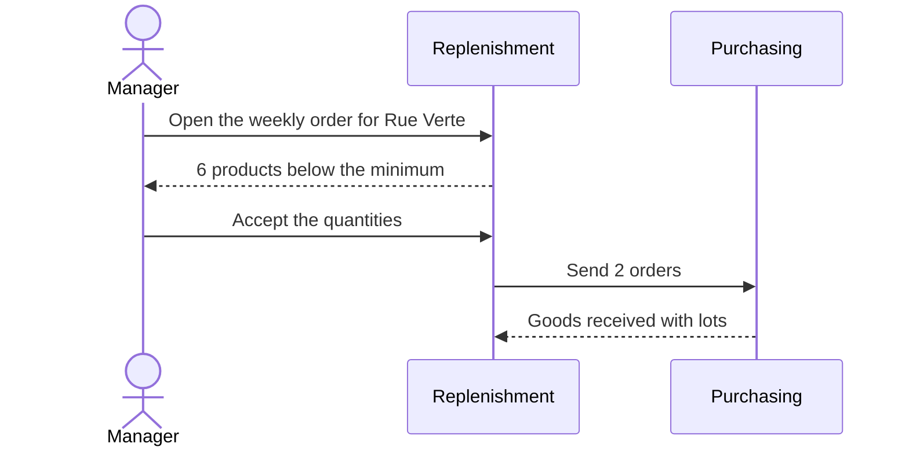

🏠 [Specs](../../../../README.md) › 🏷️ [Sectors](../../../README.md) › 💇 [SC17 Beauty and wellness](../../README.md) ›
📝 [Use cases](../README.md) › 📝 [Use cases: FL-SC17-03 Salon retail and stock](README.md) ›
📝 UC-SC17-11 Replenish the salon

# 📝 UC-SC17-11 Replenish the salon

**Status:** ✅ specified

## Summary

The salon manager orders products before they run out. Each salon has its own minimum stock per product, so the screen
proposes the orders per supplier from what each salon holds, the back-bar use and the sales. The manager checks the
proposal, sends the orders and receives the goods against them.

## Personas

- [U23 Store manager](../../../../01-users/personas/u23-store-manager.md)

## Goal

The salon never runs out of what it sells or uses, and never holds more than it needs.

## Trigger

A product falls below its minimum, the manager opens the weekly order, or a delivery arrives.

## Frequency

Weekly per salon.

## Preconditions

- Products have a minimum stock per salon
  ([E-F7-09](../../../../02-functional/f07-purchasing-and-stock/data/e-f07-09-reordering-rule.md)).
- Suppliers and their prices exist
  ([E-F7-01](../../../../02-functional/f07-purchasing-and-stock/data/e-f07-01-supplier-record.md)).

## Postconditions

- **Succeeded:** the purchase orders are sent
  ([E-F7-03](../../../../02-functional/f07-purchasing-and-stock/data/e-f07-03-purchase-order.md)) and stock is received
  against them.
- **Failed:** no order is sent; the missing supplier or price is shown.

## Main flow

1. The manager opens the replenishment screen
   ([S-SC17-11](../../screens/03-salon-retail-and-stock/s-sc17-11-salon-replenishment.md)) which lists products below
   their minimum for the salon ([BR-SC17-11](../../business-rules/br-sc17-11-orders-follow-minimum-stock-per-salon.md)).
2. The screen proposes a quantity per product from the minimum, the use of the last weeks and the supplier's pack size.
3. The manager adjusts the quantities and groups them by supplier.
4. The orders are sent to the suppliers
   [UC-F7-05](../../../../02-functional/f07-purchasing-and-stock/use-cases/03-replenish/uc-f07-05-replenish-stock.md).
5. When the goods arrive, the manager receives them against the order with their lots and expiry dates.
6. The minimum stock and the proposed quantities are reviewed each month from the real use.

## Alternative flows

- 2a. A product is in another salon of the same company: a transfer is proposed before an order
  [UC-F10-26](../../../../02-functional/f10-point-of-sale/use-cases/10-clienteling-transfers-and-tax-free/uc-f10-26-look-up-and-transfer-stock-between-stores.md).
- 3a. A supplier has a free delivery above an amount: the screen shows the amount still missing.
- 5a. Part of the order arrives: the rest stays open as a back order.

## Error flows

- 4e. The supplier has no price for a product: the line is held and the manager is told.
- 5e. A delivery arrives with a damaged product or a short expiry: it is refused or received as blocked.
- 5e. The delivery has no lot: the lot is asked before the stock is accepted.
- Any step: a service does not answer; the call is retried first
  ([BR-F3-32](../../../../02-functional/f03-assistant/business-rules/br-f03-32-retry-before-an-error.md)), then the
  message follows the error pattern ([D122](../../../../06-decisions/ux/d122-error-message-standard.md)) and what the
  user typed stays on the screen.

## Business rules

- [BR-SC17-11](../../business-rules/br-sc17-11-orders-follow-minimum-stock-per-salon.md)
- [BR-SC17-12](../../business-rules/br-sc17-12-products-keep-their-safety-sheet-and-batch.md)

## Entities

- [E-F7-09](../../../../02-functional/f07-purchasing-and-stock/data/e-f07-09-reordering-rule.md): read, the minimum
  stock per salon
- [E-F7-03](../../../../02-functional/f07-purchasing-and-stock/data/e-f07-03-purchase-order.md): created, the purchase
  orders
- [E-F7-06 Item](../../../../02-functional/f07-purchasing-and-stock/data/e-f07-06-item.md): read and changed, the stock
  received

## Permissions

Manager proposes and sends orders and receives goods; beautician reads the stock of their salon.

## Notifications

The manager, in the app: a product below its minimum, a late delivery.

## Audit events

Each proposal, order, reception and correction, with who and when.

## AI involvement

No AI step of its own. The AI assistant may open the screen and prefill it from the user's words; the user checks and
confirms
[BR-F3-07](../../../../02-functional/f03-assistant/business-rules/br-f03-07-no-deletes-no-irreversible-acts.md).

## API, MCP and A2A exposure

T5 operations of the capability for the personas above: create, read, update and list. The MCP tool of the
capability may read and propose, never confirm alone. No A2A skill.

## Screens

- [S-SC17-11](../../screens/03-salon-retail-and-stock/s-sc17-11-salon-replenishment.md)

## Flowchart

See [FL-SC17-03 Salon retail and stock](../../flows/fl-sc17-03-salon-retail-and-stock.md#flowchart).

## Sequence diagram

## Acceptance criteria

1. **Given** a minimum of 5 tubes and a stock of 3 **when** the manager opens the screen **then** the product is listed
   with a proposed quantity.
2. **Given** the same product in another salon **when** the manager opens the order **then** a transfer is proposed
   first.
3. **Given** a delivery with no lot **when** the manager receives it **then** the lot is asked before the stock is
   accepted.
4. **Given** a part delivery **when** the manager receives it **then** the rest stays as a back order.

## Non-functional notes

The screen answers within 2 seconds for 10,000 records; every change is audited.

## Regulatory references

None specific to this use case beyond the rules above.

## Related use cases

- [UC-SC17-10 Record products used in services](uc-sc17-10-record-products-used-in-services.md)
- [UC-SC17-12 Keep cosmetics safety records](uc-sc17-12-keep-cosmetics-safety-records.md)
- [UC-SC17-10 Record products used in services](uc-sc17-10-record-products-used-in-services.md)
- [UC-SC17-12 Keep cosmetics safety records](uc-sc17-12-keep-cosmetics-safety-records.md)
- [UC-F7-05](../../../../02-functional/f07-purchasing-and-stock/use-cases/03-replenish/uc-f07-05-replenish-stock.md)

## Open questions

None.

---

⬅️ [UC-SC17-10 Record products used in services](uc-sc17-10-record-products-used-in-services.md) · ⬆️ [Up](README.md) ·
➡️ [UC-SC17-12 Keep cosmetics safety records](uc-sc17-12-keep-cosmetics-safety-records.md)
