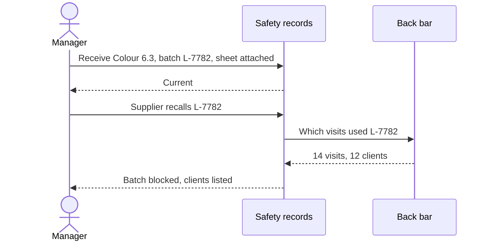

🏠 [Specs](../../../../README.md) › 🏷️ [Sectors](../../../README.md) › 💇 [SC17 Beauty and wellness](../../README.md) ›
📝 [Use cases](../README.md) › 📝 [Use cases: FL-SC17-03 Salon retail and stock](README.md) ›
📝 UC-SC17-12 Keep cosmetics safety records

# 📝 UC-SC17-12 Keep cosmetics safety records

**Status:** ✅ specified

## Summary

The salon keeps, for each cosmetic product it uses or sells, the safety sheet, the supplier, the batch, the expiry date
and the contact of the company responsible for the product on the market. When a supplier recalls a batch, the salon
finds the clients who received it and the product still in stock, and blocks it.

## Personas

- [U23 Store manager](../../../../01-users/personas/u23-store-manager.md)

## Goal

A product with a safety problem is found quickly, blocked in stock and traced to the clients, and the salon can show its
records to an inspector.

## Trigger

A product is received, a recall notice arrives, an inspection is announced, or a client reports a reaction.

## Frequency

At every delivery; a recall once or twice a year.

## Preconditions

- The product is a stock item with its lots
  ([E-F7-06 Item](../../../../02-functional/f07-purchasing-and-stock/data/e-f07-06-item.md),
  [E-F7-10](../../../../02-functional/f07-purchasing-and-stock/data/e-f07-10-lot-or-serial.md)).
- The supplier is recorded
  ([E-F7-01](../../../../02-functional/f07-purchasing-and-stock/data/e-f07-01-supplier-record.md)).

## Postconditions

- **Succeeded:** the record is saved ([E-SC17-08 Safety record](../../data/e-sc17-08-safety-record.md)) with the safety
  sheet, the batch and the supplier; a recalled batch is blocked and its clients are listed.
- **Failed:** a product without its record stays blocked for use; the missing item is shown.

## Main flow

1. On a delivery, the manager opens the safety screen
   ([S-SC17-12](../../screens/03-salon-retail-and-stock/s-sc17-12-cosmetics-safety.md)) and attaches the safety sheet,
   the batch and the expiry date to each product.
2. The screen checks the label: the name of the responsible company, the batch and the expiry are present
   ([BR-SC17-12](../../business-rules/br-sc17-12-products-keep-their-safety-sheet-and-batch.md)).
3. The product is Current and may be used or sold.
4. When a supplier recalls a batch, the manager marks it Recalled; stock of that batch is blocked.
5. SimpleERP lists the clients whose file shows a use of that batch
   ([UC-SC17-10](uc-sc17-10-record-products-used-in-services.md)) and the sales of that product.
6. The manager contacts the clients and keeps the proof of the contact.

## Alternative flows

- 1a. The product has no safety sheet: it stays Draft and cannot be used until the sheet is added.
- 4a. A client reports a reaction: the manager opens a safety record for the product and the batch and keeps the report.
- 5a. The batch was sold, not used: the buyers are found from the till and contacted.

## Error flows

- 2e. The label has no responsible company or no batch: the product is refused at reception.
- 4e. The recalled batch is already used up: the clients are still listed.
- 5e. A client's file has no consent to be contacted: the manager is shown the legal exception to contact for a safety
  reason.
- Any step: a service does not answer; the call is retried first
  ([BR-F3-32](../../../../02-functional/f03-assistant/business-rules/br-f03-32-retry-before-an-error.md)), then the
  message follows the error pattern ([D122](../../../../06-decisions/ux/d122-error-message-standard.md)) and what the
  user typed stays on the screen.

## Business rules

- [BR-SC17-12](../../business-rules/br-sc17-12-products-keep-their-safety-sheet-and-batch.md)
- [BR-SC17-10](../../business-rules/br-sc17-10-back-bar-use-lowers-stock-per-service.md)

## Entities

- [E-SC17-08 Safety record](../../data/e-sc17-08-safety-record.md): created, changed
- [E-F7-10](../../../../02-functional/f07-purchasing-and-stock/data/e-f07-10-lot-or-serial.md): read and changed, the
  batch and its block
- [E-SC17-07 Product use](../../data/e-sc17-07-product-use.md): read, the uses of the batch
- [E-F7-01](../../../../02-functional/f07-purchasing-and-stock/data/e-f07-01-supplier-record.md): read, the supplier

## Permissions

Manager keeps the records and recalls batches; beautician reads them. An inspector sees the records through
an export, never the client list.

## Notifications

The manager, in the app: a batch expires in 30 days, a recall notice is recorded.

## Audit events

Each record, safety sheet, batch, recall, block and client contacted, with who and when.

## AI involvement

No AI step of its own. The AI assistant may open the screen and prefill it from the user's words; the user checks and
confirms
[BR-F3-07](../../../../02-functional/f03-assistant/business-rules/br-f03-07-no-deletes-no-irreversible-acts.md).

## API, MCP and A2A exposure

T5 operations of the capability for the personas above: create, read, update and list. The MCP tool of the
capability may read and propose, never confirm alone. No A2A skill.

## Screens

- [S-SC17-12](../../screens/03-salon-retail-and-stock/s-sc17-12-cosmetics-safety.md)

## Flowchart

See [FL-SC17-03 Salon retail and stock](../../flows/fl-sc17-03-salon-retail-and-stock.md#flowchart).

## Sequence diagram

## Acceptance criteria

1. **Given** a product with its sheet, batch and responsible company **when** the manager saves the record **then** it
   becomes Current.
2. **Given** a recalled batch with 14 uses **when** the manager marks it Recalled **then** stock is blocked and 12
   clients are listed.
3. **Given** a product with no safety sheet **when** a beautician picks it for a service **then** it is refused.
4. **Given** a label with no batch **when** the manager receives it **then** it is refused at reception.

## Non-functional notes

The screen answers within 2 seconds for 10,000 records; every change is audited.

## Regulatory references

A cosmetic product sold in the European Union has a company responsible for it, a label with the batch and
expiry, and a safety file; a salon that uses or sells it checks the label, keeps the supplier and the batch, and stops
using a product that is recalled. The France-pack rule is written later. Related:
[CR-FR-062](../../../../10-country-packs/france/products/cr-fr-062-product-recall.md).

## Related use cases

- [UC-SC17-11 Replenish the salon](uc-sc17-11-replenish-the-salon.md)
- [UC-SC17-10 Record products used in services](uc-sc17-10-record-products-used-in-services.md)
- [UC-SC17-19](../05-rentals-care-records-and-loyalty/uc-sc17-19-keep-the-client-file-with-photos.md)
- [UC-F7-08](../../../../02-functional/f07-purchasing-and-stock/use-cases/05-count-trace-and-analyse/uc-f07-08-trace-lots-and-serials-recall.md)

## Open questions

None.

---

⬅️ [UC-SC17-11 Replenish the salon](uc-sc17-11-replenish-the-salon.md) · ⬆️ [Up](README.md) ·
➡️ [UC-SC17-13 Set commission plans](../04-commissions-and-tips/uc-sc17-13-set-commission-plans.md)
