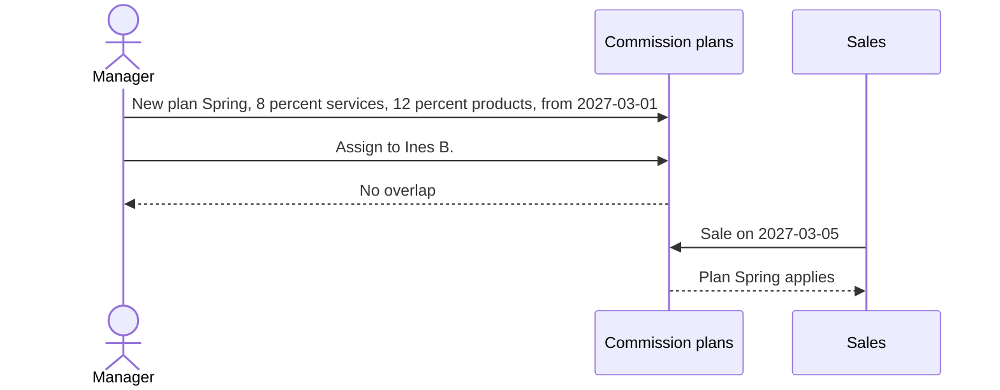

🏠 [Specs](../../../../README.md) › 🏷️ [Sectors](../../../README.md) › 💇 [SC17 Beauty and wellness](../../README.md) ›
📝 [Use cases](../README.md) › 📝 [Use cases: FL-SC17-04 Commissions and tips](README.md) ›
📝 UC-SC17-13 Set commission plans

# 📝 UC-SC17-13 Set commission plans

**Status:** ✅ specified

## Summary

The manager sets how each staff member earns on what they sell: a rate on the services they give, another on the
products they sell, tiers when a target is reached. Plans have a start date and an end date, and each sale uses the plan
in force on its date. Employees' commissions go to payroll as pay inputs; independents who rent a chair have no
commission, they keep their own takings.

## Personas

- [U23 Store manager](../../../../01-users/personas/u23-store-manager.md)

## Goal

Each employee is paid the commission they are owed, from the plan that was in force when they sold, and the plan can
change without altering past sales.

## Trigger

A new staff member joins, the salon changes its rates, or a pay period closes.

## Frequency

A few changes a year; one computation per pay period.

## Preconditions

- The staff members and their contracts exist
  ([E-F9-01](../../../../02-functional/f09-hr-and-projects/data/e-f09-01-employee-record.md),
  [E-F9-02 Contract](../../../../02-functional/f09-hr-and-projects/data/e-f09-02-contract.md)).
- The plans of customers and sales are installed
  ([E-F6-18](../../../../02-functional/f06-customers-and-sales/data/e-f06-18-commission-plan-and-target.md)).

## Postconditions

- **Succeeded:** the plan is saved ([E-SC17-09 Salon commission plan](../../data/e-sc17-09-commission-plan.md)) with its
  rates and dates; each sale's commission line
  ([E-F6-19](../../../../02-functional/f06-customers-and-sales/data/e-f06-19-commission-line.md)) uses the plan in force
  on its date.
- **Failed:** no plan is saved; the overlapping dates or missing rates are shown.

## Main flow

1. The manager opens the commission plans screen
   ([S-SC17-13](../../screens/04-commissions-and-tips/s-sc17-13-commission-plans.md)) and creates a plan with the
   service rate, the product rate, the tiers and the dates.
2. The manager assigns the plan to the staff members it covers.
3. simple-ERP checks that no staff member has two plans on the same date
   ([BR-SC17-13](../../business-rules/br-sc17-13-commissions-follow-the-plan-in-force-on-the-sale-date.md)).
4. The plan becomes In force on its start date.
5. Each sale credits a commission line at the plan in force on the sale date
   ([UC-SC17-09](../03-salon-retail-and-stock/uc-sc17-09-sell-products-at-the-desk.md)).
6. At the pay period's close, the commissions go to payroll as pay inputs of employees
   [UC-F6-25](../../../../02-functional/f06-customers-and-sales/use-cases/09-sell-on-the-road-and-steer-sales/uc-f06-25-set-sales-targets-and-pay-commissions.md).

## Alternative flows

- 2a. A staff member is an independent renter: no plan is assigned and the screen says so
  ([UC-SC17-17](../05-rentals-care-records-and-loyalty/uc-sc17-17-rent-chairs-and-cabins-to-independents.md)).
- 4a. A plan changes mid-month: the old plan ends the day before and the new one starts, so each sale uses its own plan.
- 6a. A sale is refunded: its commission is reversed in the period of the refund.

## Error flows

- 3e. Two plans overlap for one person: the plan is refused and the dates in conflict are shown.
- 5e. A sale has no plan in force: it is listed to the manager and no commission is credited until a plan is assigned.
- 6e. The pay period is already closed: a later commission goes to the next period with a note.
- Any step: a service does not answer; the call is retried first
  ([BR-F3-32](../../../../02-functional/f03-assistant/business-rules/br-f03-32-retry-before-an-error.md)), then the
  message follows the error pattern ([D122](../../../../06-decisions/ux/d122-error-message-standard.md)) and what the
  user typed stays on the screen.

## Business rules

- [BR-SC17-13](../../business-rules/br-sc17-13-commissions-follow-the-plan-in-force-on-the-sale-date.md)
- [BR-SC17-15](../../business-rules/br-sc17-15-targets-are-seen-by-the-staff-member-and-the-manager.md)

## Entities

- [E-SC17-09 Salon commission plan](../../data/e-sc17-09-commission-plan.md): created, changed
- [E-F6-18](../../../../02-functional/f06-customers-and-sales/data/e-f06-18-commission-plan-and-target.md): read, the
  shared commission plan and target
- [E-F6-19](../../../../02-functional/f06-customers-and-sales/data/e-f06-19-commission-line.md): read, the commission
  lines
- [E-F9-01](../../../../02-functional/f09-hr-and-projects/data/e-f09-01-employee-record.md): read, the staff members

## Permissions

Manager sets and assigns plans; payroll officer reads the lines; the staff member reads their own plan and lines.

## Notifications

The staff member, in the app: a new plan applies to them. The manager: sales with no plan.

## Audit events

Each plan created, changed, assigned, ended and each commission reversed, with who and when.

## AI involvement

No AI step of its own. The AI assistant may open the screen and prefill it from the user's words; the user checks and
confirms
[BR-F3-07](../../../../02-functional/f03-assistant/business-rules/br-f03-07-no-deletes-no-irreversible-acts.md).

## API, MCP and A2A exposure

T5 operations of the capability for the personas above: create, read, update and list. The MCP tool of the
capability may read and propose, never confirm alone. No A2A skill.

## Screens

- [S-SC17-13](../../screens/04-commissions-and-tips/s-sc17-13-commission-plans.md)

## Flowchart

See [FL-SC17-04 Commissions and tips](../../flows/fl-sc17-04-commissions-and-tips.md#flowchart).

## Sequence diagram

## Acceptance criteria

1. **Given** a plan from 2027-03-01 at 8 percent on services **when** a sale of 100 EUR of services is made on
   2027-03-05 **then** the commission line is 8.00 EUR.
2. **Given** two plans for one person on the same day **when** the manager saves the second **then** it is refused with
   the dates in conflict.
3. **Given** a sale made before a new plan starts **when** the pay period closes **then** the old plan's rate is used.
4. **Given** a refunded sale **when** the refund is recorded **then** its commission is reversed.

## Non-functional notes

The screen answers within 2 seconds for 10,000 records; every change is audited.

## Regulatory references

A commission is part of an employee's pay and follows the contract and the collective rules; it is computed
by the plan agreed in writing. The France-pack rule is written later.

## Related use cases

- [UC-SC17-14 Share tips](uc-sc17-14-share-tips.md)
- [UC-SC17-14 Share tips](uc-sc17-14-share-tips.md)
- [UC-SC17-15 Follow staff targets](uc-sc17-15-follow-staff-targets.md)
- [UC-F6-25](../../../../02-functional/f06-customers-and-sales/use-cases/09-sell-on-the-road-and-steer-sales/uc-f06-25-set-sales-targets-and-pay-commissions.md)

## Open questions

None.

---

⬅️ [UC-SC17-12](../03-salon-retail-and-stock/uc-sc17-12-keep-cosmetics-safety-records.md) · ⬆️ [Up](README.md) ·
➡️ [UC-SC17-14 Share tips](uc-sc17-14-share-tips.md)
