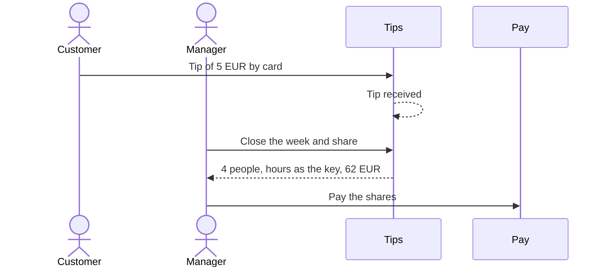

🏠 [Specs](../../../../README.md) › 🏷️ [Sectors](../../../README.md) › 💇 [SC17 Beauty and wellness](../../README.md) ›
📝 [Use cases](../README.md) › 📝 [Use cases: FL-SC17-04 Commissions and tips](README.md) › 📝 UC-SC17-14 Share tips

# 📝 UC-SC17-14 Share tips

**Status:** ✅ specified

## Summary

Customers leave tips by card or in cash. The salon posts a sharing rule (for example an equal share among the staff on
duty that day, or a share by hours worked) and applies it: each tip is recorded, shared at the end of the period and
paid to the staff members, with a statement each can read.

## Personas

- [U23 Store manager](../../../../01-users/personas/u23-store-manager.md)
- [U52 Beautician](../../../../01-users/personas/u52-beautician.md)

## Goal

Every tip reaches the staff according to a rule they can read, and nothing is kept or shared in secret.

## Trigger

A customer leaves a tip, or the sharing period closes.

## Frequency

Several tips a day; one sharing per week or month.

## Preconditions

- A sharing rule is posted by the manager (the key and the period).
- The staff on duty are known from the shifts
  ([E-F9-16 Shift](../../../../02-functional/f09-hr-and-projects/data/e-f09-16-shift.md)).
- A tip left by card is a payment line of the sale
  ([E-F10-04](../../../../02-functional/f10-point-of-sale/data/e-f10-04-till-payment.md)).

## Postconditions

- **Succeeded:** each tip is saved ([E-SC17-10 Tip](../../data/e-sc17-10-tip.md)) and, at the close, shared and paid;
  each staff member has a statement.
- **Failed:** the sharing is not closed; the tips with no rule or an unknown staff member are listed.

## Main flow

1. A customer adds a tip at the till or on the card terminal; the tip is recorded with the sale
   ([UC-SC17-09](../03-salon-retail-and-stock/uc-sc17-09-sell-products-at-the-desk.md)).
2. The tip is Received and kept apart from the salon's takings.
3. At the end of the period, the manager opens the tips screen
   ([S-SC17-14 Salon tips](../../screens/04-commissions-and-tips/s-sc17-14-salon-tips.md)) and runs the sharing by the
   posted rule ([BR-SC17-14](../../business-rules/br-sc17-14-tips-are-shared-per-the-posted-rule.md)).
4. SimpleERP computes each person's share from the shifts and hours of the period and shows it.
5. The manager confirms; the tips become Shared and are paid with the pay or as a separate payment
   [UC-F13-09](../../../../02-functional/f13-payroll/use-cases/03-declarations-and-payments/uc-f13-09-pay-employees-by-sepa-transfer.md).
6. Each staff member reads their statement: the tips, the key and their share.

## Alternative flows

- 1a. A tip is left for one named person: it goes to that person when the posted rule allows it.
- 4a. A staff member worked a part of the period: their share follows their hours.
- 5a. Independent renters are paid their own tips by the customers: the salon records none for them.

## Error flows

- 3e. No sharing rule is posted: the sharing is refused and the manager must post one.
- 4e. A tip's sale is refunded: the tip is reversed and the shares recomputed.
- 5e. A staff member has left the salon: their share is paid with their last pay.
- Any step: a service does not answer; the call is retried first
  ([BR-F3-32](../../../../02-functional/f03-assistant/business-rules/br-f03-32-retry-before-an-error.md)), then the
  message follows the error pattern ([D122](../../../../06-decisions/ux/d122-error-message-standard.md)) and what the
  user typed stays on the screen.

## Business rules

- [BR-SC17-14](../../business-rules/br-sc17-14-tips-are-shared-per-the-posted-rule.md)
- [BR-SC17-15](../../business-rules/br-sc17-15-targets-are-seen-by-the-staff-member-and-the-manager.md)

## Entities

- [E-SC17-10 Tip](../../data/e-sc17-10-tip.md): created, changed
- [E-F10-04](../../../../02-functional/f10-point-of-sale/data/e-f10-04-till-payment.md): read, the card payment that
  carried the tip
- [E-F9-16 Shift](../../../../02-functional/f09-hr-and-projects/data/e-f09-16-shift.md): read, the shifts of the period
- [E-F13-02](../../../../02-functional/f13-payroll/data/e-f13-02-employee-pay-profile.md): read, the pay profile that
  receives the tip

## Permissions

Manager runs the sharing; beautician reads their own statement; payroll officer reads the shares. The posted
rule is visible to every staff member.

## Notifications

The staff member, in the app: a sharing is closed with their amount.

## Audit events

Each tip, sharing, share, payment and reversal, with who and when and the rule applied.

## AI involvement

No AI step of its own. The AI assistant may open the screen and prefill it from the user's words; the user checks and
confirms
[BR-F3-07](../../../../02-functional/f03-assistant/business-rules/br-f03-07-no-deletes-no-irreversible-acts.md).

## API, MCP and A2A exposure

T5 operations of the capability for the personas above: create, read, update and list. The MCP tool of the
capability may read and propose, never confirm alone. No A2A skill.

## Screens

- [S-SC17-14 Salon tips](../../screens/04-commissions-and-tips/s-sc17-14-salon-tips.md)

## Flowchart

See [FL-SC17-04 Commissions and tips](../../flows/fl-sc17-04-commissions-and-tips.md#flowchart).

## Sequence diagram

## Acceptance criteria

1. **Given** a posted rule sharing by hours **when** the week is closed with 62 EUR of tips and four staff **then** each
   share follows that person's hours.
2. **Given** a tip with no posted rule **when** the manager tries to share **then** it is refused until a rule is
   posted.
3. **Given** a refunded sale **when** its tip is reversed **then** the shares are recomputed.
4. **Given** a staff member who left **when** the sharing is run **then** their share is paid with their last pay.

## Non-functional notes

The screen answers within 2 seconds for 10,000 records; every change is audited.

## Regulatory references

Tips paid by customers belong to the staff and are shared by the agreed key, which is posted; their tax and
social treatment is a value of the France pack. Related:
[CR-FR-113](../../../../10-country-packs/france/labour/cr-fr-113-tips-sharing.md).

## Related use cases

- [UC-SC17-13 Set commission plans](uc-sc17-13-set-commission-plans.md)
- [UC-SC17-15 Follow staff targets](uc-sc17-15-follow-staff-targets.md)
- [UC-SC17-13 Set commission plans](uc-sc17-13-set-commission-plans.md)
- [UC-SC17-15 Follow staff targets](uc-sc17-15-follow-staff-targets.md)
- [UC-F13-09](../../../../02-functional/f13-payroll/use-cases/03-declarations-and-payments/uc-f13-09-pay-employees-by-sepa-transfer.md)

## Open questions

None.

---

⬅️ [UC-SC17-13 Set commission plans](uc-sc17-13-set-commission-plans.md) · ⬆️ [Up](README.md) ·
➡️ [UC-SC17-15 Follow staff targets](uc-sc17-15-follow-staff-targets.md)
