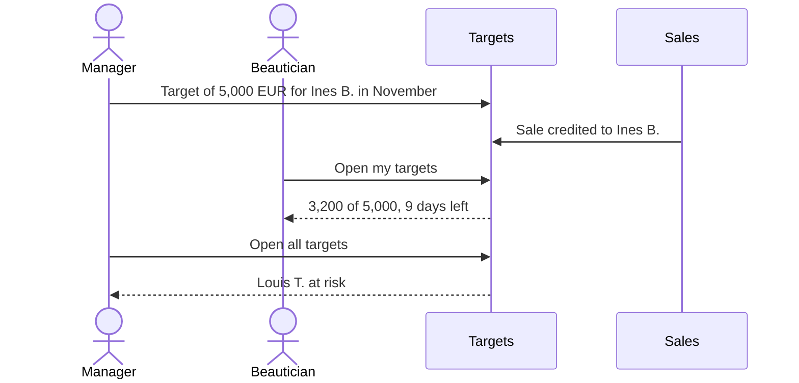

🏠 [Specs](../../../../README.md) › 🏷️ [Sectors](../../../README.md) › 💇 [SC17 Beauty and wellness](../../README.md) ›
📝 [Use cases](../README.md) › 📝 [Use cases: FL-SC17-04 Commissions and tips](README.md) ›
📝 UC-SC17-15 Follow staff targets

# 📝 UC-SC17-15 Follow staff targets

**Status:** ✅ specified

## Summary

The manager sets targets for each staff member (services sold, products sold, rebooking rate) and both the manager and
the staff member follow them during the month. The staff member reads only their own targets, the manager reads
everyone's, and the figures come from the sales already recorded.

## Personas

- [U23 Store manager](../../../../01-users/personas/u23-store-manager.md)
- [U52 Beautician](../../../../01-users/personas/u52-beautician.md)

## Goal

Everyone knows where they stand against their target before the month ends, and the manager can help those who are
behind.

## Trigger

A month starts, a sale is made, or the manager opens the targets.

## Frequency

Daily glance; a target set per month.

## Preconditions

- Targets exist for the period
  ([E-F6-18](../../../../02-functional/f06-customers-and-sales/data/e-f06-18-commission-plan-and-target.md)).
- Sales are recorded with their seller
  ([E-F10-03](../../../../02-functional/f10-point-of-sale/data/e-f10-03-point-of-sale-order.md)).

## Postconditions

- **Succeeded:** the staff member and the manager see the progress of each target.
- **Failed:** no progress is shown for a target without sales or a missing seller; the gap is listed.

## Main flow

1. The manager opens the targets screen
   ([S-SC17-15 Staff targets](../../screens/04-commissions-and-tips/s-sc17-15-staff-targets.md)) and sets each staff
   member's targets for the month.
2. Each sale updates the progress of its seller's targets.
3. The staff member opens the screen on the tablet and sees only their own targets
   ([BR-SC17-15](../../business-rules/br-sc17-15-targets-are-seen-by-the-staff-member-and-the-manager.md)).
4. The manager sees all targets with the progress and the days left.
5. At the month's end the targets are closed and the results kept.
6. The results feed the commission tiers ([UC-SC17-13](uc-sc17-13-set-commission-plans.md)).

## Alternative flows

- 1a. A target is shared by a team: the progress adds the sales of every member.
- 3a. The staff member is an independent renter: no target is set by the salon.
- 5a. The month is not over: the manager may adjust a target with a reason.

## Error flows

- 2e. A sale has no seller: it is listed apart and counts for no target.
- 3e. A staff member tries to read another's target: access is refused.
- 5e. A target is changed after the month closed: it is refused.
- Any step: a service does not answer; the call is retried first
  ([BR-F3-32](../../../../02-functional/f03-assistant/business-rules/br-f03-32-retry-before-an-error.md)), then the
  message follows the error pattern ([D122](../../../../06-decisions/ux/d122-error-message-standard.md)) and what the
  user typed stays on the screen.

## Business rules

- [BR-SC17-15](../../business-rules/br-sc17-15-targets-are-seen-by-the-staff-member-and-the-manager.md)
- [BR-SC17-13](../../business-rules/br-sc17-13-commissions-follow-the-plan-in-force-on-the-sale-date.md)

## Entities

- [E-F6-18](../../../../02-functional/f06-customers-and-sales/data/e-f06-18-commission-plan-and-target.md): read and
  changed, the targets
- [E-F6-19](../../../../02-functional/f06-customers-and-sales/data/e-f06-19-commission-line.md): read, the lines that
  make the progress
- [E-F10-03](../../../../02-functional/f10-point-of-sale/data/e-f10-03-point-of-sale-order.md): read, the sales

## Permissions

Manager sets and reads all targets; the staff member reads their own. A renter sees none.

## Notifications

The staff member, in the app: a target is reached or at risk. The manager: a staff member behind.

## Audit events

Each target set, changed and closed, with who, when and the old value.

## AI involvement

No AI step of its own. The AI assistant may open the screen and prefill it from the user's words; the user checks and
confirms
[BR-F3-07](../../../../02-functional/f03-assistant/business-rules/br-f03-07-no-deletes-no-irreversible-acts.md).

## API, MCP and A2A exposure

T5 operations of the capability for the personas above: create, read, update and list. The MCP tool of the
capability may read and propose, never confirm alone. No A2A skill.

## Screens

- [S-SC17-15 Staff targets](../../screens/04-commissions-and-tips/s-sc17-15-staff-targets.md)

## Flowchart

See [FL-SC17-04 Commissions and tips](../../flows/fl-sc17-04-commissions-and-tips.md#flowchart).

## Sequence diagram

## Acceptance criteria

1. **Given** a target of 5,000 EUR and 3,200 EUR of sales **when** the staff member opens the screen **then** 64 percent
   and the days left are shown.
2. **Given** a staff member who is not the manager **when** they open another person's target **then** access is
   refused.
3. **Given** a month closed **when** the manager tries to change a target **then** it is refused.
4. **Given** a sale with no seller **when** the figures are computed **then** it is listed apart.

## Non-functional notes

The screen answers within 2 seconds for 10,000 records; every change is audited.

## Regulatory references

None specific to this use case beyond the rules above.

## Related use cases

- [UC-SC17-14 Share tips](uc-sc17-14-share-tips.md)
- [UC-SC17-16](uc-sc17-16-ask-the-assistant-about-the-salon.md)
- [UC-SC17-13 Set commission plans](uc-sc17-13-set-commission-plans.md)
- [UC-SC17-14 Share tips](uc-sc17-14-share-tips.md)
- [UC-F6-25](../../../../02-functional/f06-customers-and-sales/use-cases/09-sell-on-the-road-and-steer-sales/uc-f06-25-set-sales-targets-and-pay-commissions.md)

## Open questions

None.

---

⬅️ [UC-SC17-14 Share tips](uc-sc17-14-share-tips.md) · ⬆️ [Up](README.md) ·
➡️ [UC-SC17-16 Ask the AI assistant about the salon](uc-sc17-16-ask-the-assistant-about-the-salon.md)
