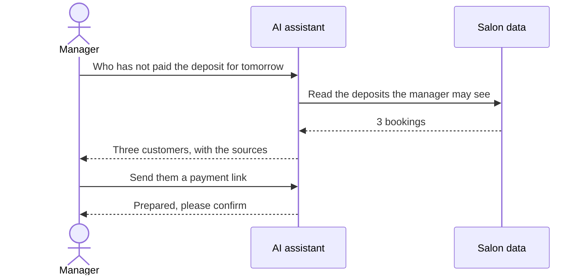

🏠 [Specs](../../../../README.md) › 🏷️ [Sectors](../../../README.md) › 💇 [SC17 Beauty and wellness](../../README.md) ›
📝 [Use cases](../README.md) › 📝 [Use cases: FL-SC17-04 Commissions and tips](README.md) ›
📝 UC-SC17-16 Ask the AI assistant about the salon

# 📝 UC-SC17-16 Ask the AI assistant about the salon

**Status:** ✅ specified

## Summary

The salon manager asks the AI assistant questions about the salon from a phone and gets answers from the salon's own
data: tomorrow's bookings, the no-shows of the week, the products below their minimum, the vouchers ending, the staff's
targets. The AI assistant never shows a figure the asker has no right to see.

## Personas

- [U23 Store manager](../../../../01-users/personas/u23-store-manager.md)

## Goal

The manager gets a clear answer in seconds, from real data, within the rights of the role.

## Trigger

The manager types or says a question.

## Frequency

Several times a day.

## Preconditions

- The manager is signed in with their role.
- The data of the salon is available ([E-SC17-02 Salon booking](../../data/e-sc17-02-salon-booking.md),
  [E-SC17-04 Session package](../../data/e-sc17-04-session-package.md),
  [E-F7-06 Item](../../../../02-functional/f07-purchasing-and-stock/data/e-f07-06-item.md)).

## Postconditions

- **Succeeded:** the answer is shown with its sources, and a prepared action waits for the manager's confirmation.
- **Failed:** no answer is shown; the reason (no right, no data) is given.

## Main flow

1. The manager opens the AI assistant screen
   ([S-SC17-16](../../screens/04-commissions-and-tips/s-sc17-16-salon-assistant.md)) and asks, for example, 'who has not
   paid the deposit for tomorrow'.
2. The AI assistant reads only the data the manager may read
   ([BR-SC17-16](../../business-rules/br-sc17-16-answers-follow-the-askers-rights.md),
   [BR-F3-07](../../../../02-functional/f03-assistant/business-rules/br-f03-07-no-deletes-no-irreversible-acts.md)).
3. The answer appears with the list or the figure and the sources it comes from.
4. The manager asks for an action (send a reminder, move a booking): the AI assistant prepares it.
5. The manager checks and confirms the action; nothing is done without that confirmation.
6. The question and the answer are kept in the audit.

## Alternative flows

- 1a. The question covers several salons: the answer is split by salon within the manager's rights.
- 4a. The manager asks for a report: the AI assistant prepares it as a saved view.
- 2a. A beautician asks: the AI assistant answers about their own bookings and sales only.

## Error flows

- 2e. The manager has no right to the data asked (for example another salon's payroll): the AI assistant says so and
  shows nothing.
- 3e. The AI assistant cannot find the answer: it says so rather than guess.
- 5e. The action fails: the manager is told and nothing is changed.
- Any step: a service does not answer; the call is retried first
  ([BR-F3-32](../../../../02-functional/f03-assistant/business-rules/br-f03-32-retry-before-an-error.md)), then the
  message follows the error pattern ([D122](../../../../06-decisions/ux/d122-error-message-standard.md)) and what the
  user typed stays on the screen.

## Business rules

- [BR-SC17-16](../../business-rules/br-sc17-16-answers-follow-the-askers-rights.md)
- [BR-F3-07](../../../../02-functional/f03-assistant/business-rules/br-f03-07-no-deletes-no-irreversible-acts.md)

## Entities

- [E-SC17-02 Salon booking](../../data/e-sc17-02-salon-booking.md): read, the bookings
- [E-SC17-04 Session package](../../data/e-sc17-04-session-package.md): read, the packages
- [E-F7-06 Item](../../../../02-functional/f07-purchasing-and-stock/data/e-f07-06-item.md): read, the stock

## Permissions

Every answer follows the asker's own rights; an action is confirmed by a person who may do it.

## Notifications

None: the use case sends no message of its own.

## Audit events

Each question, answer, source and confirmed action, with who and when.

## AI involvement

No AI step of its own. The AI assistant may open the screen and prefill it from the user's words; the user checks and
confirms
[BR-F3-07](../../../../02-functional/f03-assistant/business-rules/br-f03-07-no-deletes-no-irreversible-acts.md).

## API, MCP and A2A exposure

T5 operations of the capability for the personas above: create, read, update and list. The MCP tool of the
capability may read and propose, never confirm alone. No A2A skill.

## Screens

- [S-SC17-16](../../screens/04-commissions-and-tips/s-sc17-16-salon-assistant.md)

## Flowchart

See [FL-SC17-04 Commissions and tips](../../flows/fl-sc17-04-commissions-and-tips.md#flowchart).

## Sequence diagram

## Acceptance criteria

1. **Given** a manager with the right to the bookings **when** they ask who has not paid tomorrow's deposit **then** the
   list is shown with its sources.
2. **Given** a beautician **when** they ask about the salon's payroll **then** the AI assistant refuses and shows
   nothing.
3. **Given** an action prepared **when** the manager does not confirm **then** nothing is sent.
4. **Given** a question with no data **when** the manager asks **then** the AI assistant says it cannot answer.

## Non-functional notes

The screen answers within 2 seconds for 10,000 records; every change is audited.

## Regulatory references

None specific to this use case beyond the rules above.

## Related use cases

- [UC-SC17-15 Follow staff targets](uc-sc17-15-follow-staff-targets.md)
- [UC-SC17-15 Follow staff targets](uc-sc17-15-follow-staff-targets.md)
- [UC-SC17-20](../05-rentals-care-records-and-loyalty/uc-sc17-20-run-loyalty-and-referrals.md)
- [UC-F3-01](../../../../02-functional/f03-assistant/use-cases/01-ask-the-assistant/uc-f03-01-ask-a-question-about-the-company-s-data.md)

## Open questions

None.

---

⬅️ [UC-SC17-15 Follow staff targets](uc-sc17-15-follow-staff-targets.md) · ⬆️ [Up](README.md) ·
➡️ [UC-SC17-17](../05-rentals-care-records-and-loyalty/uc-sc17-17-rent-chairs-and-cabins-to-independents.md)
