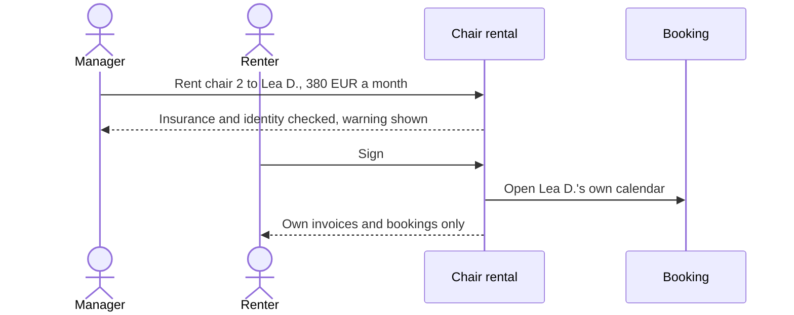

🏠 [Specs](../../../../README.md) › 🏷️ [Sectors](../../../README.md) › 💇 [SC17 Beauty and wellness](../../README.md) ›
📝 [Use cases](../README.md) › 📝 [Use cases: FL-SC17-05 Rentals, care records, client files and loyalty](README.md) ›
📝 UC-SC17-17 Rent chairs and cabins to independents

# 📝 UC-SC17-17 Rent chairs and cabins to independents

**Status:** ✅ specified

## Summary

A salon rents chairs and cabins to independent professionals (hairdressers, nail technicians, masseurs) who run their
own business inside the salon. The manager signs a rental contract with each renter, bills the rent, and gives the
renter access to their own calendar, bookings and invoices only. Employees and renters work side by side in one salon.

## Personas

- [U23 Store manager](../../../../01-users/personas/u23-store-manager.md)
- [U52 Beautician](../../../../01-users/personas/u52-beautician.md)

## Goal

The salon earns a steady rent, the renter keeps their own clients, bookings and invoices, and the relationship stays
that of a landlord and a tenant, not of an employer.

## Trigger

An independent asks to rent a place, a rental period starts or ends, or the rent is due.

## Frequency

A handful of contracts per salon; a monthly or weekly rent.

## Preconditions

- The cabin or chair exists ([E-SC17-01 Cabin](../../data/e-sc17-01-cabin.md)).
- The renter has a customer record with their business identity
  ([E-F6-01](../../../../02-functional/f06-customers-and-sales/data/e-f06-01-customer-record.md)).
- The salon has a rent price list.

## Postconditions

- **Succeeded:** the rental contract is saved ([E-SC17-11 Rental contract](../../data/e-sc17-11-rental-contract.md));
  the renter has their own calendar and invoice series, and the rent is invoiced on its due date.
- **Failed:** no contract is signed; the missing identity, insurance or dates are shown.

## Main flow

1. The manager opens the chair rental screen
   ([S-SC17-17](../../screens/05-rentals-care-records-and-loyalty/s-sc17-17-chair-rental.md)) and creates a contract for
   a chair or cabin: renter, place, period, rent, notice and deposit.
2. The screen checks the renter's business identity and insurance, and shows the warning of disguised employment: the
   renter sets their own hours, prices and clients.
3. The renter signs electronically
   ([CR-FR-020](../../../../10-country-packs/france/invoicing/cr-fr-020-electronic-acceptance-and-signature.md)); the
   contract becomes Signed then Active on its start date.
4. simple-ERP creates the renter's own calendar for the chair and their own invoice series
   ([BR-SC17-17](../../business-rules/br-sc17-17-renters-keep-their-own-bookings-and-invoices.md)).
5. The rent is invoiced on its due date; the renter's own sales are never mixed with the salon's.
6. At the end date or by notice, the contract becomes Ended and the renter's access closes.

## Alternative flows

- 2a. The renter works only some days: the calendar shows the chair free for others on the other days.
- 5a. The renter asks the salon to collect their sales: it is a separate paid-out account, with a statement, never the
  salon's takings.
- 6a. The salon ends the contract early for a serious breach: it becomes Terminated with the reason.

## Error flows

- 2e. The renter has no business identity or insurance: the contract cannot be signed.
- 2e. The manager sets the renter's prices or hours in the contract: the screen warns of the disguised-employment risk
  and asks for a written reason.
- 5e. The rent is unpaid: a reminder follows and, after the delay in the contract, the access is suspended.
- Any step: a service does not answer; the call is retried first
  ([BR-F3-32](../../../../02-functional/f03-assistant/business-rules/br-f03-32-retry-before-an-error.md)), then the
  message follows the error pattern ([D122](../../../../06-decisions/ux/d122-error-message-standard.md)) and what the
  user typed stays on the screen.

## Business rules

- [BR-SC17-17](../../business-rules/br-sc17-17-renters-keep-their-own-bookings-and-invoices.md)
- [BR-SC17-01](../../business-rules/br-sc17-01-a-booking-needs-a-free-staff-member-and-cabin.md)

## Entities

- [E-SC17-11 Rental contract](../../data/e-sc17-11-rental-contract.md): created, changed
- [E-SC17-01 Cabin](../../data/e-sc17-01-cabin.md): read, the chair or cabin
- [E-F6-07](../../../../02-functional/f06-customers-and-sales/data/e-f06-07-subscription-contract.md): created, the
  subscription that bills the rent
- [E-F2-18](../../../../02-functional/f02-no-code-configuration/data/e-f02-18-resource-booking.md): created, the
  renter's own resource bookings
- [E-F6-01](../../../../02-functional/f06-customers-and-sales/data/e-f06-01-customer-record.md): read, the renter

## Permissions

Manager creates and ends contracts; the renter sees their own contract, calendar, bookings and invoices; the beautician
employees see no renter's clients.

## Notifications

The renter, in the app: the rent due, the end date. The manager: a contract ending in 30 days, an unpaid rent.

## Audit events

Each contract, signature, rent invoice, access change, end and termination, with who and when.

## AI involvement

No AI step of its own. The AI assistant may open the screen and prefill it from the user's words; the user checks and
confirms
[BR-F3-07](../../../../02-functional/f03-assistant/business-rules/br-f03-07-no-deletes-no-irreversible-acts.md).

## API, MCP and A2A exposure

T5 operations of the capability for the personas above: create, read, update and list. The MCP tool of the
capability may read and propose, never confirm alone. No A2A skill.

## Screens

- [S-SC17-17](../../screens/05-rentals-care-records-and-loyalty/s-sc17-17-chair-rental.md)

## Flowchart

See
[FL-SC17-05 Rentals, care records, client files and loyalty](../../flows/fl-sc17-05-rentals-care-records-and-loyalty.md#flowchart).

## Sequence diagram

## Acceptance criteria

1. **Given** a renter who signed a contract **when** they open the app **then** they see their own calendar, bookings
   and invoices only.
2. **Given** a renter without insurance **when** the manager signs **then** the contract is refused.
3. **Given** a contract that sets the renter's prices **when** the manager saves **then** a warning of disguised
   employment is shown with a reason asked.
4. **Given** a rent unpaid after the delay **when** the delay passes **then** the renter's access is suspended.

## Non-functional notes

The screen answers within 2 seconds for 10,000 records; every change is audited.

## Regulatory references

An independent who rents a chair works for their own account: their clients, prices, hours and invoices are
their own. If the salon sets those, the relationship may be treated as employment with the consequences of undeclared
work; the pack carries the checklist. The France-pack rule is written later. Related:
[CR-FR-101](../../../../10-country-packs/france/labour/cr-fr-101-undeclared-work.md).

## Related use cases

- [UC-SC17-18 Keep regulated care records](uc-sc17-18-keep-regulated-care-records.md)
- [UC-SC17-01](../01-book-staff-and-cabins/uc-sc17-01-set-up-services-staff-and-cabins.md)
- [UC-SC17-13 Set commission plans](../04-commissions-and-tips/uc-sc17-13-set-commission-plans.md)
- [UC-F6-10](../../../../02-functional/f06-customers-and-sales/use-cases/04-subscriptions/uc-f06-10-manage-subscriptions.md)

## Open questions

None.

---

⬅️ [UC-SC17-16](../04-commissions-and-tips/uc-sc17-16-ask-the-assistant-about-the-salon.md) · ⬆️ [Up](README.md) ·
➡️ [UC-SC17-18 Keep regulated care records](uc-sc17-18-keep-regulated-care-records.md)
