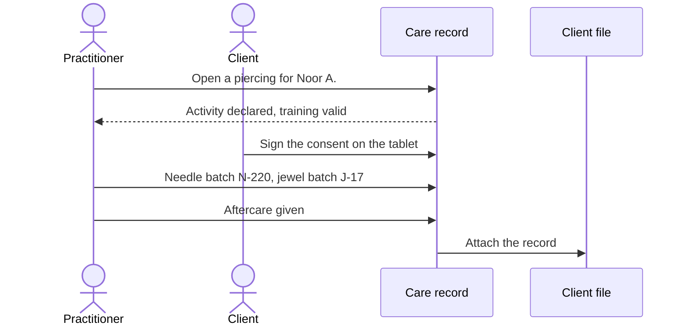

🏠 [Specs](../../../../README.md) › 🏷️ [Sectors](../../../README.md) › 💇 [SC17 Beauty and wellness](../../README.md) ›
📝 [Use cases](../README.md) › 📝 [Use cases: FL-SC17-05 Rentals, care records, client files and loyalty](README.md) ›
📝 UC-SC17-18 Keep regulated care records

# 📝 UC-SC17-18 Keep regulated care records

**Status:** 🔄 waiting for the owner

## Summary

Some treatments need more than a booking: tattooing, piercing and laser treatments. For these, the salon keeps a care
record: the practitioner, the declared activity, the client's informed consent (and the guardian's for a minor), the
products and needles used by batch, and the aftercare given. The salon cannot start a regulated treatment without a
valid declaration of the activity and a signed consent.

## Personas

- [U52 Beautician](../../../../01-users/personas/u52-beautician.md)

## Goal

Regulated treatments are done only by a trained practitioner, with the activity declared, the client's consent and a
trace of what was used, and every client leaves with the aftercare.

## Trigger

A client books or arrives for a tattoo, a piercing or a laser treatment.

## Frequency

Several a day in a studio.

## Preconditions

- The activity is declared for the salon in its settings.
- The practitioner holds the hygiene training
  ([E-F9-12](../../../../02-functional/f09-hr-and-projects/data/e-f09-12-certification.md)).
- The client file exists ([E-SC17-13 Salon client file](../../data/e-sc17-13-client-file.md)).

## Postconditions

- **Succeeded:** the care record is saved ([E-SC17-12 Regulated care record](../../data/e-sc17-12-care-record.md)) with
  the consent, the batches and the aftercare; the client file shows it.
- **Failed:** the treatment does not start; the missing declaration, training or consent is shown.

## Main flow

1. The beautician opens the regulated care screen
   ([S-SC17-18](../../screens/05-rentals-care-records-and-loyalty/s-sc17-18-regulated-care.md)) for the booked client
   and chooses the kind (tattoo, piercing or laser).
2. SimpleERP checks that the salon declared the activity and that the practitioner's hygiene training is valid
   [BR-SC17-18](../../business-rules/br-sc17-18-tattoo-piercing-and-laser-need-the-declared-activity-and-consent.md).
3. The client reads and signs the consent on the tablet; for a minor the guardian signs.
4. The beautician records the place on the body, the product and needle batches
   ([UC-SC17-12](../03-salon-retail-and-stock/uc-sc17-12-keep-cosmetics-safety-records.md)) and performs the treatment.
5. The beautician hands the aftercare advice and records it.
6. The record becomes Closed and is attached to the client file, with the health data protected.

## Alternative flows

- 3a. The client is a minor: the guardian's identity and signature are kept, and the treatment follows the age limit of
  the country pack.
- 4a. A product has a recorded safety sheet: its allergen information is shown to the client before the consent.
- 5a. The client has a reaction afterwards: a follow-up is added to the record.

## Error flows

- 2e. The activity is not declared or the training is expired: the treatment is blocked and the manager is told.
- 3e. The consent is not signed: the treatment is blocked.
- 4e. The batch is recalled: it is refused and another is proposed.
- Any step: a service does not answer; the call is retried first
  ([BR-F3-32](../../../../02-functional/f03-assistant/business-rules/br-f03-32-retry-before-an-error.md)), then the
  message follows the error pattern ([D122](../../../../06-decisions/ux/d122-error-message-standard.md)) and what the
  user typed stays on the screen.

## Business rules

- [BR-SC17-18](../../business-rules/br-sc17-18-tattoo-piercing-and-laser-need-the-declared-activity-and-consent.md)
- [BR-SC17-19](../../business-rules/br-sc17-19-photos-are-kept-only-with-the-clients-consent.md)
- [BR-SC17-12](../../business-rules/br-sc17-12-products-keep-their-safety-sheet-and-batch.md)

## Entities

- [E-SC17-12 Regulated care record](../../data/e-sc17-12-care-record.md): created, changed
- [E-SC17-13 Salon client file](../../data/e-sc17-13-client-file.md): read and changed, the client file
- [E-F9-12](../../../../02-functional/f09-hr-and-projects/data/e-f09-12-certification.md): read, the practitioner's
  training
- [E-SC17-08 Safety record](../../data/e-sc17-08-safety-record.md): read, the safety record of the products used

## Permissions

The practitioner creates and closes records; the manager reads them; the client reads their own. Care records
are health data: access is limited to those who need them.

## Notifications

The client, with their consent: the aftercare advice. The manager: a practitioner's training ends in 30 days.

## Audit events

Each record, consent, batch, aftercare and reading, with who and when.

## AI involvement

No AI step of its own. The AI assistant may open the screen and prefill it from the user's words; the user checks and
confirms
[BR-F3-07](../../../../02-functional/f03-assistant/business-rules/br-f03-07-no-deletes-no-irreversible-acts.md).

## API, MCP and A2A exposure

T5 operations of the capability for the personas above: create, read, update and list. The MCP tool of the
capability may read and propose, never confirm alone. No A2A skill.

## Screens

- [S-SC17-18](../../screens/05-rentals-care-records-and-loyalty/s-sc17-18-regulated-care.md)

## Flowchart

See
[FL-SC17-05 Rentals, care records, client files and loyalty](../../flows/fl-sc17-05-rentals-care-records-and-loyalty.md#flowchart).

## Sequence diagram

## Acceptance criteria

1. **Given** a studio that has not declared the activity **when** a practitioner opens a piercing record **then** the
   treatment is blocked.
2. **Given** an unsigned consent **when** the practitioner tries to start **then** it is blocked.
3. **Given** a minor client **when** the consent is signed by the guardian **then** the guardian's identity is kept.
4. **Given** a recalled needle batch **when** the practitioner picks it **then** it is refused.

## Non-functional notes

The screen answers within 2 seconds for 10,000 records; every change is audited.

## Regulatory references

A studio that tattoos or pierces declares the activity to the authority before it starts, the person who
performs it holds a hygiene and health-and-safety training, the client signs an informed consent (a minor needs the
guardian's), aftercare advice is given, and the products and needles are traced by batch. Laser and similar techniques
follow their own limits on who may perform them; the pack carries the list. Health data is hosted as the law requires
([CR-FR-055](../../../../10-country-packs/france/data-protection/cr-fr-055-health-data-hosting.md)). The France-pack
rule is written later.

- France-pack rule, (Proposed) until its law is read:
  [CR-FR-257 Tattoo, piercing and laser declarations](../../../../10-country-packs/france/health-practice/cr-fr-257-tattoo-and-piercing-declaration.md)

## Related use cases

- [UC-SC17-17](uc-sc17-17-rent-chairs-and-cabins-to-independents.md)
- [UC-SC17-19 Keep the client file with photos](uc-sc17-19-keep-the-client-file-with-photos.md)
- [UC-SC17-12](../03-salon-retail-and-stock/uc-sc17-12-keep-cosmetics-safety-records.md)
- [UC-SC17-19 Keep the client file with photos](uc-sc17-19-keep-the-client-file-with-photos.md)

## Open questions

None.

---

⬅️ [UC-SC17-17 Rent chairs and cabins to independents](uc-sc17-17-rent-chairs-and-cabins-to-independents.md) ·
⬆️ [Up](README.md) · ➡️ [UC-SC17-19 Keep the client file with photos](uc-sc17-19-keep-the-client-file-with-photos.md)
