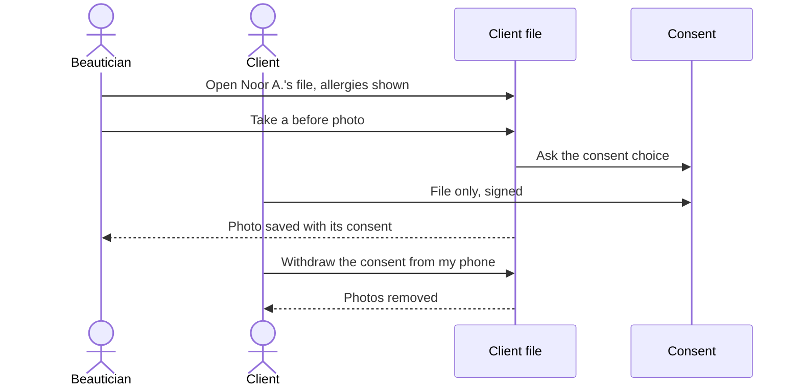

🏠 [Specs](../../../../README.md) › 🏷️ [Sectors](../../../README.md) › 💇 [SC17 Beauty and wellness](../../README.md) ›
📝 [Use cases](../README.md) › 📝 [Use cases: FL-SC17-05 Rentals, care records, client files and loyalty](README.md) ›
📝 UC-SC17-19 Keep the client file with photos

# 📝 UC-SC17-19 Keep the client file with photos

**Status:** ✅ specified

## Summary

The salon keeps a file for each client: allergies and skin notes, hair formulas and past services, preferences, and
photos taken before and after a treatment. Photos are taken and kept only with the client's consent, with a clear
purpose (the file only, or also the salon's communication), and the client can withdraw it at any time. The file is
archived when the client stops coming and erased on request.

## Personas

- [U52 Beautician](../../../../01-users/personas/u52-beautician.md)
- [U09 Customer](../../../../01-users/personas/u09-customer.md)

## Goal

Staff know what suits each client and what to avoid, the client controls their photos and data, and the salon keeps
nothing it has no right to keep.

## Trigger

A client arrives, a service is done, a photo is taken, or the client asks about or for the erasure of their data.

## Frequency

At every visit; a few consent changes or erasure requests a month.

## Preconditions

- The customer exists ([E-F6-01](../../../../02-functional/f06-customers-and-sales/data/e-f06-01-customer-record.md)).
- The consent texts are set by the manager
  ([E-F5-10](../../../../02-functional/f05-social-media/data/e-f05-10-consent-and-suppression-record.md)).

## Postconditions

- **Succeeded:** the client file is saved ([E-SC17-13 Salon client file](../../data/e-sc17-13-client-file.md)) with its
  notes, photos and the consent that covers each photo.
- **Failed:** no photo is saved; the missing consent is shown.

## Main flow

1. The beautician opens the client file screen
   ([S-SC17-19](../../screens/05-rentals-care-records-and-loyalty/s-sc17-19-client-file.md)) on the tablet; allergies
   and notes are shown first.
2. After a service, the beautician adds the formula or the notes.
3. To take a photo, the beautician asks the client to choose a consent: none, the file only, or also the salon's
   communication; the choice is signed on the tablet
   ([BR-SC17-19](../../business-rules/br-sc17-19-photos-are-kept-only-with-the-clients-consent.md)).
4. The photo is saved with the consent that covers it, and is shown only to staff who need it.
5. The client can see their file and withdraw a consent from their phone; the photos covered are removed.
6. A file with no visit for the set period is archived; an erasure request erases it
   ([CR-FR-051](../../../../10-country-packs/france/data-protection/cr-fr-051-access-and-erasure.md)).

## Alternative flows

- 3a. The client refuses any photo: the file records the refusal and no photo is taken.
- 5a. The client withdraws the consent for the salon's communication: the photos stay in the file, but never in a post
  or an advert.
- 6a. The client asks for a copy of their file: an export is prepared and delivered to them only.

## Error flows

- 3e. A photo is taken with no consent: it is not saved and the beautician is told.
- 4e. A staff member with no need opens a file: access is refused and logged.
- 6e. An erasure is asked while a legal duty requires keeping a record (an invoice): that part is kept and the rest is
  erased, with the reason told to the client.
- Any step: a service does not answer; the call is retried first
  ([BR-F3-32](../../../../02-functional/f03-assistant/business-rules/br-f03-32-retry-before-an-error.md)), then the
  message follows the error pattern ([D122](../../../../06-decisions/ux/d122-error-message-standard.md)) and what the
  user typed stays on the screen.

## Business rules

- [BR-SC17-19](../../business-rules/br-sc17-19-photos-are-kept-only-with-the-clients-consent.md)
- [BR-SC17-18](../../business-rules/br-sc17-18-tattoo-piercing-and-laser-need-the-declared-activity-and-consent.md)

## Entities

- [E-SC17-13 Salon client file](../../data/e-sc17-13-client-file.md): created, changed
- [E-F6-01](../../../../02-functional/f06-customers-and-sales/data/e-f06-01-customer-record.md): read, the customer
- [E-F5-10](../../../../02-functional/f05-social-media/data/e-f05-10-consent-and-suppression-record.md): read and
  changed, the consent record
- [E-SC17-12 Regulated care record](../../data/e-sc17-12-care-record.md): read, the care records of the file

## Permissions

The beautician who serves the client and the manager read the file; the client reads and exports their own.
Photos and health notes are visible only to staff with a care role.

## Notifications

The client, with their consent: a copy of their file when asked. The manager: an erasure request and its deadline.

## Audit events

Each file opening, note, photo, consent, withdrawal, export, archive and erasure, with who and when.

## AI involvement

No AI step of its own. The AI assistant may open the screen and prefill it from the user's words; the user checks and
confirms
[BR-F3-07](../../../../02-functional/f03-assistant/business-rules/br-f03-07-no-deletes-no-irreversible-acts.md).

## API, MCP and A2A exposure

T5 operations of the capability for the personas above: create, read, update and list. The MCP tool of the
capability may read and propose, never confirm alone. No A2A skill.

## Screens

- [S-SC17-19](../../screens/05-rentals-care-records-and-loyalty/s-sc17-19-client-file.md)

## Flowchart

See
[FL-SC17-05 Rentals, care records, client files and loyalty](../../flows/fl-sc17-05-rentals-care-records-and-loyalty.md#flowchart).

## Sequence diagram

## Acceptance criteria

1. **Given** a client who refused photos **when** the beautician tries to take one **then** no photo is saved.
2. **Given** a photo with the consent 'file only' **when** the manager tries to post it **then** it is refused.
3. **Given** a client who withdraws the consent **when** the withdrawal is saved **then** the photos it covered are
   removed.
4. **Given** an erasure request **when** the manager runs it **then** the file is erased except what the law requires to
   keep.

## Non-functional notes

The screen answers within 2 seconds for 10,000 records; every change is audited.

## Regulatory references

Allergies, skin and treatment notes are health-related data and a photo of a client is personal data: both
are kept only with the client's consent for a stated purpose, protected, kept no longer than needed, and shown to the
client or erased on request
([CR-FR-051](../../../../10-country-packs/france/data-protection/cr-fr-051-access-and-erasure.md),
[CR-FR-052](../../../../10-country-packs/france/data-protection/cr-fr-052-storage-limitation.md),
[CR-FR-055](../../../../10-country-packs/france/data-protection/cr-fr-055-health-data-hosting.md)). A photo used in a
post or an advert needs its own consent. The France-pack rule is [CR-FR-283 Health data outside care](../../../../10-country-packs/france/data-protection/cr-fr-283-health-data-outside-care.md).

## Related use cases

- [UC-SC17-18 Keep regulated care records](uc-sc17-18-keep-regulated-care-records.md)
- [UC-SC17-20 Run loyalty and referrals](uc-sc17-20-run-loyalty-and-referrals.md)
- [UC-SC17-18 Keep regulated care records](uc-sc17-18-keep-regulated-care-records.md)
- [UC-SC17-10](../03-salon-retail-and-stock/uc-sc17-10-record-products-used-in-services.md)
- [UC-F5-15](../../../../02-functional/f05-social-media/use-cases/06-audiences-consent-and-journeys/uc-f05-15-record-and-prove-consent.md)

## Open questions

None.

---

⬅️ [UC-SC17-18 Keep regulated care records](uc-sc17-18-keep-regulated-care-records.md) · ⬆️ [Up](README.md) ·
➡️ [UC-SC17-20 Run loyalty and referrals](uc-sc17-20-run-loyalty-and-referrals.md)
