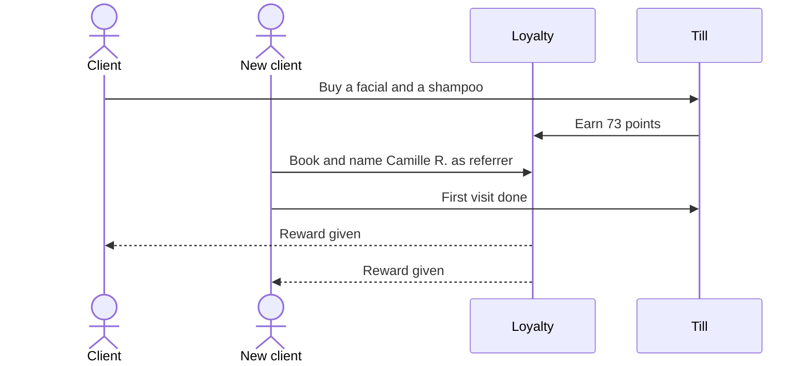

🏠 [Specs](../../../../README.md) › 🏷️ [Sectors](../../../README.md) › 💇 [SC17 Beauty and wellness](../../README.md) ›
📝 [Use cases](../README.md) › 📝 [Use cases: FL-SC17-05 Rentals, care records, client files and loyalty](README.md) ›
📝 UC-SC17-20 Run loyalty and referrals

# 📝 UC-SC17-20 Run loyalty and referrals

**Status:** ✅ specified

## Summary

The salon rewards its regular clients and the clients who bring new ones. Points are earned on the services and products
bought, follow the loyalty rules shared with the point of sale, and are spent at the till. A referral gives the referrer
and the new client a reward when the new client makes a first visit.

## Personas

- [U23 Store manager](../../../../01-users/personas/u23-store-manager.md)
- [U09 Customer](../../../../01-users/personas/u09-customer.md)

## Goal

Clients come back and bring friends, and the salon's points and rewards follow one set of rules in every salon and till.

## Trigger

A client buys, reaches a reward, or a new client names a referrer.

## Frequency

At every sale; a few referrals a week.

## Preconditions

- The loyalty programme is set up in the point of sale
  ([E-F10-10](../../../../02-functional/f10-point-of-sale/data/e-f10-10-loyalty-card-and-gift-card.md)).
- The referral programme is set up
  [UC-F5-25](../../../../02-functional/f05-social-media/use-cases/10-referrals-push-and-listening/uc-f05-25-run-a-customer-referral-programme.md).

## Postconditions

- **Succeeded:** points are earned and spent on the loyalty card
  ([E-F10-10](../../../../02-functional/f10-point-of-sale/data/e-f10-10-loyalty-card-and-gift-card.md)) and a referral
  reward is given to both people when the first visit is done.
- **Failed:** no point or reward is given; the rule that stopped it is shown.

## Main flow

1. The manager opens the loyalty screen
   ([S-SC17-20](../../screens/05-rentals-care-records-and-loyalty/s-sc17-20-salon-loyalty.md)) and sets the salon's
   earning rates for services and products within the shared loyalty rules
   ([BR-SC17-20](../../business-rules/br-sc17-20-salon-points-follow-the-shared-loyalty-rules.md)).
2. At each sale, points are earned on the card of the customer.
3. The customer sees their points and the next reward when they book and at the till.
4. A new client names a referrer at the first booking; the referral is recorded.
5. When the new client's first visit is done, both receive their reward
   [UC-F5-25](../../../../02-functional/f05-social-media/use-cases/10-referrals-push-and-listening/uc-f05-25-run-a-customer-referral-programme.md).
6. The manager reads points earned, spent and rewards given.

## Alternative flows

- 2a. A service paid with a voucher earns no point on the part paid by the voucher.
- 4a. The new client is already a client: no referral reward is given.
- 5a. The reward is a service: it is given as a voucher with its validity
  ([UC-SC17-07](../02-packages-and-memberships/uc-sc17-07-sell-and-redeem-gift-vouchers.md)).

## Error flows

- 2e. A refunded sale: the points it earned are removed.
- 5e. The same person tries to refer themselves: the referral is refused.
- 2e. The card's points are used above the balance: the use is refused.
- Any step: a service does not answer; the call is retried first
  ([BR-F3-32](../../../../02-functional/f03-assistant/business-rules/br-f03-32-retry-before-an-error.md)), then the
  message follows the error pattern ([D122](../../../../06-decisions/ux/d122-error-message-standard.md)) and what the
  user typed stays on the screen.

## Business rules

- [BR-SC17-20](../../business-rules/br-sc17-20-salon-points-follow-the-shared-loyalty-rules.md)
- [BR-SC17-08](../../business-rules/br-sc17-08-balances-are-shown-before-each-sale.md)

## Entities

- [E-F10-10](../../../../02-functional/f10-point-of-sale/data/e-f10-10-loyalty-card-and-gift-card.md): read and changed,
  the loyalty card and its points
- [E-F6-01](../../../../02-functional/f06-customers-and-sales/data/e-f06-01-customer-record.md): read, the referrer and
  the new client

## Permissions

Manager sets the rates and reads the programme; beautician reads a client's points at the till; the client reads their
own.

## Notifications

The client, with their consent: points earned, a reward reached, a referral reward.

## Audit events

Each rate, points earned or spent, referral and reward, with who and when.

## AI involvement

No AI step of its own. The AI assistant may open the screen and prefill it from the user's words; the user checks and
confirms
[BR-F3-07](../../../../02-functional/f03-assistant/business-rules/br-f03-07-no-deletes-no-irreversible-acts.md).

## API, MCP and A2A exposure

T5 operations of the capability for the personas above: create, read, update and list. The MCP tool of the
capability may read and propose, never confirm alone. No A2A skill.

## Screens

- [S-SC17-20](../../screens/05-rentals-care-records-and-loyalty/s-sc17-20-salon-loyalty.md)

## Flowchart

See
[FL-SC17-05 Rentals, care records, client files and loyalty](../../flows/fl-sc17-05-rentals-care-records-and-loyalty.md#flowchart).

## Sequence diagram

## Acceptance criteria

1. **Given** a loyalty rule of 1 point per euro **when** a client pays 73 EUR **then** 73 points are earned.
2. **Given** a refunded sale **when** the refund is recorded **then** its points are removed.
3. **Given** a client who names themselves as referrer **when** the referral is saved **then** it is refused.
4. **Given** a first visit done by a new client with a referrer **when** the visit closes **then** both people get their
   reward.

## Non-functional notes

The screen answers within 2 seconds for 10,000 records; every change is audited.

## Regulatory references

The salon tells clients the terms of its loyalty programme and the use of their data for it, and sends offers
only to clients who agreed
([CR-FR-063](../../../../10-country-packs/france/consumer/cr-fr-063-electronic-marketing-consent.md)). The France-pack rule is [CR-FR-063 Consent for email and SMS marketing](../../../../10-country-packs/france/consumer/cr-fr-063-electronic-marketing-consent.md).

## Related use cases

- [UC-SC17-19 Keep the client file with photos](uc-sc17-19-keep-the-client-file-with-photos.md)
- [UC-SC17-08](../02-packages-and-memberships/uc-sc17-08-follow-customer-balances.md)
- [UC-F10-07](../../../../02-functional/f10-point-of-sale/use-cases/03-after-sales/uc-f10-07-use-loyalty-gift-cards-and-e-wallet.md)
- [UC-F5-25](../../../../02-functional/f05-social-media/use-cases/10-referrals-push-and-listening/uc-f05-25-run-a-customer-referral-programme.md)

## Open questions

None.

---

⬅️ [UC-SC17-19 Keep the client file with photos](uc-sc17-19-keep-the-client-file-with-photos.md) · ⬆️ [Up](README.md)
