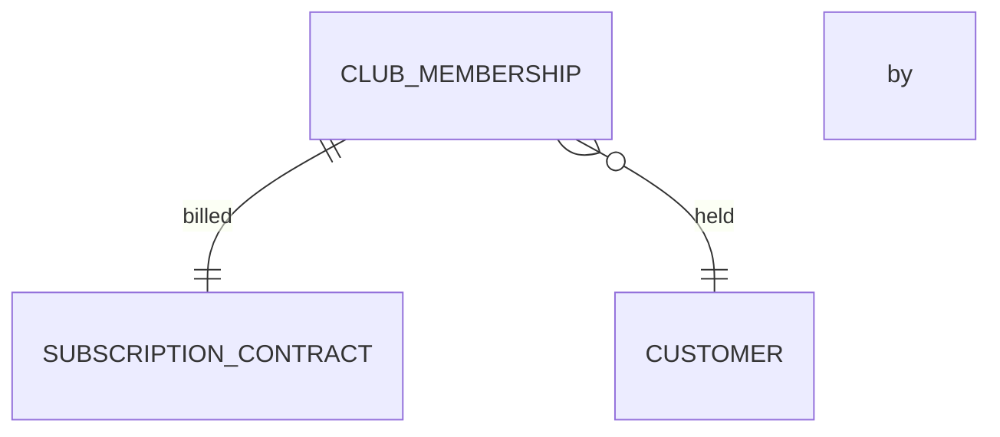
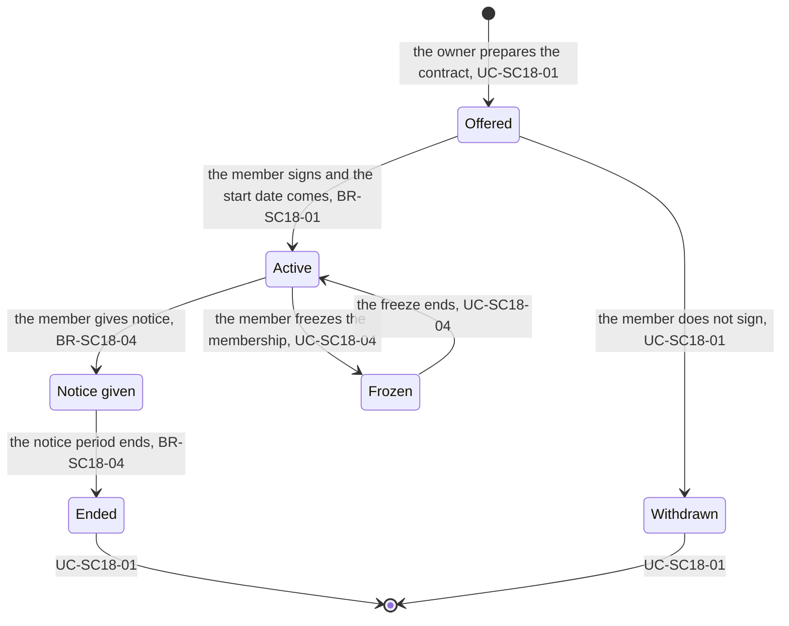

🏠 [Specs](../../../README.md) › 🏷️ [Sectors](../../README.md) › 🏋️ [SC18 Sports and fitness](../README.md) ›
🗃️ [Data](README.md) › 🗃️ E-SC18-01 Club membership

# 🗃️ E-SC18-01 Club membership

**Status:** ✅ specified

## Purpose

A person's membership of a club or a gym: the plan, the commitment, the signed cancellation terms and the state. The
billing is the subscription contract of customers and sales
([E-F6-07](../../../02-functional/f06-customers-and-sales/data/e-f06-07-subscription-contract.md)); this record adds
what is particular to a club (the access rights, the commitment, the freeze and the signed terms) and is linked to its
subscription ([D562](../../../06-decisions/sectors/d562-benchmark-gaps-sc18-sports-and-fitness.md)).

## Fields

| Name | Type | Required | Validation | Default | Example | Personal data | Custom fields |
|---|---|---|---|---|---|---|---|
| member | customer record (E-F6-01) | yes | a customer of the company | - | Mia L. | yes | no |
| plan | text | yes | a plan of the club | - | Annual adult | no | no |
| organisation kind | choice | yes | association or commercial gym | from the settings | commercial gym | no | no |
| starts on | date | yes | not in the past | today | 2026-12-01 | no | no |
| commitment months | number | yes | 0 or more | from the plan | 12 | no | no |
| notice months | number | yes | 0 or more | from the plan | 1 | no | no |
| cancellation terms | text | yes | shown before signature | from the plan | Cancel from the app with one month's notice | no | no |
| signed on | date and time | no | needed to become Active | - | 2026-11-21 10:07 | no | no |
| notice ends on | date | no | set when notice is given | - | - | no | no |
| subscription | subscription contract (E-F6-07) | yes | created at signature | - | SUB-2026-201 | no | no |
| state | Offered, Active, Frozen, Notice given, Ended, Withdrawn | yes | the lifecycle below | Offered | Active | no | no |
| owner | user | yes | a user of the company | the creator | Claire P. | yes | no |

## Relations

- [E-F6-07](../../../02-functional/f06-customers-and-sales/data/e-f06-07-subscription-contract.md)
- [E-F6-01](../../../02-functional/f06-customers-and-sales/data/e-f06-01-customer-record.md)
- [E-SC18-02 Dues mandate](e-sc18-02-dues-mandate.md)
- [E-SC18-03 Access event](e-sc18-03-access-event.md)

## Lifecycle

## Indexes and search

By member, plan, state and start date.

## Retention

Kept with the contracts and invoices
([CR-FR-002](../../../10-country-packs/france/accounting/cr-fr-002-accounting-records-kept-ten-years.md)).

## Audit

Every offer, signature, start, freeze, notice and end, with who, when and the terms shown.

## Import and export

Export of the memberships and their state; no import.

## Used by

- [UC-SC18-01](../use-cases/01-memberships-and-access/uc-sc18-01-sell-a-membership.md)
- [UC-SC18-02](../use-cases/01-memberships-and-access/uc-sc18-02-collect-dues-by-direct-debit.md)
- [UC-SC18-03](../use-cases/01-memberships-and-access/uc-sc18-03-control-access-at-the-door.md)
- [UC-SC18-04](../use-cases/01-memberships-and-access/uc-sc18-04-freeze-or-cancel-a-membership.md)

## Open questions

None.

---

⬆️ [Up](README.md) · ➡️ [E-SC18-02 Dues mandate](e-sc18-02-dues-mandate.md)
