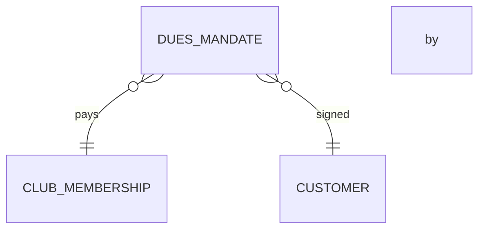
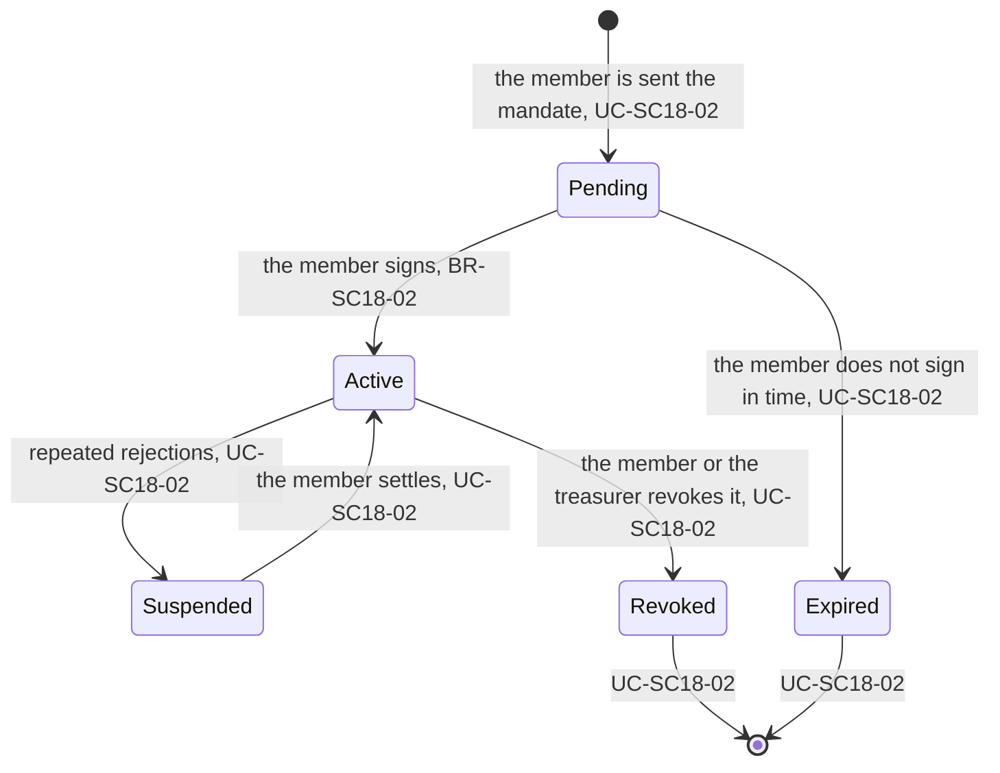

🏠 [Specs](../../../README.md) › 🏷️ [Sectors](../../README.md) › 🏋️ [SC18 Sports and fitness](../README.md) ›
🗃️ [Data](README.md) › 🗃️ E-SC18-02 Dues mandate

# 🗃️ E-SC18-02 Dues mandate

**Status:** ✅ specified

## Purpose

The authorisation a member signs for the club to debit their account: its reference, signature date, account and state
([D562](../../../06-decisions/sectors/d562-benchmark-gaps-sc18-sports-and-fitness.md)). The payments it produces are
customer payments ([E-F6-06](../../../02-functional/f06-customers-and-sales/data/e-f06-06-customer-payment.md)); this
record is the legal basis of the debit.

## Fields

| Name | Type | Required | Validation | Default | Example | Personal data | Custom fields |
|---|---|---|---|---|---|---|---|
| member | customer record (E-F6-01) | yes | a customer of the company | - | Mia L. | yes | no |
| reference | text | yes | unique | generated | RUM-2026-0881 | no | no |
| account | masked IBAN | yes | a valid account | - | FR76 **** 1234 | yes | no |
| signed on | date and time | yes | before the first debit | - | 2026-11-21 10:09 | no | no |
| sequence | choice | yes | first or recurrent | first | first | no | no |
| membership | club membership (E-SC18-01) | yes | a membership of the member | - | M-2026-201 | no | no |
| revoked on | date | no | set at revocation | - | - | no | no |
| state | Pending, Active, Suspended, Revoked, Expired | yes | the lifecycle below | Pending | Active | no | no |
| owner | user | yes | a user of the company | the creator | Claire P. | yes | no |

## Relations

- [E-SC18-01 Club membership](e-sc18-01-club-membership.md)
- [E-F6-01](../../../02-functional/f06-customers-and-sales/data/e-f06-01-customer-record.md)
- [E-F6-06](../../../02-functional/f06-customers-and-sales/data/e-f06-06-customer-payment.md)

## Lifecycle

## Indexes and search

By member, reference, state and signature date; the account is never searched.

## Retention

Kept for the period the scheme sets after the last debit
([CR-FR-052](../../../10-country-packs/france/data-protection/cr-fr-052-storage-limitation.md)).

## Audit

Every mandate, signature, debit, rejection, refund and revocation, with who and when.

## Import and export

Export of the debit file in the bank's format; no import.

## Used by

- [UC-SC18-02](../use-cases/01-memberships-and-access/uc-sc18-02-collect-dues-by-direct-debit.md)
- [UC-SC18-01](../use-cases/01-memberships-and-access/uc-sc18-01-sell-a-membership.md)

## Open questions

None.

---

⬅️ [E-SC18-01 Club membership](e-sc18-01-club-membership.md) · ⬆️ [Up](README.md) ·
➡️ [E-SC18-03 Access event](e-sc18-03-access-event.md)
