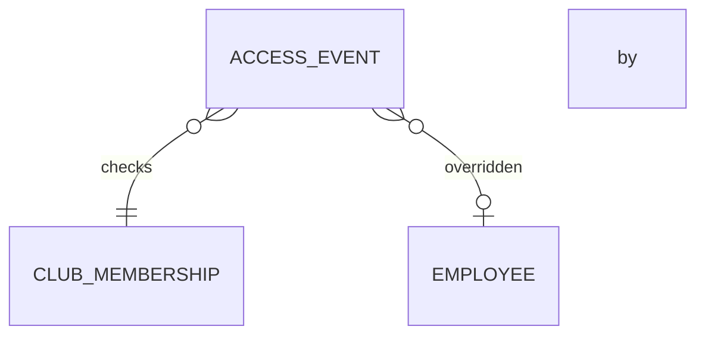
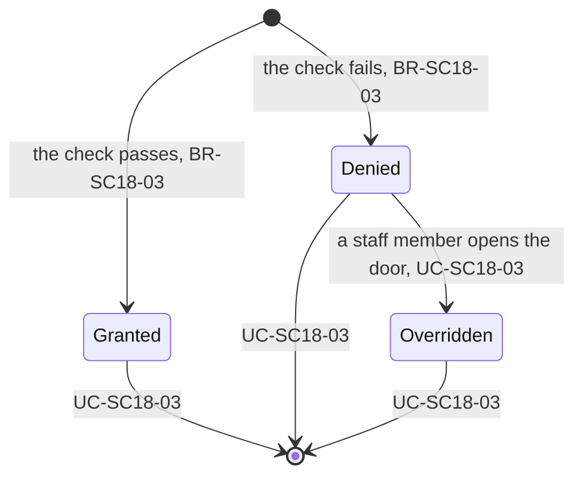

🏠 [Specs](../../../README.md) › 🏷️ [Sectors](../../README.md) › 🏋️ [SC18 Sports and fitness](../README.md) ›
🗃️ [Data](README.md) › 🗃️ E-SC18-03 Access event

# 🗃️ E-SC18-03 Access event

**Status:** ✅ specified

## Purpose

One scan at a door and its result: granted, denied or overridden by a staff member
([D562](../../../06-decisions/sectors/d562-benchmark-gaps-sc18-sports-and-fitness.md)). It is the entry log of the club;
the membership it checks is [E-SC18-01 Club membership](e-sc18-01-club-membership.md).

## Fields

| Name | Type | Required | Validation | Default | Example | Personal data | Custom fields |
|---|---|---|---|---|---|---|---|
| member | customer record (E-F6-01) | yes | a member or a guest | - | Mia L. | yes | no |
| door | text | yes | a door of the club | - | Main entrance | no | no |
| at | date and time | yes | not in the future | now | 2026-12-02 08:14 | no | no |
| method | choice | yes | code, card or staff | code | code | no | no |
| result | choice | yes | granted, denied or overridden | - | granted | no | no |
| reason | text | no | needed when denied or overridden | - | - | no | no |
| overridden by | employee (E-F9-01) | no | a staff member | - | - | no | no |
| state | Granted, Denied, Overridden | yes | the lifecycle below | Granted | Denied | no | no |
| owner | user | yes | a user of the company | the creator | Claire P. | yes | no |

## Relations

- [E-SC18-01 Club membership](e-sc18-01-club-membership.md)
- [E-F6-01](../../../02-functional/f06-customers-and-sales/data/e-f06-01-customer-record.md)
- [E-F9-01](../../../02-functional/f09-hr-and-projects/data/e-f09-01-employee-record.md)

## Lifecycle

## Indexes and search

By member, door, result and time.

## Retention

Kept for a short period set by the owner, then erased or made anonymous
([CR-FR-052](../../../10-country-packs/france/data-protection/cr-fr-052-storage-limitation.md)).

## Audit

Every entry, denial and override, with who, when, the door and the reason.

## Import and export

Export of the counts by day for the club's reports; no import of entries.

## Used by

- [UC-SC18-03](../use-cases/01-memberships-and-access/uc-sc18-03-control-access-at-the-door.md)
- [UC-SC18-01](../use-cases/01-memberships-and-access/uc-sc18-01-sell-a-membership.md)

## Open questions

None.

---

⬅️ [E-SC18-02 Dues mandate](e-sc18-02-dues-mandate.md) · ⬆️ [Up](README.md) · ➡️ [E-SC18-04 Class](e-sc18-04-class.md)
