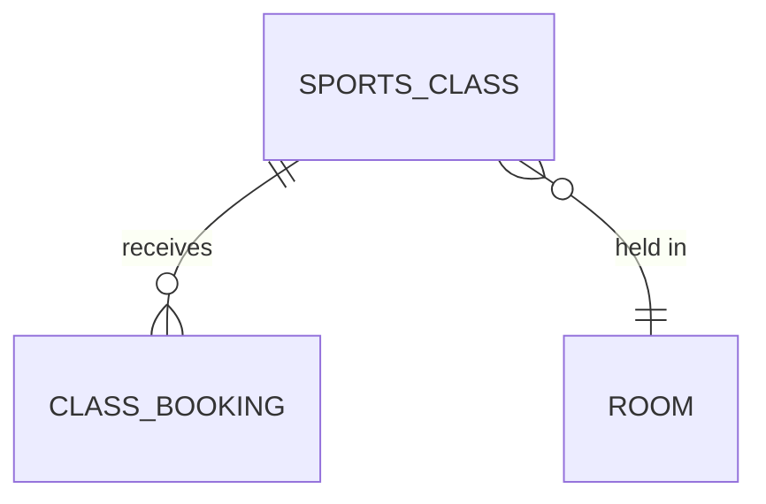
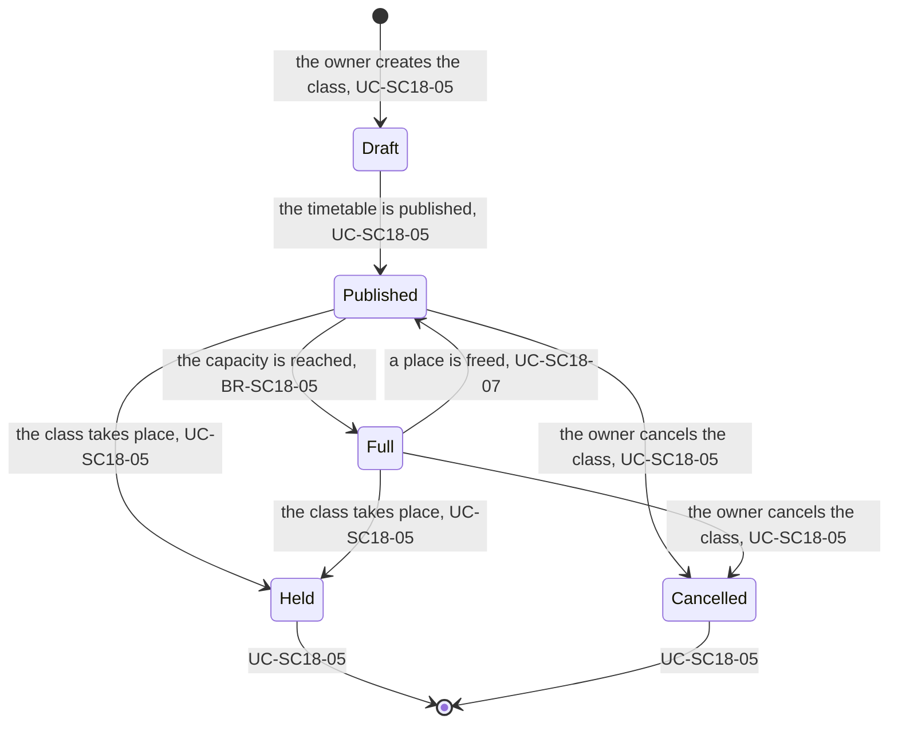

🏠 [Specs](../../../README.md) › 🏷️ [Sectors](../../README.md) › 🏋️ [SC18 Sports and fitness](../README.md) ›
🗃️ [Data](README.md) › 🗃️ E-SC18-04 Class

# 🗃️ E-SC18-04 Class

**Status:** ✅ specified

## Purpose

One class of the timetable: the activity, the coach, the room, the time, the capacity and the state
([D562](../../../06-decisions/sectors/d562-benchmark-gaps-sc18-sports-and-fitness.md)). The room's calendar is the
shared booking engine
([E-F2-17](../../../02-functional/f02-no-code-configuration/data/e-f02-17-bookable-resource-setting.md)); this record
adds what is particular to a class (the coach, the level, the capacity and the minimum).

## Fields

| Name | Type | Required | Validation | Default | Example | Personal data | Custom fields |
|---|---|---|---|---|---|---|---|
| activity | choice | yes | an activity of the club | - | Yoga | no | no |
| coach | employee (E-F9-01) | yes | holds the diploma for the activity | - | Sana M. | no | no |
| room | bookable resource (E-F2-17) | yes | free for the whole class | - | Room A | no | no |
| starts at | date and time | yes | inside the opening hours | - | 2026-12-07 18:30 | no | no |
| duration minutes | number | yes | above 0 | 60 | 60 | no | no |
| level | choice | no | beginner, all levels, advanced | all levels | all levels | no | no |
| capacity | number | yes | not above the room's capacity | the room's capacity | 20 | no | no |
| minimum | number | no | 0 or more | 0 | 5 | no | no |
| repeat | choice | no | none or weekly | none | weekly | no | no |
| state | Draft, Published, Full, Held, Cancelled | yes | the lifecycle below | Draft | Published | no | no |
| owner | user | yes | a user of the company | the creator | Claire P. | yes | no |

## Relations

- [E-F2-17](../../../02-functional/f02-no-code-configuration/data/e-f02-17-bookable-resource-setting.md)
- [E-F9-01](../../../02-functional/f09-hr-and-projects/data/e-f09-01-employee-record.md)
- [E-SC18-05 Class booking](e-sc18-05-class-booking.md)

## Lifecycle

## Indexes and search

By activity, coach, room, day and state.

## Retention

Kept with the club's records for the attendance reports
([CR-FR-002](../../../10-country-packs/france/accounting/cr-fr-002-accounting-records-kept-ten-years.md)).

## Audit

Every class created, changed, published, cancelled and held, with who and when.

## Import and export

Export of the timetable to the club's site; no import.

## Used by

- [UC-SC18-05](../use-cases/02-classes-and-waiting-lists/uc-sc18-05-publish-the-class-timetable.md)
- [UC-SC18-06 Book a class](../use-cases/02-classes-and-waiting-lists/uc-sc18-06-book-a-class.md)
- [UC-SC18-07](../use-cases/02-classes-and-waiting-lists/uc-sc18-07-handle-the-waiting-list.md)
- [UC-SC18-08 Plan coaches](../use-cases/02-classes-and-waiting-lists/uc-sc18-08-plan-coaches.md)

## Open questions

None.

---

⬅️ [E-SC18-03 Access event](e-sc18-03-access-event.md) · ⬆️ [Up](README.md) ·
➡️ [E-SC18-05 Class booking](e-sc18-05-class-booking.md)
