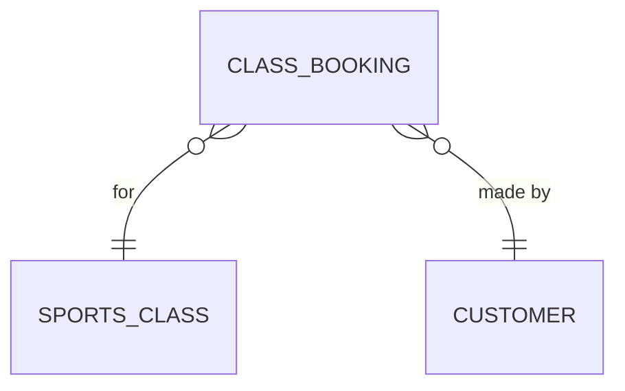
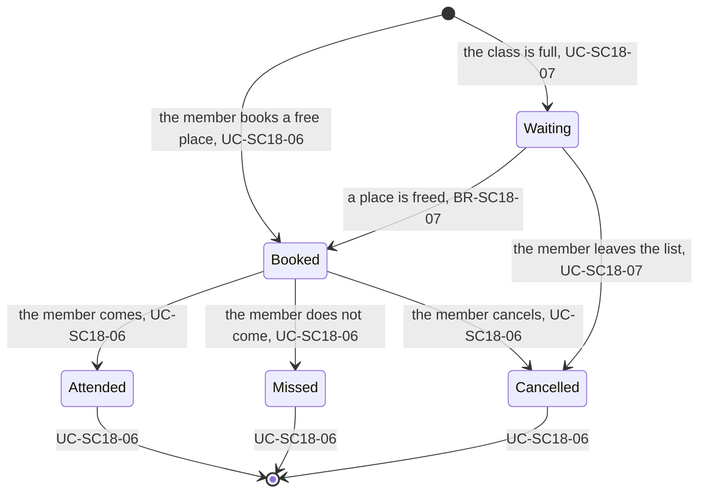

🏠 [Specs](../../../README.md) › 🏷️ [Sectors](../../README.md) › 🏋️ [SC18 Sports and fitness](../README.md) ›
🗃️ [Data](README.md) › 🗃️ E-SC18-05 Class booking

# 🗃️ E-SC18-05 Class booking

**Status:** 🔄 waiting for the owner

## Purpose

A member's place in a class and what became of it: booked, on the waiting list, attended, missed or cancelled
([D562](../../../06-decisions/sectors/d562-benchmark-gaps-sc18-sports-and-fitness.md)). The place is a resource booking
of the shared booking engine
([E-F2-18](../../../02-functional/f02-no-code-configuration/data/e-f02-18-resource-booking.md)); this record adds the
member, the credit used and the attendance.

## Fields

| Name | Type | Required | Validation | Default | Example | Personal data | Custom fields |
|---|---|---|---|---|---|---|---|
| class | class (E-SC18-04) | yes | a published class | - | Yoga Mon 18:30 | no | no |
| member | customer record (E-F6-01) | yes | a member with the right to the class | - | Mia L. | yes | no |
| credit used | choice | yes | included, pack or drop-in | included | included | no | no |
| booked on | date and time | yes | before the closing time | now | 2026-12-04 09:00 | no | no |
| waiting position | number | no | 1 or more when Waiting | - | - | no | no |
| guest | text | no | free text | - | - | yes | no |
| state | Booked, Waiting, Attended, Missed, Cancelled | yes | the lifecycle below | Booked | Waiting | no | no |
| owner | user | yes | a user of the company | the creator | Claire P. | yes | no |

## Relations

- [E-SC18-04 Class](e-sc18-04-class.md)
- [E-F2-18](../../../02-functional/f02-no-code-configuration/data/e-f02-18-resource-booking.md)
- [E-F6-01](../../../02-functional/f06-customers-and-sales/data/e-f06-01-customer-record.md)

## Lifecycle

## Indexes and search

By class, member, state and date.

## Retention

Kept with the club's records for the attendance reports
([CR-FR-002](../../../10-country-packs/france/accounting/cr-fr-002-accounting-records-kept-ten-years.md)).

## Audit

Every booking, waiting, cancellation, attendance and missed class, with who and when.

## Import and export

Export of the attendance of a period; no import.

## Used by

- [UC-SC18-06 Book a class](../use-cases/02-classes-and-waiting-lists/uc-sc18-06-book-a-class.md)
- [UC-SC18-07](../use-cases/02-classes-and-waiting-lists/uc-sc18-07-handle-the-waiting-list.md)

## Open questions

None.

---

⬅️ [E-SC18-04 Class](e-sc18-04-class.md) · ⬆️ [Up](README.md) · ➡️ [E-SC18-06 Licence](e-sc18-06-licence.md)
