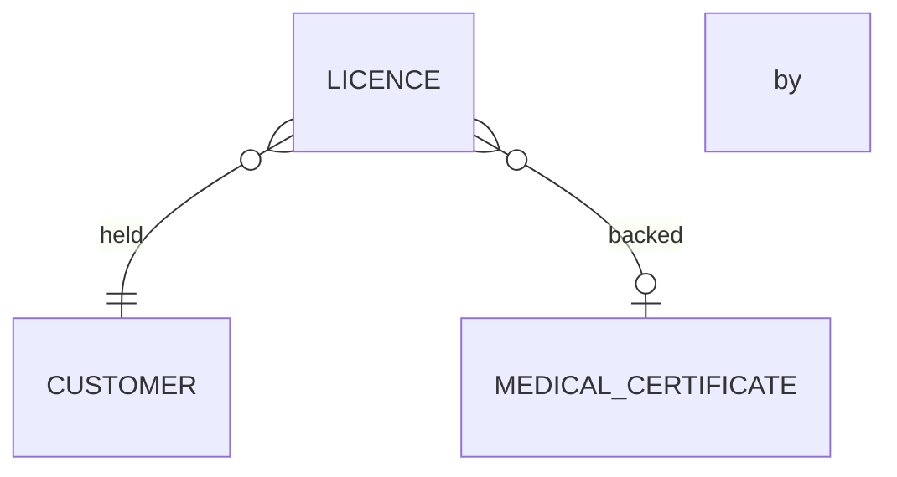
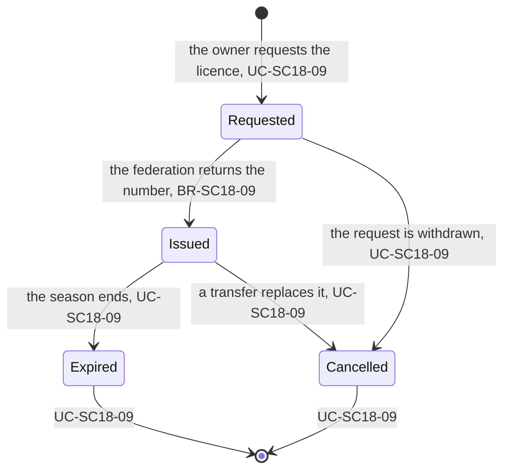

🏠 [Specs](../../../README.md) › 🏷️ [Sectors](../../README.md) › 🏋️ [SC18 Sports and fitness](../README.md) ›
🗃️ [Data](README.md) › 🗃️ E-SC18-06 Licence

# 🗃️ E-SC18-06 Licence

**Status:** ✅ specified

## Purpose

A member's licence from a sports federation for one season: its number, category, fee and dates
([D562](../../../06-decisions/sectors/d562-benchmark-gaps-sc18-sports-and-fitness.md)). It is issued by the federation;
this record is the club's copy and the request that led to it.

## Fields

| Name | Type | Required | Validation | Default | Example | Personal data | Custom fields |
|---|---|---|---|---|---|---|---|
| member | customer record (E-F6-01) | yes | a member of the club | - | Mia L. | yes | no |
| federation | choice | yes | a federation of the club | - | Tennis | no | no |
| season | text | yes | one season | the current season | 2026-27 | no | no |
| category | choice | yes | from the birth year | computed | Adult | no | no |
| number | text | no | set by the federation | - | T-998213 | no | no |
| fee | amount | yes | 0 or more | from the federation | 42.00 EUR | no | no |
| certificate | medical certificate (E-SC18-07) | no | valid where required | - | MC-2026-14 | no | no |
| valid to | date | no | the end of the season | end of the season | 2027-08-31 | no | no |
| state | Requested, Issued, Cancelled, Expired | yes | the lifecycle below | Requested | Issued | no | no |
| owner | user | yes | a user of the company | the creator | Claire P. | yes | no |

## Relations

- [E-F6-01](../../../02-functional/f06-customers-and-sales/data/e-f06-01-customer-record.md)
- [E-SC18-07 Medical certificate](e-sc18-07-medical-certificate.md)
- [E-SC18-08 Sports team](e-sc18-08-team.md)

## Lifecycle

## Indexes and search

By member, federation, season, category and state.

## Retention

Kept for the period the federation requires after the season
([CR-FR-002](../../../10-country-packs/france/accounting/cr-fr-002-accounting-records-kept-ten-years.md)).

## Audit

Every request, number, refusal, transfer, expiry and cancellation, with who and when.

## Import and export

Export of the requests in the federation's format; import of the numbers returned.

## Used by

- [UC-SC18-09](../use-cases/03-licences-and-competitions/uc-sc18-09-issue-federation-licences.md)
- [UC-SC18-10](../use-cases/03-licences-and-competitions/uc-sc18-10-check-medical-certificates.md)
- [UC-SC18-11](../use-cases/03-licences-and-competitions/uc-sc18-11-run-teams-and-competitions.md)

## Open questions

None.

---

⬅️ [E-SC18-05 Class booking](e-sc18-05-class-booking.md) · ⬆️ [Up](README.md) ·
➡️ [E-SC18-07 Medical certificate](e-sc18-07-medical-certificate.md)
