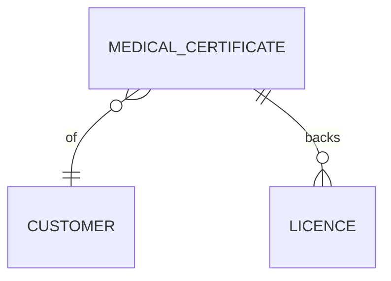
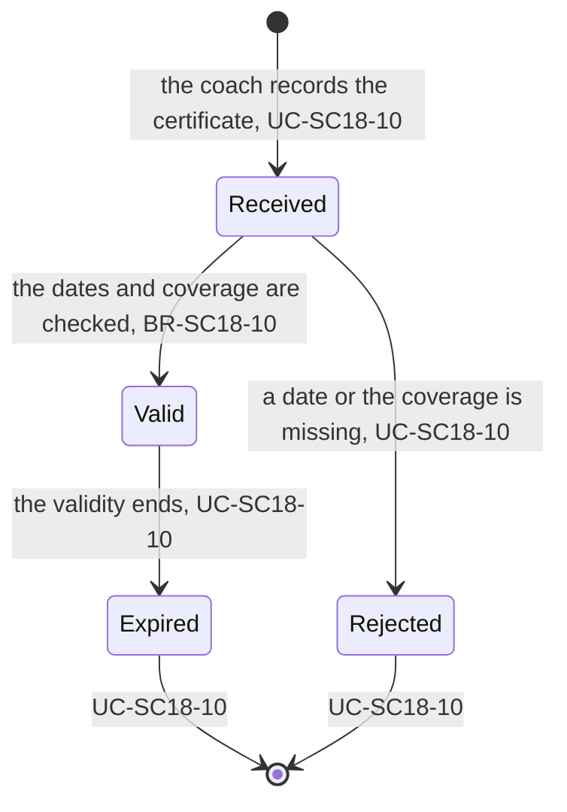

🏠 [Specs](../../../README.md) › 🏷️ [Sectors](../../README.md) › 🏋️ [SC18 Sports and fitness](../README.md) ›
🗃️ [Data](README.md) › 🗃️ E-SC18-07 Medical certificate

# 🗃️ E-SC18-07 Medical certificate

**Status:** ✅ specified

## Purpose

A medical certificate of a member: its date, validity, coverage and the stored document
([D562](../../../06-decisions/sectors/d562-benchmark-gaps-sc18-sports-and-fitness.md)). It holds health data and so only
what the club needs: whether the person is fit, for what and until when.

## Fields

| Name | Type | Required | Validation | Default | Example | Personal data | Custom fields |
|---|---|---|---|---|---|---|---|
| member | customer record (E-F6-01) | yes | a member of the club | - | Lena T. | yes | no |
| issued on | date | yes | not in the future | - | 2026-09-02 | yes | no |
| valid to | date | yes | after the issue date | one year later | 2027-09-01 | no | no |
| covers | choice | yes | training or competition | training | competition | no | no |
| fit | yes or no | yes | yes to be Valid | - | yes | yes | no |
| document | document (E-F2-13) | yes | limited access | - | cert-lena-t.pdf | yes | no |
| state | Received, Valid, Rejected, Expired | yes | the lifecycle below | Received | Valid | no | no |
| owner | user | yes | a user of the company | the creator | Claire P. | yes | no |

## Relations

- [E-F6-01](../../../02-functional/f06-customers-and-sales/data/e-f06-01-customer-record.md)
- [E-SC18-06 Licence](e-sc18-06-licence.md)
- [E-F2-13 Document](../../../02-functional/f02-no-code-configuration/data/e-f02-13-document.md)

## Lifecycle

## Indexes and search

By member, coverage, state and validity date; the document is never searched.

## Retention

Kept for the season and the period needed to prove coverage, then erased
([CR-FR-052](../../../10-country-packs/france/data-protection/cr-fr-052-storage-limitation.md)).

## Audit

Every certificate recorded, read, expired and rejected, with who and when.

## Import and export

Export of the coverage list for a competition; no export of the documents.

## Used by

- [UC-SC18-10](../use-cases/03-licences-and-competitions/uc-sc18-10-check-medical-certificates.md)
- [UC-SC18-09](../use-cases/03-licences-and-competitions/uc-sc18-09-issue-federation-licences.md)
- [UC-SC18-11](../use-cases/03-licences-and-competitions/uc-sc18-11-run-teams-and-competitions.md)

## Open questions

None.

---

⬅️ [E-SC18-06 Licence](e-sc18-06-licence.md) · ⬆️ [Up](README.md) · ➡️ [E-SC18-08 Sports team](e-sc18-08-team.md)
